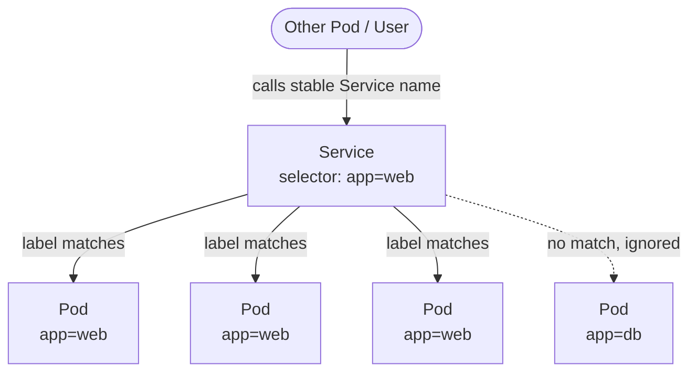
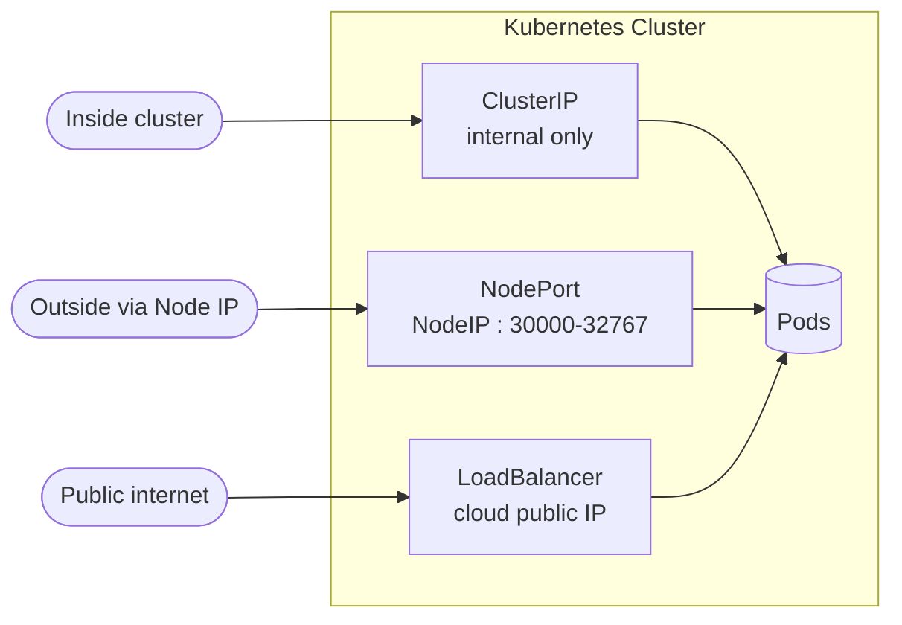
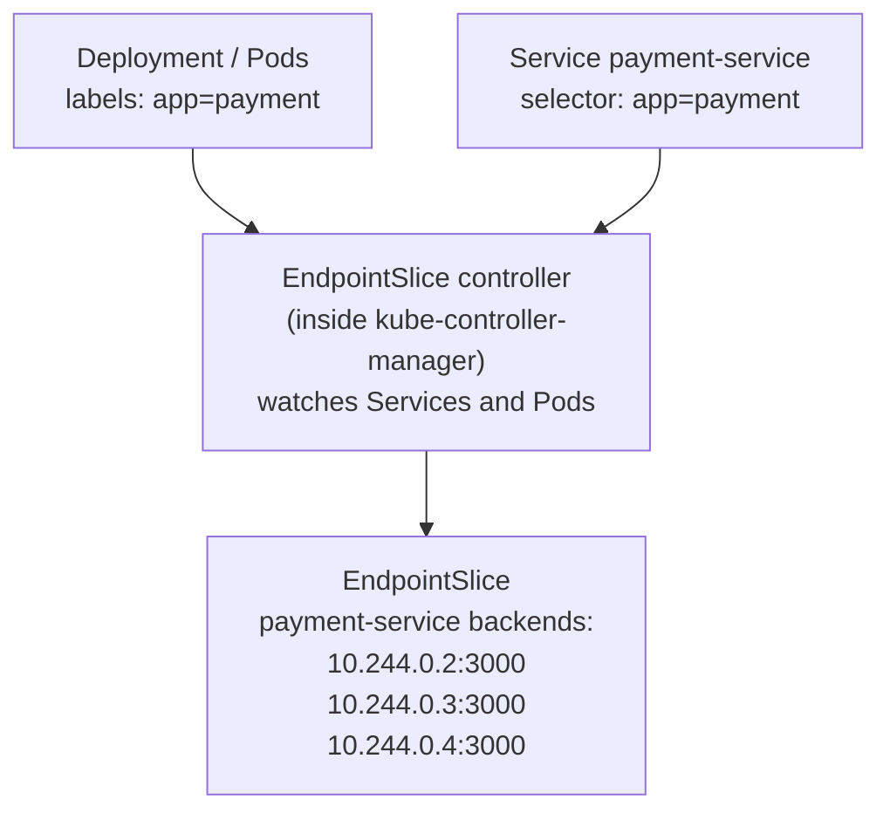
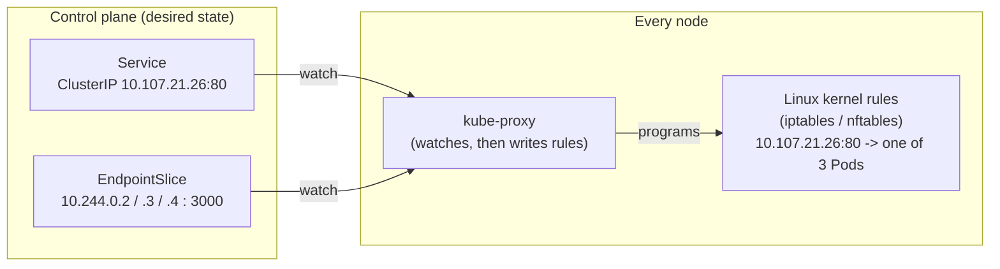
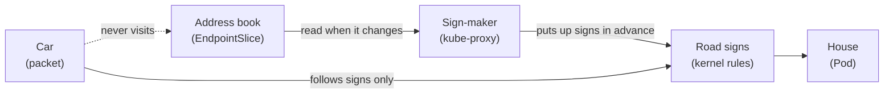
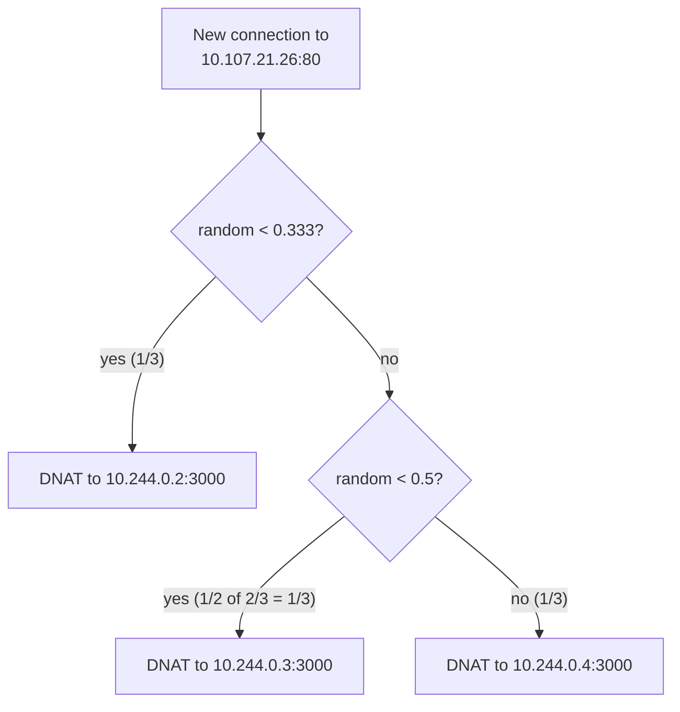
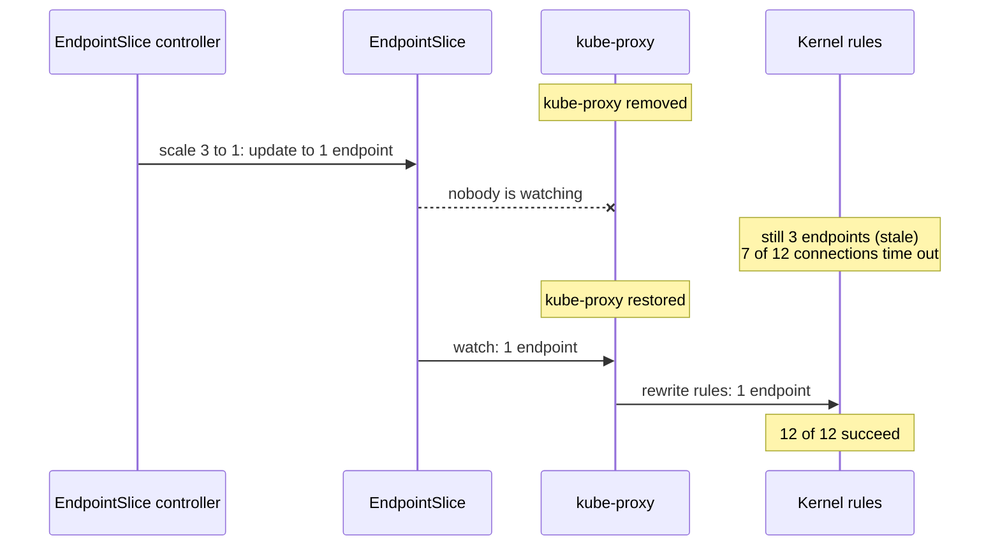
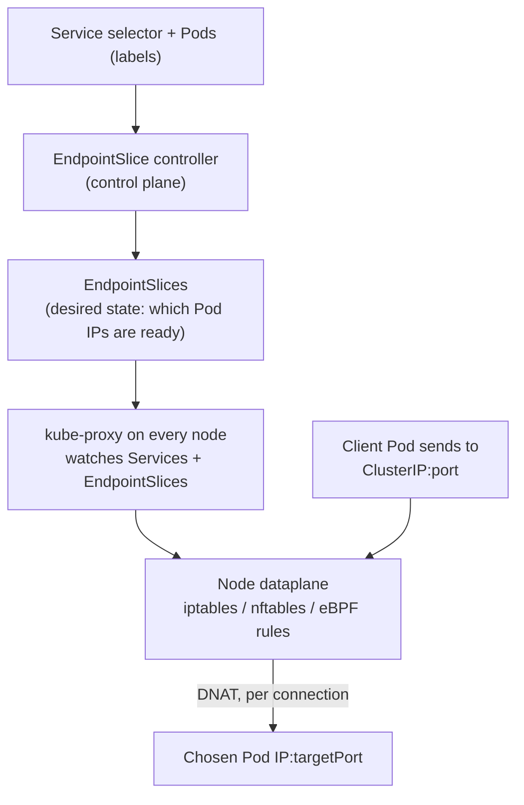

# Day 07 - Services & Networking

> **Goal:** Give your constantly-changing Pods a single, stable address - and load-balance traffic across them.

## Learning Objectives
- Explain why Pods need a Service in front of them
- Describe the three main Service types: **ClusterIP**, **NodePort**, **LoadBalancer**
- Understand how a Service finds Pods using **label selectors**
- Tell apart `port`, `targetPort`, and `nodePort`
- Write, apply, and inspect a Service with `kubectl`
- Explain what really forwards Service traffic: the **EndpointSlice controller**, **EndpointSlices**, **kube-proxy** and the **kernel dataplane** (desired state vs programmed dataplane)

---

## Real-World Analogy: The Pizza Shop Phone Number

Imagine a pizza shop with several delivery drivers. Each driver has their **own personal phone**, and those phones change all the time - drivers quit, new ones get hired, phones get replaced.

If you, the customer, had to memorize every driver's personal number, you'd be lost the moment anything changed.

Instead, the shop gives you **one stable number** to call: the front desk. You call that one number, and the front desk routes your order to whichever driver is free right now.

In Kubernetes:
- **Drivers** = your Pods (created and destroyed constantly, each with a new IP).
- **The shop's front-desk number** = the **Service** (one stable address that never changes).
- **The front desk knowing who works there today** = the Service's **selector** matching Pod **labels**.

> Pods are disposable; their IPs change on every restart. A **Service** is the permanent "phone number" that always reaches the right Pods.

> **Careful with this analogy:** it describes *what* a Service gives you, not *how* it works. There is no front-desk process taking every call; the routing is done by rules in each node's kernel. See [Under the Hood](#under-the-hood-how-a-service-really-moves-packets) below.

---

## The Problem - Why Do We Need Services?

From Day 06, you have a Deployment running 3 nginx pods. But:

1. **Pods get random IPs** - Every time a pod restarts, it gets a NEW IP address
2. **How do other apps find your pods?** - You can't hardcode pod IPs
3. **How do users access your app?** - Pods are inside the cluster, not reachable from outside

```
Pod restarts → New IP!

Before restart: Pod IP = 10.244.0.5
After restart:  Pod IP = 10.244.0.9  ← Different!

Anyone using 10.244.0.5 gets "connection refused"
```

**Service** = A stable address that always points to the right pods, even when they restart.

---

## What Is a Service?

A **Service** provides:
- A **stable IP address** (doesn't change even when pods restart)
- A **stable DNS name** (e.g., `backend.default.svc.cluster.local`)
- **Load balancing** across multiple pods

```
                   ┌─────────────┐
                   │   Service   │
Users/Other ──────→│   (stable   │
  Apps             │    IP)      │
                   └──────┬──────┘
                          │
                ┌─────────┼─────────┐
                │         │         │
           ┌────┴──┐ ┌───┴───┐ ┌───┴───┐
           │ Pod 1 │ │ Pod 2 │ │ Pod 3 │
           │10.0.1 │ │10.0.2 │ │10.0.3 │
           └───────┘ └───────┘ └───────┘
           IPs can change, but Service IP stays the same!
```

---

## How Services Find Pods (Selectors!)

Services use **labels** to find pods - the same label system we used in ReplicaSets and Deployments.

```yaml
# Service says: "Send traffic to pods with label app=web"
selector:
  app: web

# Pods with label app=web get traffic
# Pods without this label are ignored
```



> If the Service `selector` does not EXACTLY match the Pods' `labels`, the Service ends up with **no endpoints** and traffic goes nowhere. This is the #1 beginner bug - check it with `kubectl get endpoints <svc>`.

---

## Types of Services



> Each type **builds on** the previous one: a NodePort also gets a ClusterIP, and a LoadBalancer also gets a NodePort + ClusterIP.

### 1. ClusterIP (Default) - Internal Communication

```
┌─────────────── Kubernetes Cluster ───────────────┐
│                                                    │
│  ┌──────────┐         ┌──────────┐               │
│  │ Frontend │ ──────→ │ Backend  │               │
│  │ Service  │         │ Service  │               │
│  │          │         │(ClusterIP│               │
│  └──────────┘         │10.96.0.1)│               │
│                        └────┬─────┘               │
│                       ┌─────┼─────┐               │
│                       │     │     │               │
│                      Pod   Pod   Pod              │
│                                                    │
│   NOT accessible from outside the cluster       │
└────────────────────────────────────────────────────┘
```

**Use case:** Backend services that only need to talk to other services inside the cluster.

```yaml
apiVersion: v1
kind: Service
metadata:
  name: backend
spec:
  type: ClusterIP       # default, can be omitted
  selector:
    app: web
  ports:
    - port: 80           # Port the service listens on
      targetPort: 80     # Port on the pod/container
```

### 2. NodePort - Expose on Node's IP

```
┌──── Outside World ────┐
│                        │
│   http://NodeIP:30080  │
│         │              │
└─────────┼──────────────┘
          │
┌─────────┼──────── Kubernetes Cluster ──────────┐
│         ↓                                       │
│  ┌──────────────┐                              │
│  │   NodePort    │                              │
│  │  Service      │                              │
│  │ Port: 30080   │                              │
│  └──────┬────────┘                              │
│    ┌────┼────┐                                  │
│   Pod  Pod  Pod                                 │
└─────────────────────────────────────────────────┘
```

**Use case:** Quick access during development. NOT recommended for production.

```yaml
apiVersion: v1
kind: Service
metadata:
  name: web-nodeport
spec:
  type: NodePort
  selector:
    app: web
  ports:
    - port: 80           # Internal cluster port
      targetPort: 80     # Port on the pod
      nodePort: 30080    # Port opened on the Node (30000-32767)
```

**Access:** `http://<any-node-ip>:30080`

```bash
# With Minikube:
minikube service web-nodeport --url
```

### 3. LoadBalancer - Cloud Load Balancer

```
┌──── Internet ────┐
│                   │
│   http://lb-ip    │
│       │           │
└───────┼───────────┘
        │
  ┌─────┴─────┐
  │   Cloud    │
  │   Load     │        ← Created by cloud provider (AWS/Azure/GCP)
  │  Balancer  │
  └─────┬──────┘
        │
┌───────┼──────── Kubernetes Cluster ──────────┐
│       ↓                                       │
│  ┌──────────────┐                            │
│  │ LoadBalancer  │                            │
│  │   Service     │                            │
│  └──────┬────────┘                            │
│    ┌────┼────┐                                │
│   Pod  Pod  Pod                               │
└───────────────────────────────────────────────┘
```

**Use case:** Production apps in the cloud. Gets a public IP from your cloud provider.

```yaml
apiVersion: v1
kind: Service
metadata:
  name: web-lb
spec:
  type: LoadBalancer
  selector:
    app: web
  ports:
    - port: 80
      targetPort: 80
```

**Note:** Only works in cloud environments (AWS, Azure, GCP). On Minikube, use `minikube tunnel`.

---

## Comparison of Service Types

| Type | Accessible From | Use Case | Port Range |
|------|----------------|----------|------------|
| **ClusterIP** | Inside cluster only | Internal services | Any |
| **NodePort** | Outside via Node IP | Dev/testing | 30000-32767 |
| **LoadBalancer** | Internet (via cloud LB) | Production | Any |

---

## Port Terminology (Confusing but Important!)

```yaml
ports:
  - port: 80          #  Service port (what other services use)
    targetPort: 8080   #  Container port (where your app listens)
    nodePort: 30080    #  Node port (external access, NodePort only)
```

```
External User -> NodePort(30080) -> Service Port(80) -> Container Port(8080)
```

If `targetPort` is not specified, it defaults to the same value as `port`.

---

## Hands-On Lab

### Step 1: Make sure you have a Deployment running

```bash
kubectl apply -f deployment.yaml
kubectl get pods
```

### Step 2: Create a ClusterIP Service

```yaml
# service-clusterip.yaml
apiVersion: v1
kind: Service
metadata:
  name: backend
spec:
  selector:
    app: web
  ports:
    - port: 80
      targetPort: 80
```

```bash
kubectl apply -f service-clusterip.yaml
kubectl get services
# NAME      TYPE        CLUSTER-IP    EXTERNAL-IP   PORT(S)   AGE
# backend   ClusterIP   10.96.45.23   <none>        80/TCP    10s
```

### Step 3: Test the Service from inside the cluster

```bash
# Create a temporary pod to test
kubectl run test-pod --image=busybox --rm -it -- wget -qO- http://backend
# You should see the nginx welcome page HTML!
```

### Step 4: Create a NodePort Service

```yaml
# service-nodeport.yaml
apiVersion: v1
kind: Service
metadata:
  name: web-nodeport
spec:
  type: NodePort
  selector:
    app: web
  ports:
    - port: 80
      targetPort: 80
      nodePort: 30080
```

```bash
kubectl apply -f service-nodeport.yaml

# Access it (Minikube)
minikube service web-nodeport --url
# Open the URL in your browser!
```

---

## DNS Inside Kubernetes

Every service gets a DNS name automatically:

```
<service-name>.<namespace>.svc.cluster.local
```

Examples:
```
backend.default.svc.cluster.local       # Full DNS name
backend.default                          # Short form
backend                                  # Shortest (works within same namespace)
```

So your app can connect to the backend using just `http://backend:80`

---

## Under the Hood: How a Service Really Moves Packets

The pizza-shop analogy at the top of this lesson describes **what a Service gives you**: one stable number. It is misleading about **how it works**. There is no "front desk" person in the middle taking every call. This section explains what really happens, and every output below is from a real cluster (Minikube, Kubernetes v1.35, October 2026).

### A Service is not a program

A Kubernetes Service is **not an active process** that receives a packet, looks up the Pods, and forwards the packet. A Service is mostly a **logical, virtual networking object**: a ClusterIP, a port, a selector and some policy, stored in the API server. There is no "Service process" anywhere doing this:

```text
packet arrives
-> query the list of Pods
-> choose a Pod
-> forward the packet
```

That design would be too slow (an extra hop for every request) and would create a central bottleneck and a single point of failure.

Instead, Kubernetes separates two things:

- **Control plane: the desired state.** Objects that *describe* where traffic should go.
- **Data plane: the programmed state.** Rules inside each node's Linux kernel that *actually move* the packets.

### The control-plane side: who maintains the list of Pods



A common misunderstanding is that "the Service updates its endpoints". It does not. The **EndpointSlice controller**, part of the control plane, watches Services and Pods. Whenever a matching Pod becomes ready, dies or is added, it updates the **EndpointSlice** objects for that Service.

You can see this ownership on a real cluster:

```bash
kubectl create deployment payment --image=registry.k8s.io/gateway-api/echo-basic:v1.5.1 --replicas=3 --port=3000
kubectl expose deployment payment --name=payment-service --port=80 --target-port=3000

kubectl get svc payment-service
# NAME              TYPE        CLUSTER-IP     EXTERNAL-IP   PORT(S)   AGE
# payment-service   ClusterIP   10.107.21.26   <none>        80/TCP    9s

kubectl get endpointslices -l kubernetes.io/service-name=payment-service
# NAME                    ADDRESSTYPE   PORTS   ENDPOINTS                          AGE
# payment-service-8qgzp   IPv4          3000    10.244.0.2,10.244.0.4,10.244.0.3   9s

# Who manages it? The labels say so:
kubectl get endpointslice payment-service-8qgzp -o jsonpath='{.metadata.labels}'
# {"app":"payment",
#  "endpointslice.kubernetes.io/managed-by":"endpointslice-controller.k8s.io",
#  "kubernetes.io/service-name":"payment-service"}

# Each endpoint records its Pod and whether it is ready
kubectl get endpointslice payment-service-8qgzp \
  -o jsonpath='{range .endpoints[*]}{.addresses[0]} ready={.conditions.ready} pod={.targetRef.name}{"\n"}{end}'
# 10.244.0.2 ready=true pod=payment-69c8f8ddd-9t8gx
# 10.244.0.4 ready=true pod=payment-69c8f8ddd-xf976
# 10.244.0.3 ready=true pod=payment-69c8f8ddd-nkjms
```

> **EndpointSlices replaced Endpoints.** The older `Endpoints` object still exists, but on Kubernetes 1.33 and later `kubectl get endpoints payment-service` prints:
> `Warning: v1 Endpoints is deprecated in v1.33+; use discovery.k8s.io/v1 EndpointSlice`
> EndpointSlices were created because one huge Endpoints object per Service did not scale: a Service with 5,000 Pods meant re-sending all 5,000 addresses to every node on every change. EndpointSlices split the list into chunks (100 endpoints each by default), so a change only re-sends one small slice.

### The data-plane side: kube-proxy programs the kernel

On **every node**, **kube-proxy** watches two things, **Services** and **EndpointSlices**, and turns that desired state into **Linux kernel networking rules** on its node.



Then the packet flow is:

```text
Application Pod
     |
     |  connects to 10.107.21.26:80      <- Service virtual IP (exists only as a rule)
     v
kernel dataplane rules on the SAME node  <- rewrite destination (DNAT)
     |
     v
10.244.0.3:3000                          <- a real Pod IP
     |
     v
destination Pod
```

The most important sentence in this section:

> **The packet does not travel through the EndpointSlice object, and normally it does not travel through the kube-proxy process either.** EndpointSlice is just information. kube-proxy's job is to **watch Kubernetes networking state and program the node's dataplane**. Then Linux handles the packets.

### A better analogy: the address book and the road signs

```text
EndpointSlice      = the address book (who lives where right now)
kube-proxy         = the person who reads the address book and puts up road signs
Service ClusterIP  = the destination name everybody knows ("Payment Street")
Linux dataplane    = the actual roads the cars drive on
```

A car does not stop at the address book on every trip. It follows the road signs, which were put up in advance. If the address book changes, the sign-maker updates the signs, and **only then** do cars go to the new address.



### See it for yourself: the actual kernel rules

Minikube's kube-proxy runs in **iptables mode** (`kubectl logs -n kube-system -l k8s-app=kube-proxy` shows `"Using iptables Proxier"`). Look at the rules it wrote for `payment-service`:

```bash
minikube ssh -- "sudo iptables -t nat -S KUBE-SERVICES | grep payment"
# -A KUBE-SERVICES -d 10.107.21.26/32 -p tcp -m comment --comment "default/payment-service cluster IP"
#    -m tcp --dport 80 -j KUBE-SVC-7NWAR22K4SA3UAVO
```

"Any TCP packet to 10.107.21.26 port 80, jump to chain `KUBE-SVC-7NWAR22K4SA3UAVO`." Now look at that chain:

```bash
minikube ssh -- "sudo iptables -t nat -S KUBE-SVC-7NWAR22K4SA3UAVO"
# -A KUBE-SVC-... ! -s 10.244.0.0/16 -d 10.107.21.26/32 ... -j KUBE-MARK-MASQ
# -A KUBE-SVC-... -m comment --comment "default/payment-service -> 10.244.0.2:3000"
#      -m statistic --mode random --probability 0.33333333349 -j KUBE-SEP-NZUO4VHJKRJPXTY7
# -A KUBE-SVC-... -m comment --comment "default/payment-service -> 10.244.0.3:3000"
#      -m statistic --mode random --probability 0.50000000000 -j KUBE-SEP-KAYF7SMKMPHA5RXA
# -A KUBE-SVC-... -m comment --comment "default/payment-service -> 10.244.0.4:3000"
#      -j KUBE-SEP-BHFD3BQ6OQ34RLOW
```

This is the "load balancer". It is just three rules with random probabilities:

- Rule 1: jump to Pod 1 with probability **1/3**.
- Otherwise rule 2: jump to Pod 2 with probability **1/2** of the remaining 2/3, which is also 1/3 overall.
- Otherwise rule 3: Pod 3 gets everything left, again 1/3.



And each `KUBE-SEP` ("service endpoint") chain does the actual rewrite:

```bash
minikube ssh -- "sudo iptables -t nat -S KUBE-SEP-NZUO4VHJKRJPXTY7"
# -A KUBE-SEP-NZUO4VHJKRJPXTY7 -s 10.244.0.2/32 ... -j KUBE-MARK-MASQ
# -A KUBE-SEP-NZUO4VHJKRJPXTY7 -p tcp ... -j DNAT --to-destination 10.244.0.2:3000
```

**DNAT** (destination NAT) rewrites the packet's destination from the ClusterIP to the chosen Pod IP. Nothing listens on 10.107.21.26: the IP is not on any network interface, and there is no process for the Service. In our run, `ip addr | grep 10.107.21.26` and a process search on the node both found **0** matches.

### Four real consequences you can prove

These are exactly the things that confuse people in production and come up in interviews.

**1. You cannot ping a ClusterIP.** The rules only match TCP port 80 (the Service's port and protocol). An ICMP ping matches nothing, and no interface owns the IP:

```bash
kubectl exec client -- ping -c 2 -W 2 10.107.21.26
# 2 packets transmitted, 0 packets received, 100% packet loss
```

The Service is fine; `curl http://payment-service` works. Never debug a Service with ping.

**2. Load balancing is per connection, not per request.** The random choice happens when a **new connection** is created; the kernel's connection tracking (conntrack) then keeps every packet of that connection on the same Pod.

```bash
# 6 separate connections
for i in 1 2 3 4 5 6; do kubectl exec client -- curl -s http://payment-service | grep '"pod"'; done
#  "pod": "payment-8f676b8d9-rdw62"
#  "pod": "payment-8f676b8d9-p89gg"
#  "pod": "payment-8f676b8d9-pdr5x"
#  "pod": "payment-8f676b8d9-p89gg"
#  "pod": "payment-8f676b8d9-pdr5x"
#  "pod": "payment-8f676b8d9-p89gg"

# 6 requests on ONE keep-alive connection (curl reuses the connection for several URLs)
kubectl exec client -- sh -c 'curl -s http://payment-service/a http://payment-service/b \
  http://payment-service/c http://payment-service/d http://payment-service/e http://payment-service/f' | grep '"pod"'
#  "pod": "payment-8f676b8d9-rdw62"     <- all six on the same Pod
#  "pod": "payment-8f676b8d9-rdw62"
#  "pod": "payment-8f676b8d9-rdw62"
#  "pod": "payment-8f676b8d9-rdw62"
#  "pod": "payment-8f676b8d9-rdw62"
#  "pod": "payment-8f676b8d9-rdw62"
```

**Real-world impact:** gRPC and HTTP/2 clients open **one long-lived connection** and send thousands of requests over it. Behind a plain ClusterIP Service, one Pod gets all the traffic while the others sit idle, and adding replicas does not help. The fixes are client-side load balancing (gRPC with a headless Service), or an L7 proxy that balances per request, such as a service mesh waypoint (Day 24) or a Gateway (Day 23).

**3. kube-proxy is not in the packet path, so traffic survives without it.** We removed kube-proxy from the node (by giving its DaemonSet a nodeSelector that matches no node) and kept sending traffic:

```bash
kubectl -n kube-system get pods -l k8s-app=kube-proxy
# No resources found in kube-system namespace.

for i in $(seq 1 10); do kubectl exec client -- curl -s -m 2 -o /dev/null -w "%{http_code}\n" http://payment-service; done | sort | uniq -c
#      10 200          <- still works: the rules are already in the kernel
```

**4. But without kube-proxy, the desired state and the dataplane drift apart.** With kube-proxy still gone, we scaled the Deployment from 3 Pods to 1:

```bash
kubectl scale deploy payment --replicas=1

kubectl get endpointslice -l kubernetes.io/service-name=payment-service     # desired state
# NAME                    ADDRESSTYPE   PORTS   ENDPOINTS    AGE
# payment-service-8qgzp   IPv4          3000    10.244.0.7   119s          <- 1 Pod: correct

minikube ssh -- "sudo iptables -t nat -S KUBE-SVC-7NWAR22K4SA3UAVO | grep -c KUBE-SEP"   # programmed state
# 3                                                                          <- still 3 Pods: stale!

for i in $(seq 1 12); do kubectl exec client -- curl -s -m 2 -o /dev/null -w "%{http_code}\n" http://payment-service; done | sort | uniq -c
#       7 000          <- 7 of 12 connections sent to Pods that no longer exist (timeouts)
#       5 200
```

The EndpointSlice controller did its job; the address book was right. But nobody updated the road signs, so two-thirds of new connections drove to houses that had been demolished. When kube-proxy came back, it re-synced the rules within seconds:

```bash
minikube ssh -- "sudo iptables -t nat -S KUBE-SVC-7NWAR22K4SA3UAVO | grep -c KUBE-SEP"
# 1
#      12 200          <- all 12 requests succeed again
```



This is a real production failure mode. If kube-proxy is crash-looping or stuck on one node (for example after a bad upgrade, or a node under memory pressure), Services **keep working on that node with stale rules** until Pods move, and then you see intermittent timeouts **only on that node**. The fix starts with `kubectl -n kube-system get pods -l k8s-app=kube-proxy -o wide`.

### Why not make the Service do the forwarding?

If every request went through a central "Service process":

```text
request -> Service process -> look up backend -> choose Pod -> forward packet
```

you would add an extra network hop, extra latency, a component that must scale with all cluster traffic, and another failure point. Kubernetes instead **pushes the backend information down to every node in advance**, so forwarding happens in the kernel on the node where the traffic starts:

```text
Service information + EndpointSlice information
                    |
     already converted into dataplane rules on every node
                    |
          packet forwarding happens locally and quickly
```

### kube-proxy modes and replacements (2026)

| Dataplane | How it forwards | Status |
|---|---|---|
| **iptables** | Chains of NAT rules, as shown above; rule count grows with Services x endpoints | Default on Linux; what Minikube uses |
| **nftables** | The modern Linux packet framework; faster updates and lookups at large scale | Stable (GA) since Kubernetes v1.33; the recommended choice for new large clusters |
| **IPVS** | Linux kernel load balancer with hash tables | **Deprecated in v1.35**; plan to migrate to nftables |
| **eBPF, no kube-proxy** (Cilium, Calico eBPF) | eBPF programs in the kernel replace kube-proxy entirely | Common on large or performance-sensitive clusters, and on several managed offerings |

The **design is the same in every row**: a component watches Services and EndpointSlices and programs the kernel; packets never pass through an API object. Only the mechanism of the "road signs" changes.

### The full picture, in one diagram



> **Desired state vs programmed dataplane** is one of the most important ideas in Kubernetes networking. When a Service "does not work", ask two separate questions: (1) Is the desired state right? Check the EndpointSlice has the expected ready Pod IPs. (2) Is the dataplane programmed? Check kube-proxy (or your eBPF agent) is healthy on the node where the client runs.

---

## Useful Commands

```bash
# List all services
kubectl get services   # or: kubectl get svc

# Describe a service (shows endpoints/pods)
kubectl describe svc backend

# See the pod IPs behind the Service (EndpointSlices; 'kubectl get endpoints' is deprecated in 1.33+)
kubectl get endpointslices -l kubernetes.io/service-name=backend

# Is kube-proxy healthy on every node? (it programs the Service rules)
kubectl -n kube-system get pods -l k8s-app=kube-proxy -o wide

# Delete a service
kubectl delete svc backend
```

---

## Common Mistakes

1. **Selector / label mismatch.** `spec.selector` must exactly match the Pods' `metadata.labels`. A typo means zero endpoints and "connection refused." Confirm with `kubectl get endpoints <svc>`.
2. **Confusing `port` and `targetPort`.** `port` is what the Service listens on; `targetPort` is the port **inside the container**. They are often different.
3. **Expecting ClusterIP to work from your laptop.** ClusterIP is **internal only** - reach it via NodePort, LoadBalancer, or `kubectl port-forward`.
4. **Picking a `nodePort` outside 30000 - 32767.** Values outside this range are rejected.
5. **Using `type: LoadBalancer` on a local cluster** (Minikube/kind) and expecting a public IP - it stays `<pending>` without `minikube tunnel` or a cloud provider.
6. **Pinging a ClusterIP to "test" a Service.** A ClusterIP is a rule, not a host; ping always fails. Test with `curl` or `nc` on the Service port.
7. **Expecting a Service to spread gRPC / HTTP/2 traffic.** Balancing happens per connection; one long-lived connection sticks to one Pod. Use client-side balancing with a headless Service, or an L7 proxy.
8. **Thinking the Service (or kube-proxy) forwards packets.** The EndpointSlice controller maintains the backend list, kube-proxy programs the kernel, and the kernel forwards. If one node has a broken kube-proxy, that node keeps stale rules.

---

## Quick Self-Check

1. Why can't you reliably talk to a Pod by its IP address directly?
2. How does a Service know which Pods to send traffic to?
3. What is the default Service type, and who can reach it?
4. What's the difference between `port` and `targetPort`?
5. Your Service shows no endpoints. What's the likely cause, and which command confirms it?
6. Which component creates and updates EndpointSlices: the Service, kube-proxy, or the EndpointSlice controller?
7. Why does `ping <ClusterIP>` fail even when the Service works?
8. In our lab, kube-proxy was removed and the Deployment scaled from 3 Pods to 1. Why did 7 of 12 requests time out?

**Answers to 6 to 8:** (6) The EndpointSlice controller in the control plane. (7) The ClusterIP is not on any interface; kube-proxy only wrote rules for the Service's TCP port, so ICMP matches nothing. (8) The EndpointSlice was updated to 1 Pod, but without kube-proxy nobody rewrote the kernel rules, which still sent two-thirds of new connections to deleted Pod IPs.

---

## Summary

A **Service** gives a stable IP + DNS name to a constantly-changing set of Pods and load-balances across them. It finds Pods via **label selectors**. The three core types: **ClusterIP** (internal), **NodePort** (external via Node IP), **LoadBalancer** (external via cloud LB). Remember `port` (service) vs `targetPort` (container) vs `nodePort` (external).

Next up → [Day 08 - Services Demo](../day08-services-demo/notes.md)

---

## Key Takeaways

1. **Services** give pods a stable IP and DNS name
2. **ClusterIP** = internal only (default)
3. **NodePort** = accessible from outside via node's IP
4. **LoadBalancer** = cloud load balancer for production
5. Services find pods using **label selectors**
6. Pods can reach services using **DNS names** (e.g., `http://backend`)
7. `port` = service port, `targetPort` = container port, `nodePort` = external port
8. A Service is **not a process**: EndpointSlice controller -> EndpointSlices -> kube-proxy -> kernel rules -> Pod. Packets never pass through the EndpointSlice object or (normally) kube-proxy
9. Service load balancing is **per connection**, not per request

---

## Practice / Homework

1. Create a ClusterIP service and test it from within the cluster
2. Create a NodePort service and access nginx from your browser
3. Run `kubectl get endpointslices -l kubernetes.io/service-name=<svc>` and compare IPs with `kubectl get pods -o wide`
4. Delete a pod and check: does the service still work? (Yes! Self-healing)
5. Scale your deployment to 5 replicas and check endpoints again
6. Run `minikube ssh -- "sudo iptables -t nat -S KUBE-SERVICES | grep <svc>"`, follow the `KUBE-SVC-...` chain, and explain the `--probability` values for 5 replicas
7. Prove per-connection balancing: compare 6 separate `curl` calls with one `curl` given 6 URLs (it reuses one connection)

---

**Previous:** [← Day 06 - Deployments](../day06-deployments/notes.md)
**Next:** [Day 08 - Services Demo →](../day08-services-demo/notes.md)
