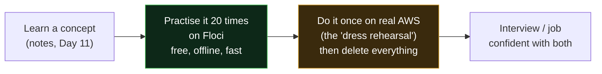
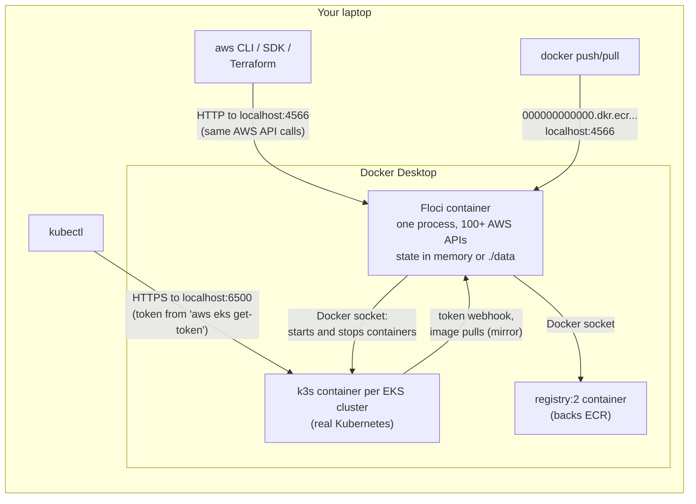
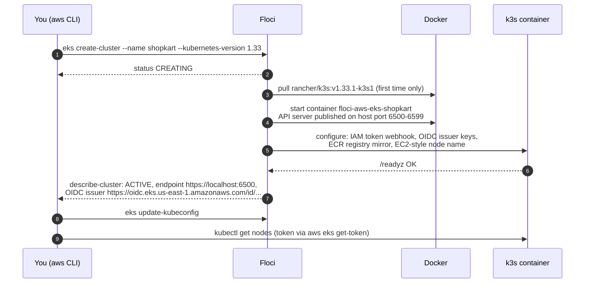
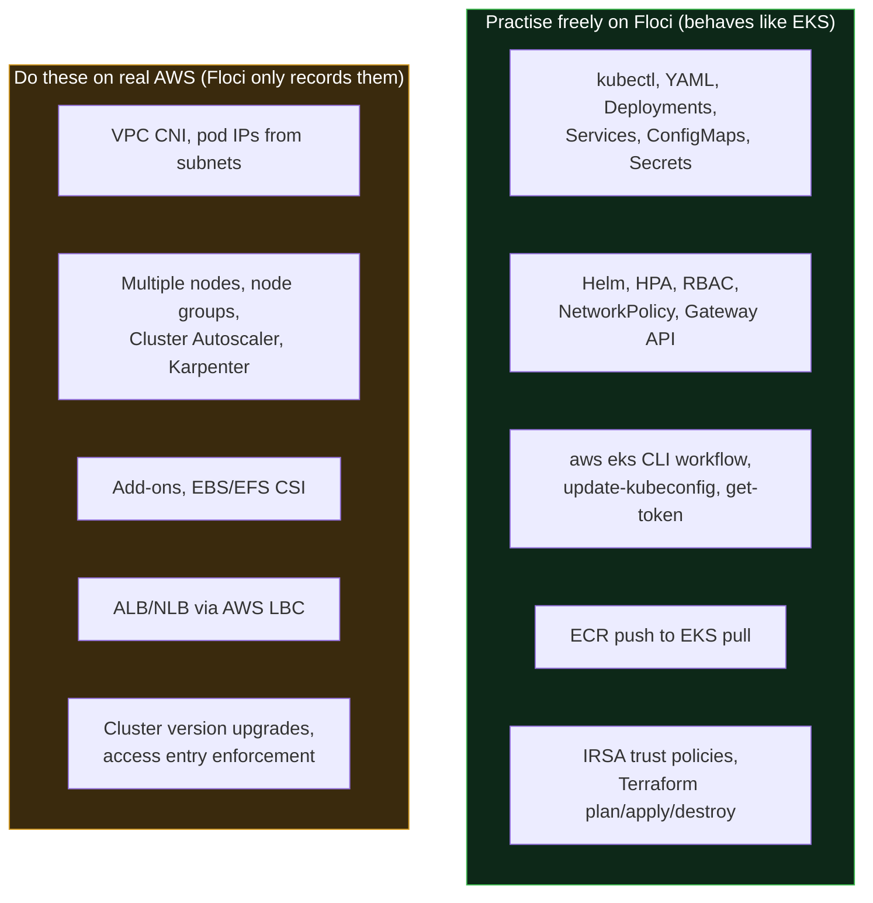
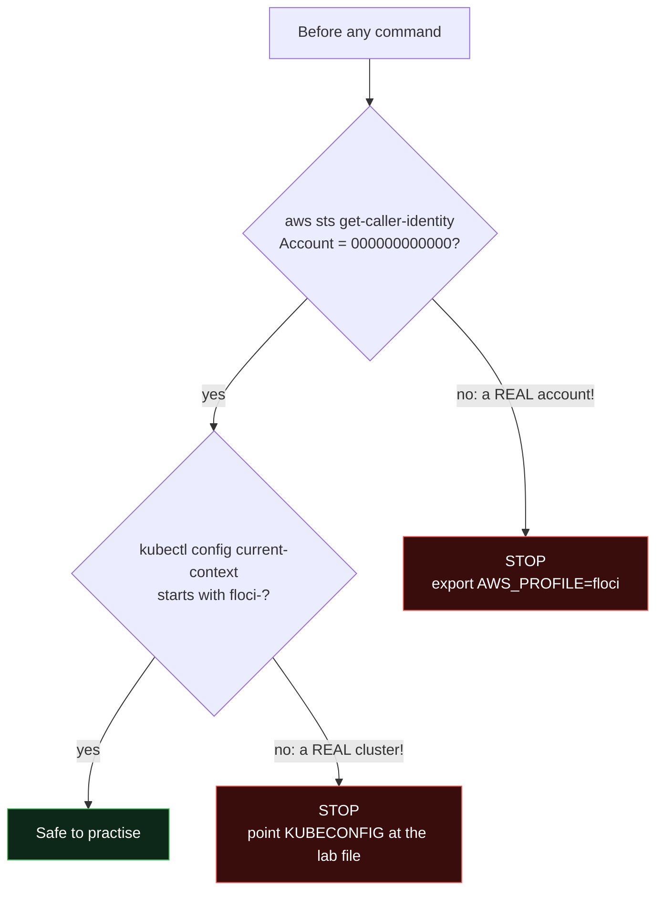
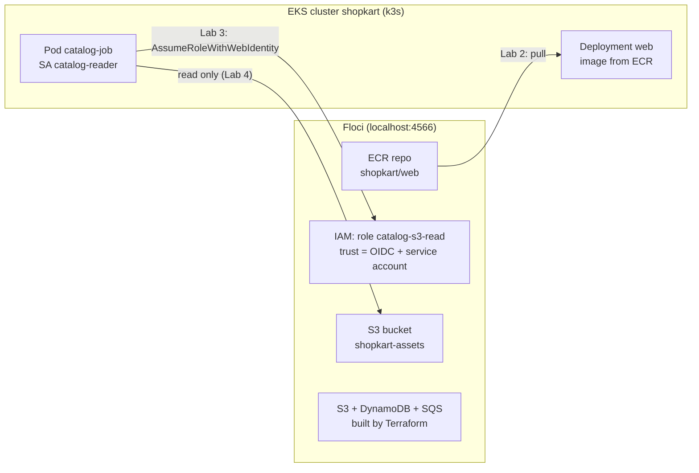
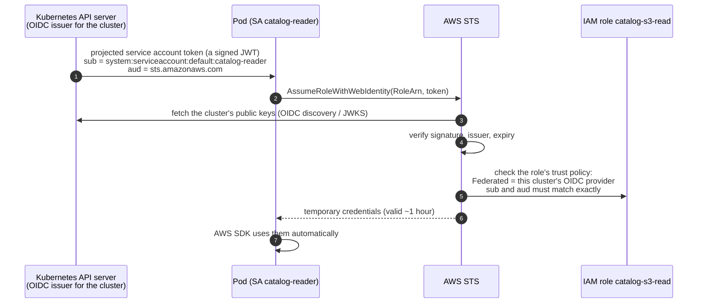
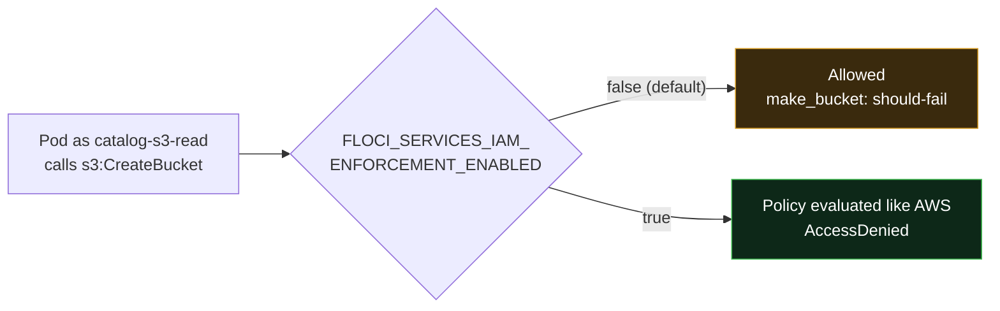
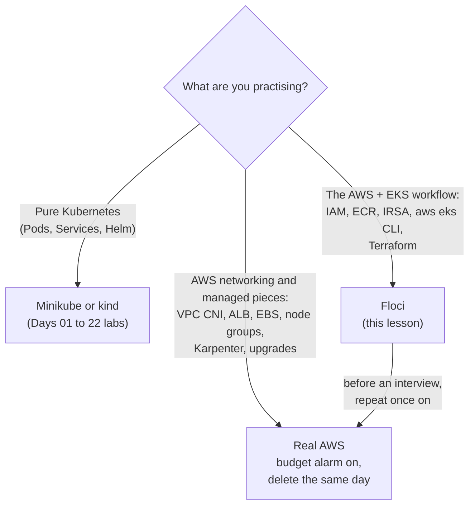

# Day 11 Companion - Practise EKS and AWS for Free on Your Laptop with Floci

> **Goal:** Run a working "EKS cluster", an ECR registry, IAM, S3, DynamoDB and SQS **on your own laptop, with no AWS account and no bill**, using Floci. Set it up step by step, learn exactly what is real and what is simulated, and use it to practise the EKS parts of this course: cluster creation, ECR to EKS deployments, IAM roles for pods (IRSA), IAM policy enforcement and Terraform.

> **Pre-requisites:** [Day 11 - EKS](notes.md) (read it first: this lesson is the free practice ground for it), [Day 10 - ConfigMaps and Secrets](../day10-configmaps-secrets/notes.md), Docker basics. You need **Docker Desktop** (or Docker Engine on Linux), the **AWS CLI v2**, **kubectl**, and optionally **Terraform**.

> **Every command and output in this lesson was run for real** on 31 October 2026 with Floci 2.3.0, k3s v1.33.1, AWS CLI v2, Terraform v1.15.6 and AWS provider v6.71.0, on Windows 11 with Docker Desktop. Where your output differs (IDs, timestamps), the shape will be the same.

---

## Learning Objectives

By the end of this lesson you will be able to:

1. Explain what an AWS emulator is, why Floci appeared in 2026, and when to use it instead of real AWS.
2. Describe how Floci works inside: one process that speaks the AWS APIs, plus real containers (k3s, registry) for services that need them.
3. Install Floci with Docker Compose and verify it is healthy.
4. Set up a **separate, safe AWS profile and kubeconfig** so practice commands can never touch a real AWS account or a real cluster.
5. Create an "EKS cluster" with the normal `aws eks` commands and connect `kubectl` to it.
6. Push an image to Floci's ECR and run it on the cluster.
7. Configure **IRSA** (IAM Roles for Service Accounts) end to end, and explain every step of the token exchange.
8. Turn on **IAM policy enforcement** and prove a read-only role cannot write.
9. Run **Terraform** against Floci for free plan/apply/destroy practice.
10. State clearly which EKS behaviours Floci reproduces faithfully and which it does not, so you never learn something false.

---

## Why This Lesson Exists: Practising Cloud Without the Bill

Every DevOps student hits the same wall. To learn EKS you need an EKS cluster, and EKS costs money even when it does nothing:

| Item (us-east-1 list prices, approximate) | Per hour | Left running for a month |
|---|---|---|
| EKS control plane | $0.10 | about $73 (roughly ₹6,400) |
| One NAT Gateway (needed by private subnets) | $0.045 + data | about $33+ (roughly ₹2,900+) |
| Two t3.medium worker nodes | 2 x $0.0416 | about $61 (roughly ₹5,300) |
| **Total, doing nothing** | | **about $165 a month (roughly ₹14,500)** |

**The real story repeated in every batch:** a student finishes an EKS lab on Friday night, closes the laptop, and forgets `eksctl delete cluster`. On Monday there is a bill of ₹1,500 to ₹2,000 for a cluster that served nobody. Some students stop practising entirely because they are afraid of the bill, and that is worse.

You still need real AWS before an interview (some things only real AWS can teach, as you will see). But for the **hundreds of repetitions** that build muscle memory, such as create cluster, connect kubectl, push image, deploy, wire IAM, break it, fix it, delete it, a local emulator is free, fast and safe.



---

## Part 1: What Is Floci?

**Floci** is a free, open-source (MIT licence) **local AWS emulator**. It runs as one Docker container and listens on `http://localhost:4566`. Anything that speaks to AWS, such as the AWS CLI, the SDKs (boto3, the JavaScript and Java SDKs), Terraform, OpenTofu or the CDK, can be pointed at that address instead of at `amazonaws.com`. Floci answers the same API calls with the same request and response shapes.

- **Project:** `github.com/floci-io/floci`, image `floci/floci` on Docker Hub (the older `hectorvent/floci` image is no longer updated).
- **Services:** well over 100 AWS service APIs, including S3, SQS, SNS, DynamoDB, Lambda, IAM, STS, KMS, Secrets Manager, SSM, EC2, ECR, ECS, **EKS**, RDS, CloudFormation and Route 53. The depth varies by service (Part 3).
- **Releases:** stable versions on the 15th and the last day of each month. Pin a version (this lesson uses `2.3.0`) so your labs behave the same every time.

### Why Floci appeared in 2026

For years the standard local AWS emulator was **LocalStack**. In **March 2026** LocalStack changed its free Community edition to require an account and an auth token. Floci grew quickly as the free alternative with no sign-up and no token. It deliberately listens on the same port, 4566, so most LocalStack-based setups can switch with little change.

> **Career note:** the tool will change again some day. What lasts is the **skill**: pointing AWS tooling at a different endpoint, isolating credentials, and knowing the difference between an emulator and the real thing. Those transfer to LocalStack, Moto, or whatever comes next.

### Real-World Analogy: The Flight Simulator

Airline pilots do not learn engine-failure procedures on a real plane full of passengers. They use a **flight simulator**:

- The **cockpit is real**: same buttons, same checklists, same procedures. In Floci, the **AWS CLI, Terraform, kubectl and the API calls are exactly the ones you use at work**.
- The **physics is simulated**: no real engines, no real fuel. In Floci, there are **no real data centres, no real VPC networking, no real load balancers**.
- Pilots still do **real flights** before they get their licence. You still do **one real-AWS run** of each important lab.
- A good instructor tells you **where the simulator is unrealistic**. Part 3 of this lesson is that briefing.

---

## Part 2: How Floci Works Inside

### One process for the APIs, real containers where needed



Most services (S3, SQS, DynamoDB, IAM, STS...) are **pure API emulation** inside the Floci process: it stores your buckets, queues and tables and answers calls about them. Services that need to *run* something use **real containers** that Floci starts through the Docker socket:

| AWS service | What Floci starts | So it is |
|---|---|---|
| **EKS** (real mode, the default) | One **k3s** container per cluster (k3s is a small, CNCF-certified Kubernetes distribution) | Real Kubernetes, real kubectl, real Pods |
| **ECR** | A shared **registry:2** container behind Floci | Real `docker push` and `docker pull` |
| Lambda, RDS, ElastiCache and others | Real runtime or database containers | Real code execution or a real engine |

That is why the Compose file mounts `/var/run/docker.sock`: Floci needs it to start those containers.

### How an EKS cluster is born in Floci



### Authentication works like real EKS

On real EKS, `kubectl` does not use a password. Your kubeconfig runs `aws eks get-token`, which creates a **signed (SigV4) STS `GetCallerIdentity` request** with your IAM credentials. The API server sends that token to an authentication webhook, which asks STS "who signed this?" and maps the IAM identity to a Kubernetes user.

Floci reproduces this flow: each k3s cluster has a token webhook that asks Floci's STS. Two consequences you will meet in the lab:

- The public test keys `test`/`test` (and `floci`/`floci`) are **rejected** by the cluster. You need a real IAM access key **created inside Floci**.
- A long-term IAM user key from the same (fake) account maps to `system:masters`, which is cluster-admin.

---

## Part 3: What Is Real and What Is Simulated

Read this table before every lab. Practising on a simulator is only safe when you know where it differs from reality.

| Area | In Floci | On real EKS | What to remember |
|---|---|---|---|
| Kubernetes API, Pods, Deployments, Services, RBAC, Helm, HPA | **Real** (k3s v1.33) | Real | Everything you learn here transfers |
| `aws eks create-cluster / describe / update-kubeconfig / get-token` | **Real API shapes** | Real | Same commands, same flags |
| IAM authentication to the cluster | **Real flow** (SigV4 token + webhook) | Real | `test`/`test` keys are rejected, as on AWS |
| OIDC issuer and IRSA token exchange | **Real flow**, trust policy conditions checked | Real | Proven in Lab 3 |
| IRSA environment injection from the service account annotation | **Not injected over plain HTTP** (Floci's webhook needs TLS mode) | Injected automatically | Lab 3 wires it by hand, which also teaches what the webhook does |
| IAM **permission** policies (what an identity may do) | **Not enforced by default**; enforced with `FLOCI_SERVICES_IAM_ENFORCEMENT_ENABLED=true` | Always enforced | Lab 4 |
| Number of nodes | **One** k3s node per cluster, whatever node groups say | As many as you create | Extra node groups are metadata only |
| Pod networking | k3s flannel, pod IPs like `10.42.x.x` | VPC CNI, pod IPs from your subnets | VPC CNI and IP exhaustion cannot be practised here |
| Add-ons (`vpc-cni`, `coredns`, `aws-ebs-csi-driver`...) | **Recorded as metadata, nothing installed** | Installed and running | Do not "test" add-ons on Floci |
| Access entries and access policies | **Recorded, not enforced** by Kubernetes | Enforced | Practise the commands, not the effect |
| Storage | No default StorageClass (like EKS without EBS CSI); optional k3s `local-path` | EBS CSI, EFS CSI | PVC concepts yes, EBS behaviour no |
| Load balancers (`type: LoadBalancer`, AWS Load Balancer Controller) | No real ALB/NLB | Real ALB/NLB | Use Gateway API (Day 23) locally; ALB on real AWS |
| Cluster upgrades (`update-cluster-version`) | **Not implemented** | Supported | Practise upgrades on real AWS or kind |
| Pods reaching the internet | **Yes, really** (they can reach real `amazonaws.com`) | Yes | Safety rule 5 below |



---

## Part 4: Setup, Step by Step

### Step 1: Prerequisites

| Tool | Check | Notes |
|---|---|---|
| Docker Desktop (Windows/macOS) or Docker Engine (Linux) | `docker version` | Give Docker at least 6 GB of memory; each cluster uses 1.5 to 2 GB |
| AWS CLI v2 | `aws --version` | v2 is needed for `endpoint_url` in profiles |
| kubectl | `kubectl version --client` | Any recent version |
| Terraform (optional) | `terraform version` | For Lab 5 |

### Step 2: The Compose file

Create a folder for your lab, for example `eks-local-floci`, and inside it `docker-compose.yml`:

```yaml
# Floci: a local AWS emulator. In EKS "real" mode every cluster you create becomes
# a rancher/k3s container started through the Docker socket, with its API server
# published on a host port in 6500-6599 (no ports: entry needed for those).
services:
  floci:
    image: floci/floci:2.3.0          # pin a version; 'latest' moves twice a month
    container_name: floci
    ports:
      - "4566:4566"                   # the single AWS endpoint
    volumes:
      - /var/run/docker.sock:/var/run/docker.sock   # lets Floci start k3s and registry containers
      - ./data:/app/data              # where state is saved
    environment:
      # k3s containers join this network so they can reach Floci's IAM token
      # webhook and the ECR registry mirror.
      FLOCI_SERVICES_DOCKER_NETWORK: floci_default
      FLOCI_STORAGE_MODE: persistent  # memory | persistent | hybrid | wal
      FLOCI_DEFAULT_REGION: us-east-1
      # Cap each cluster's k3s container (laptop-friendly):
      FLOCI_SERVICES_EKS_MAX_MEMORY_MIB: "2048"
      # Like real EKS, PVCs stay Pending until you install a CSI driver.
      # Set this to get k3s's local-path StorageClass on clusters created afterwards:
      # FLOCI_SERVICES_EKS_DEFAULT_STORAGE_CLASS: "true"
      # Enforce IAM permission policies like real AWS (see Lab 4):
      # FLOCI_SERVICES_IAM_ENFORCEMENT_ENABLED: "true"
    networks:
      - floci_default

networks:
  floci_default:
    name: floci_default
```

**Storage modes explained:**

| `FLOCI_STORAGE_MODE` | Behaviour | Use it for |
|---|---|---|
| `memory` | Everything lost when the container stops | CI pipelines, throwaway tests |
| `persistent` | Written to `./data` on every change | Learning: your clusters, users and images survive restarts |
| `hybrid` | In memory, flushed to disk every 5 seconds | Faster local development |
| `wal` | Write-ahead log, most durable | Long-lived local environments |

### Step 3: Start Floci and check it is healthy

```bash
docker compose up -d
# Container floci  Started

curl -s http://localhost:4566/_floci/health
# {"version":"2.3.0","services":{"ssm":"running","sqs":"running","s3":"running",
#  "dynamodb":"running", ... "eks":"running", ... }}

docker logs floci 2>&1 | tail -1
# ... floci 2.3.0 native (powered by Quarkus 3.40.1) started in 6.037s. Listening on: http://0.0.0.0:4566
```

Six seconds to a working "AWS". (In PowerShell use `Invoke-RestMethod http://localhost:4566/_floci/health` instead of curl.)

### Step 4: First look, with the public test keys

For plain API services, any non-empty credentials work. Floci's convention is `test`/`test`:

```bash
export AWS_ACCESS_KEY_ID=test AWS_SECRET_ACCESS_KEY=test AWS_REGION=us-east-1

aws --endpoint-url http://localhost:4566 sts get-caller-identity
# {
#     "UserId": "000000000000",
#     "Account": "000000000000",          <- the fake account ID: a quick "am I on Floci?" check
#     "Arn": "arn:aws:iam::000000000000:root"
# }

aws --endpoint-url http://localhost:4566 s3 mb s3://shopkart-assets
# make_bucket: shopkart-assets

echo "hello floci" > hello.txt
aws --endpoint-url http://localhost:4566 s3 cp hello.txt s3://shopkart-assets/
aws --endpoint-url http://localhost:4566 s3 ls s3://shopkart-assets/
# 2026-10-31 13:36:53         12 hello.txt
```

PowerShell equivalent of the `export` line:

```powershell
$env:AWS_ACCESS_KEY_ID='test'; $env:AWS_SECRET_ACCESS_KEY='test'; $env:AWS_REGION='us-east-1'
```

### Step 5: Create a real IAM key inside Floci and a dedicated profile

EKS rejects `test`/`test`, so mint an IAM user and key **inside Floci**, then save them as a separate AWS CLI profile named `floci` whose `endpoint_url` points at Floci:

```bash
# still using test/test, and always the local endpoint
aws --endpoint-url http://localhost:4566 iam create-user --user-name eks-admin --query User.Arn --output text
# arn:aws:iam::000000000000:user/eks-admin

aws --endpoint-url http://localhost:4566 iam attach-user-policy --user-name eks-admin \
  --policy-arn arn:aws:iam::aws:policy/AdministratorAccess     # needed once enforcement is on (Lab 4)

aws --endpoint-url http://localhost:4566 iam create-access-key --user-name eks-admin \
  --query 'AccessKey.[AccessKeyId,SecretAccessKey]' --output text
# AKIA...............   wJalr...............          <- copy both values

aws configure set aws_access_key_id     <AccessKeyId>     --profile floci
aws configure set aws_secret_access_key <SecretAccessKey> --profile floci
aws configure set region       us-east-1               --profile floci
aws configure set output       json                    --profile floci
aws configure set endpoint_url http://localhost:4566   --profile floci

unset AWS_ACCESS_KEY_ID AWS_SECRET_ACCESS_KEY      # stop using test/test
export AWS_PROFILE=floci                           # PowerShell: $env:AWS_PROFILE='floci'

aws sts get-caller-identity
# {
#     "UserId": "AIDAQ6AQPUUOLQRWW6QC",
#     "Account": "000000000000",
#     "Arn": "arn:aws:iam::000000000000:user/eks-admin"
# }
```

Your `~/.aws/config` now has:

```ini
[profile floci]
region = us-east-1
endpoint_url = http://localhost:4566
output = json
```

Because `endpoint_url` lives **in the profile**, every `aws` command run with `--profile floci` (or `AWS_PROFILE=floci`) goes to Floci, including `aws eks get-token` inside your kubeconfig. Your other profiles are untouched.

### Step 6: The five safety rules

You probably also have real AWS credentials on your laptop. These rules make sure practice never touches them.



1. **Use the `floci` profile for everything**, with `endpoint_url` inside it. Never put real AWS keys in it.
2. **Use a separate kubeconfig file** for Floci clusters (Step 7). Your `~/.kube/config` may hold real production contexts; `kubectl delete` against the wrong one is a career moment you do not want.
3. **Check before anything destructive:** account `000000000000` and a `floci-` context name.
4. **Watch for the "wrong profile" failure.** If your shell lost `AWS_PROFILE=floci`, `aws eks get-token` signs the token with your default (possibly real) credentials. While writing this lesson exactly that happened, and kubectl answered:
   ```
   error: You must be logged in to the server (Unauthorized)
   ```
   Nothing reached real AWS (`get-token` only signs locally, and the request went to Floci, which rejected the unknown key), but it is a warning sign: **fix the profile, do not "fix" the credentials**.
5. **Pods can reach the real internet.** From inside a Floci cluster, `curl https://sts.amazonaws.com/` reached real AWS (HTTP 302) in our test. An app in a pod with no endpoint override talks to **real** AWS. Always set `AWS_ENDPOINT_URL` in pods (Lab 3), and never mount real credentials into a practice cluster.

### Step 7: Create the EKS cluster

Exactly the commands you would run on real AWS: a cluster IAM role with the EKS trust policy, subnets, then `create-cluster`.

```bash
export AWS_PROFILE=floci

# 1. Cluster role, as on real AWS
cat > eks-trust.json <<'EOF'
{"Version":"2012-10-17","Statement":[{"Effect":"Allow",
  "Principal":{"Service":"eks.amazonaws.com"},"Action":"sts:AssumeRole"}]}
EOF
ROLE=$(aws iam create-role --role-name eks-cluster-role \
  --assume-role-policy-document file://eks-trust.json --query Role.Arn --output text)
aws iam attach-role-policy --role-name eks-cluster-role \
  --policy-arn arn:aws:iam::aws:policy/AmazonEKSClusterPolicy
echo $ROLE
# arn:aws:iam::000000000000:role/eks-cluster-role

# 2. Floci ships a default VPC with one subnet per AZ, and it validates subnet IDs
aws ec2 describe-vpcs --query 'Vpcs[].[VpcId,CidrBlock,IsDefault]' --output text
# vpc-default-us-east-1   172.31.0.0/16   True
SUBNETS=$(aws ec2 describe-subnets --filters Name=default-for-az,Values=true \
  --query 'Subnets[].SubnetId' --output text | tr '\t' ',')
echo $SUBNETS
# subnet-default-us-east-1-c,subnet-default-us-east-1-b,subnet-default-us-east-1-a

# 3. Create the cluster. Note: --kubernetes-version, NOT --version
aws eks create-cluster --name shopkart --kubernetes-version 1.33 \
  --role-arn $ROLE --resources-vpc-config subnetIds=$SUBNETS \
  --query cluster.status --output text
# CREATING

aws eks wait cluster-active --name shopkart          # took 34 seconds here
aws eks describe-cluster --name shopkart \
  --query 'cluster.{status:status,version:version,endpoint:endpoint,oidc:identity.oidc.issuer}'
# {
#     "status": "ACTIVE",
#     "version": "1.33",
#     "endpoint": "https://localhost:6500",
#     "oidc": "https://oidc.eks.us-east-1.amazonaws.com/id/92E4E608078D45D8A3F70BB31860001A"
# }
```

> **Trap: `--version` vs `--kubernetes-version`.** `aws eks create-cluster --version 1.33` does **not** set the Kubernetes version. `--version` is the AWS CLI's global flag: it prints the CLI version and creates nothing. Floci's own early docs had this wrong. The same trap exists on real AWS.

> **First-run trap: the cluster goes `FAILED`.** The very first cluster triggers a pull of the k3s image (about 40 seconds here). On our first attempt that pull raced with a retry, and the cluster ended `FAILED` with this in `docker logs floci`:
> ```
> ERROR ... Failed to start k3s container for cluster shopkart: Status 409: Conflict.
> The container name "/floci-aws-eks-shopkart" is already in use ...
> ```
> Fix: delete the cluster, remove the leftover container, create again (the image is cached now, so it is quick):
> ```bash
> aws eks delete-cluster --name shopkart
> docker rm -f floci-aws-eks-shopkart
> aws eks create-cluster ...   # same command as above
> ```
> You can avoid it entirely by pulling the image first: `docker pull rancher/k3s:v1.33.1-k3s1`.

### Step 8: Connect kubectl (to a separate kubeconfig)

```bash
aws eks update-kubeconfig --name shopkart --kubeconfig ./kubeconfig --alias floci-shopkart
export KUBECONFIG=$PWD/kubeconfig            # PowerShell: $env:KUBECONFIG="$PWD\kubeconfig"

kubectl get nodes -o wide
# NAME                               STATUS   ROLES                  AGE   VERSION        ... OS-IMAGE           CONTAINER-RUNTIME
# i-35003c59e48a376a9.ec2.internal   Ready    control-plane,master   24s   v1.33.1+k3s1   ... K3s v1.33.1+k3s1   containerd://2.0.5-k3s1

kubectl auth whoami
# ATTRIBUTE   VALUE
# Username    floci:aws-iam
# UID         floci-aws-iam
# Groups      [system:masters system:authenticated]
```

Notice the node name `i-35003c59e48a376a9.ec2.internal`: Floci names the k3s node like an EC2 instance, so EKS-style tooling feels at home. Look inside the kubeconfig and you will see the same `exec` block real EKS uses:

```yaml
users:
- name: arn:aws:eks:us-east-1:000000000000:cluster/shopkart
  user:
    exec:
      apiVersion: client.authentication.k8s.io/v1beta1
      args: [--region, us-east-1, eks, get-token, --cluster-name, shopkart, --output, json]
      command: aws
      env: [{name: AWS_PROFILE, value: floci}]
```

And the auth check that proves it is not a toy:

```bash
AWS_PROFILE= AWS_ACCESS_KEY_ID=test AWS_SECRET_ACCESS_KEY=test kubectl get nodes
# error: You must be logged in to the server (Unauthorized)
```

---

## Hands-On Labs: ShopKart on Local EKS

The same ShopKart company from Days 23 to 25. Before spending on AWS, the platform team rehearses on Floci: push the web image to ECR, run it on EKS, give the catalog job read-only S3 access through IRSA, prove the permissions, and build the order infrastructure with Terraform.



### Lab 2: ECR to EKS

```bash
URI=$(aws ecr create-repository --repository-name shopkart/web \
  --query repository.repositoryUri --output text)
echo $URI
# 000000000000.dkr.ecr.us-east-1.localhost:4566/shopkart/web

aws ecr get-login-password | docker login --username AWS --password-stdin ${URI%%/*}
# Login Succeeded

docker pull nginx:1.27-alpine
docker tag nginx:1.27-alpine $URI:v1
docker push $URI:v1
aws ecr list-images --repository-name shopkart/web --query 'imageIds[].imageTag'
# [ "v1" ]

kubectl create deployment web --image=$URI:v1 --replicas=2
kubectl expose deployment web --port=80
kubectl rollout status deploy/web
# deployment "web" successfully rolled out
kubectl get pods -o wide
# NAME                   READY   STATUS    RESTARTS   AGE   IP          NODE
# web-7d7d694874-8tshm   1/1     Running   0          36s   10.42.0.6   i-35003c59e48a376a9.ec2.internal
# web-7d7d694874-k4sqs   1/1     Running   0          35s   10.42.0.5   i-35003c59e48a376a9.ec2.internal
```

How does a pod inside k3s pull from `...localhost:4566`, when "localhost" inside the cluster is not your laptop? Floci writes a **registry mirror** into each cluster's `/etc/rancher/k3s/registries.yaml`, mapping every region's ECR hostname to Floci's address on the Docker network:

```yaml
mirrors:
  "000000000000.dkr.ecr.us-east-1.localhost:4566":
    endpoint:
      - "http://172.29.0.2:4566"
```

So the **same image URI** works for `docker push` on your laptop and for `image:` in your YAML. That is what you want: manifests that look like production.

### Lab 3: IRSA, IAM Roles for Service Accounts, end to end

**The real requirement.** ShopKart's nightly catalog job reads product images from S3. The bad old way is to put an access key in a Kubernetes Secret: it never rotates, it leaks into logs and Git, and every pod that can read the Secret becomes that IAM user. **IRSA** gives the pod a short-lived IAM role identity based on **which service account it runs as**, with no stored keys at all.

**How IRSA works, step by step:**



**Step 3a: register the cluster's OIDC issuer with IAM** (on real AWS this is the `eksctl utils associate-iam-oidc-provider` step):

```bash
ISSUER=$(aws eks describe-cluster --name shopkart --query cluster.identity.oidc.issuer --output text)
OIDC=${ISSUER#https://}
echo $OIDC
# oidc.eks.us-east-1.amazonaws.com/id/92E4E608078D45D8A3F70BB31860001A

aws iam create-open-id-connect-provider --url $ISSUER --client-id-list sts.amazonaws.com \
  --query OpenIDConnectProviderArn --output text
# arn:aws:iam::000000000000:oidc-provider/oidc.eks.us-east-1.amazonaws.com/id/92E4E608078D45D8A3F70BB31860001A
```

**Step 3b: a role that only one service account may assume:**

```bash
cat > irsa-trust.json <<EOF
{"Version":"2012-10-17","Statement":[{"Effect":"Allow",
 "Principal":{"Federated":"arn:aws:iam::000000000000:oidc-provider/$OIDC"},
 "Action":"sts:AssumeRoleWithWebIdentity",
 "Condition":{"StringEquals":{
   "$OIDC:sub":"system:serviceaccount:default:catalog-reader",
   "$OIDC:aud":"sts.amazonaws.com"}}}]}
EOF
aws iam create-role --role-name catalog-s3-read \
  --assume-role-policy-document file://irsa-trust.json --query Role.Arn --output text
# arn:aws:iam::000000000000:role/catalog-s3-read
aws iam attach-role-policy --role-name catalog-s3-read \
  --policy-arn arn:aws:iam::aws:policy/AmazonS3ReadOnlyAccess
```

The `sub` condition is the security heart of IRSA: **only pods running as `catalog-reader` in namespace `default`** can become this role. Without it, any pod in the cluster could.

**Step 3c: give pods a stable name for Floci.** Pods resolve names through the cluster's CoreDNS, which does not know the Docker container name `floci`. In our test, `floci` did not resolve from a pod, but Floci's IP on the Docker network did. Give it a proper in-cluster name with a Service that has no selector and a manual EndpointSlice:

```bash
FIP=$(docker inspect floci --format '{{(index .NetworkSettings.Networks "floci_default").IPAddress}}')
echo $FIP     # e.g. 172.29.0.2
```

```yaml
# floci-service.yaml  (replace 172.29.0.2 with your $FIP)
apiVersion: v1
kind: Service
metadata:
  name: floci
  namespace: default
spec:
  ports:
  - name: aws
    port: 4566
    targetPort: 4566
---
apiVersion: discovery.k8s.io/v1
kind: EndpointSlice
metadata:
  name: floci-1
  namespace: default
  labels:
    kubernetes.io/service-name: floci     # links this slice to the Service above
addressType: IPv4
ports:
- name: aws
  port: 4566
endpoints:
- addresses: ["172.29.0.2"]
```

Pods can now use `http://floci.default.svc.cluster.local:4566` as their AWS endpoint. (This is the same "Service without a selector" pattern from Day 07 that you use in real life to give an external database a cluster DNS name.) If Floci's container IP changes after a restart, update the address.

**Step 3d: the service account and the pod.** On real EKS you only annotate the service account, and the **EKS Pod Identity webhook** injects the rest. In our Floci run over plain HTTP, the annotation alone injected nothing: the pod saw only the variables we set ourselves and failed with `Unable to locate credentials`. Floci's docs say its mutating webhook needs `FLOCI_TLS_ENABLED=true`. So we write by hand **exactly what the webhook would inject**, which is the best way to understand IRSA anyway:

```yaml
# irsa-pod.yaml
apiVersion: v1
kind: ServiceAccount
metadata:
  name: catalog-reader
  annotations:
    eks.amazonaws.com/role-arn: arn:aws:iam::000000000000:role/catalog-s3-read   # all you need on real EKS
---
apiVersion: v1
kind: Pod
metadata:
  name: catalog-job
spec:
  serviceAccountName: catalog-reader
  restartPolicy: Never
  containers:
  - name: aws
    image: amazon/aws-cli:2.27.50
    command: ["sh","-c","aws sts get-caller-identity; aws s3 ls s3://shopkart-assets/; aws s3 mb s3://should-fail || true"]
    env:
    - name: AWS_ENDPOINT_URL                  # Floci only: send AWS calls to Floci, not the internet
      value: http://floci.default.svc.cluster.local:4566
    - name: AWS_REGION
      value: us-east-1
    # ---- below: what the EKS webhook injects automatically on real EKS ----
    - name: AWS_ROLE_ARN
      value: arn:aws:iam::000000000000:role/catalog-s3-read
    - name: AWS_WEB_IDENTITY_TOKEN_FILE
      value: /var/run/secrets/eks.amazonaws.com/serviceaccount/token
    volumeMounts:
    - name: aws-iam-token
      mountPath: /var/run/secrets/eks.amazonaws.com/serviceaccount
      readOnly: true
  volumes:
  - name: aws-iam-token
    projected:
      sources:
      - serviceAccountToken:
          audience: sts.amazonaws.com         # must match the trust policy's aud
          expirationSeconds: 86400
          path: token
```

```bash
kubectl apply -f floci-service.yaml -f irsa-pod.yaml
kubectl wait --for=jsonpath='{.status.phase}'=Succeeded pod/catalog-job --timeout=120s
kubectl logs catalog-job
# {
#     "UserId": "AROASP4GCNKIKBBYVCZ6:botocore-session-1793434999",
#     "Account": "000000000000",
#     "Arn": "arn:aws:sts::000000000000:assumed-role/catalog-s3-read/botocore-session-1793434999"
# }
# 2026-10-31 08:06:53         12 hello.txt
# make_bucket: should-fail               <- wait, a READ-ONLY role created a bucket? See Lab 4.
```

The pod **became the role** with no keys anywhere. The AWS CLI found `AWS_ROLE_ARN` and `AWS_WEB_IDENTITY_TOKEN_FILE` and called `AssumeRoleWithWebIdentity` on its own. Every AWS SDK does the same.

**Step 3e: prove the trust policy protects the role.** Run the same pod as the `default` service account:

```bash
sed -e 's/serviceAccountName: catalog-reader/serviceAccountName: default/' \
    -e 's/name: catalog-job/name: catalog-job-wrong-sa/' irsa-pod.yaml | kubectl apply -f -
kubectl logs catalog-job-wrong-sa
# An error occurred (AccessDenied) when calling the AssumeRoleWithWebIdentity operation:
# Not authorized to perform sts:AssumeRoleWithWebIdentity on resource: arn:aws:iam::000000000000:role/catalog-s3-read
```

The token's `sub` is `system:serviceaccount:default:default`, which does not match the condition, so STS refuses. That is exactly how a compromised pod with the wrong service account is stopped on real AWS.

### Lab 4: IAM permission enforcement

Back to the surprise in Lab 3: a role with only `AmazonS3ReadOnlyAccess` created a bucket. That is Floci's default: it checks **trust policies** (who may assume a role, as you just saw) but does **not evaluate permission policies** (what an identity may do), because most local development does not want to debug IAM. If you are learning IAM, you want it on.



Uncomment `FLOCI_SERVICES_IAM_ENFORCEMENT_ENABLED: "true"` in `docker-compose.yml` and recreate the container:

```bash
docker compose up -d
# Container floci  Started        (persistent mode: users, roles, cluster and images survive)

kubectl get nodes        # still works: eks-admin has AdministratorAccess (Step 5)
# i-35003c59e48a376a9.ec2.internal   Ready   control-plane,master   14m   v1.33.1+k3s1
```

Run the catalog job again (a new pod name):

```bash
sed 's/name: catalog-job$/name: catalog-job-enforced/' irsa-pod.yaml | kubectl apply -f -
kubectl logs catalog-job-enforced
# {
#     "Arn": "arn:aws:sts::000000000000:assumed-role/catalog-s3-read/botocore-session-1793435107"
# }
# 2026-10-31 08:06:53         12 hello.txt
# make_bucket failed: s3://should-fail An error occurred (AccessDenied) when calling the
#   CreateBucket operation: User is not authorized to perform: s3:CreateBucket
```

Read allowed, write denied, as on real AWS. This is why Step 5 attached `AdministratorAccess` to `eks-admin`: with enforcement on, a user with no policies can do nothing, including talking to EKS.

> **Rule for learners:** turn enforcement **on** whenever the lesson is about IAM (IRSA, least privilege, the snapvault IAM policies). Turn it **off** when you just want to practise Kubernetes without IAM friction.

### Lab 5: Terraform against Floci

The [learn-terraform](../../learn-terraform/README.md) module uses real AWS. You can rehearse most of it for free by pointing the AWS provider at Floci:

```hcl
terraform {
  required_providers {
    aws = {
      source  = "hashicorp/aws"
      version = "~> 6.0"
    }
  }
}

provider "aws" {
  region                      = "us-east-1"
  access_key                  = var.floci_access_key   # the eks-admin key from Step 5
  secret_key                  = var.floci_secret_key
  skip_credentials_validation = true    # do not call real STS to validate keys
  skip_metadata_api_check     = true    # do not look for an EC2 instance profile
  skip_requesting_account_id  = true
  s3_use_path_style           = true    # http://localhost:4566/bucket, not bucket.localhost

  endpoints {                           # EVERY service you use needs an entry
    s3       = "http://localhost:4566"
    dynamodb = "http://localhost:4566"
    sqs      = "http://localhost:4566"
    iam      = "http://localhost:4566"
    sts      = "http://localhost:4566"
  }
}

variable "floci_access_key" { type = string }
variable "floci_secret_key" {
  type      = string
  sensitive = true
}

resource "aws_s3_bucket" "invoices" {
  bucket = "shopkart-invoices"
}

resource "aws_s3_bucket_versioning" "invoices" {
  bucket = aws_s3_bucket.invoices.id
  versioning_configuration {
    status = "Enabled"
  }
}

resource "aws_dynamodb_table" "orders" {
  name         = "shopkart-orders"
  billing_mode = "PAY_PER_REQUEST"
  hash_key     = "order_id"
  attribute {
    name = "order_id"
    type = "S"
  }
}

resource "aws_sqs_queue" "order_events" {
  name                       = "shopkart-order-events"
  visibility_timeout_seconds = 60
}

output "queue_url" { value = aws_sqs_queue.order_events.url }
```

```bash
export TF_VAR_floci_access_key=<AccessKeyId> TF_VAR_floci_secret_key=<SecretAccessKey>
terraform init
# - Installed hashicorp/aws v6.71.0 (signed by HashiCorp)
terraform apply -auto-approve
# aws_s3_bucket.invoices: Creation complete after 0s [id=shopkart-invoices]
# aws_s3_bucket_versioning.invoices: Creation complete after 2s [id=shopkart-invoices]
# aws_dynamodb_table.orders: Creation complete after 7s [id=shopkart-orders]
# aws_sqs_queue.order_events: Creation complete after 26s [id=http://localhost:4566/000000000000/shopkart-order-events]
# Apply complete! Resources: 4 added, 0 changed, 0 destroyed.

aws dynamodb list-tables --output text
# TABLENAMES      shopkart-orders

terraform plan -detailed-exitcode; echo $?
# 0          <- no drift: Floci returned the resources exactly as Terraform expects

terraform destroy -auto-approve
# Destroy complete! Resources: 4 destroyed.
```

**Why `skip_credentials_validation` matters for safety:** without it the provider calls STS to check the keys. With the `endpoints` block it would call Floci anyway, but if you forget an endpoint for some service, that service's calls go to **real AWS**. Floci keys are useless there, so they would fail, which is the safe failure mode. That is one more reason never to use real keys with Floci.

> **Not tested in this lesson but worth trying:** `aws_eks_cluster` with Terraform against Floci (add `eks`, `ec2` and `ecr` endpoints). The EKS API shapes are emulated, so the plan and apply flow is good practice. Remember from Part 3 that node groups and add-ons are only recorded.

---

## Part 5: Using Floci With This Course

Which EKS-related lessons can you practise on Floci?

| Lesson | On Floci | How |
|---|---|---|
| [Day 11 - EKS](notes.md), cluster creation with the AWS CLI | **Yes, tested** | Step 7 of this lesson |
| Day 11 - managed node groups | Commands only | Node groups are metadata; one k3s node runs everything |
| Days 04 to 10, 14, 16, 19, 21, 22 (core Kubernetes, Helm) | **Yes** | It is real Kubernetes; k3s ships metrics-server, so HPA works |
| [Day 12/13 - EBS volumes](../day12-volumes/aws-volumes/notes.md) | Concepts only | No EBS CSI; enable `FLOCI_SERVICES_EKS_DEFAULT_STORAGE_CLASS` for `local-path` PVCs |
| [Day 15 - StatefulSets EKS demo](../day15-statefulsets-demo/eks-demo.md) | With `local-path` storage | Storage class name differs from `gp3` |
| [Day 17 - RBAC on EKS](../day17-rbac-security/rbac-on-eks.md) | Partly | IAM to cluster auth is real; access entries/policies are recorded but not enforced |
| [Day 18 - ALB Ingress EKS demo](../day18-ingress-demo/eks-demo.md) | **No** | Needs a real ALB; practise routing with Gateway API (Day 23) instead |
| [Day 20 - NetworkPolicy](../day20-network-policies/notes.md) | Expected to work (not tested here) | k3s includes a NetworkPolicy controller |
| [Day 23 - Gateway API](../day23-gateway-api/notes.md) | Expected to work (not tested here) | Install Envoy Gateway with Helm as in the lab |
| ECR to EKS, IRSA, IAM least privilege | **Yes, tested** | Labs 2, 3, 4 |
| learn-terraform Days 1 to 13 | **Mostly** | Lab 5 pattern; EC2/VPC resources are emulated, not real machines |

### Floci vs the alternatives

| | Floci | LocalStack | Minikube / kind | Real AWS |
|---|---|---|---|---|
| Cost | Free (MIT) | Free tier needs account and token since March 2026; paid tiers | Free | Pay per hour |
| AWS APIs (IAM, S3, ECR, EKS API) | Yes, 100+ services | Yes | No | Yes |
| Real Kubernetes | Yes (k3s, one node per cluster) | Yes in paid tiers | Yes (multi-node with kind) | Yes |
| EKS workflow (`aws eks ...`, get-token, IRSA) | Yes | Yes | No | Yes |
| VPC CNI, ALB, EBS, upgrades | No | Partly | No | Yes |
| Best for | Free practice of the AWS + EKS workflow | Teams already invested in LocalStack | Pure Kubernetes learning | Final rehearsal, real behaviour |



---

## Part 6: Daily Use and Cleanup

```bash
# Start of a practice session
cd eks-local-floci
docker compose up -d
export AWS_PROFILE=floci KUBECONFIG=$PWD/kubeconfig
aws sts get-caller-identity --query Account --output text     # must print 000000000000
kubectl config current-context                                 # must print floci-...

# More clusters (each is one k3s container, about 1.5 to 2 GB of memory)
aws eks create-cluster --name dev ...
aws eks update-kubeconfig --name dev --kubeconfig ./kubeconfig --alias floci-dev
kubectl config use-context floci-dev

# End of session: stop everything but keep state (persistent mode)
docker compose stop

# Delete one cluster
aws eks delete-cluster --name shopkart
aws eks wait cluster-deleted --name shopkart

# Full reset: delete clusters first, then
docker compose down
docker ps -a --filter name=floci-aws          # leftovers: the ECR registry container, k3s containers
docker rm -f floci-aws-ecr-registry
docker network ls | grep floci-aws            # leftover emulated-VPC network
docker network rm <that network> floci_default
rm -rf ./data                                 # all saved state
```

> **Real cleanup gotcha:** `docker compose down` removes the Floci container but **not** the containers and networks Floci itself created (the ECR registry container and the emulated VPC network). In our run, `docker compose down` even reported `Network ... Resource is still in use` until those were removed. Clean them explicitly, as above.

---

## Troubleshooting Guide

| Symptom | Likely reason | Fix |
|---|---|---|
| `create-cluster` prints the CLI version and nothing happens | You used `--version` | Use `--kubernetes-version` |
| First cluster ends `FAILED`; logs show `409 Conflict ... container name already in use` | k3s image pull raced with a retry on first run | `delete-cluster`, `docker rm -f floci-aws-eks-<name>`, create again; or pre-pull the k3s image |
| `kubectl`: `You must be logged in to the server (Unauthorized)` | Shell is not using the `floci` profile (test/test or real keys used) | `export AWS_PROFILE=floci`; check `aws sts get-caller-identity` shows account 000000000000 |
| Same error after a Floci reset | The `eks-admin` key in your profile no longer exists in Floci (state deleted) | Recreate the user and key (Step 5) |
| Everything is `AccessDenied` after enabling enforcement | Your user has no policies | Attach `AdministratorAccess` to your practice user (in Floci only) |
| Pod: `Unable to locate credentials` with IRSA | The annotation did not inject env vars (no TLS webhook) | Set `AWS_ROLE_ARN`, `AWS_WEB_IDENTITY_TOKEN_FILE` and the projected token volume (Lab 3) |
| Pod: `Could not connect to the endpoint URL: "http://floci:4566/"` | Pods cannot resolve Docker container names | Use the `floci` Service + EndpointSlice (Lab 3, Step 3c) |
| `AssumeRoleWithWebIdentity ... AccessDenied` | Token `sub` or `aud` does not match the trust policy | Check namespace, service account name, `audience: sts.amazonaws.com` |
| PVC stays `Pending` | No StorageClass, like EKS without EBS CSI | Set `FLOCI_SERVICES_EKS_DEFAULT_STORAGE_CLASS: "true"` and create a new cluster |
| `ImagePullBackOff` for an ECR image | Image not pushed, or tag typo | `aws ecr list-images --repository-name ...`; the URI must match exactly |
| Laptop slows down | Each cluster is a full k3s | Delete clusters you are not using; set `FLOCI_SERVICES_EKS_MAX_MEMORY_MIB` |

---

## Common Mistakes

1. **Using real AWS keys in the Floci profile.** Never. Floci keys are fake and useless outside Floci, which is exactly what makes them safe.
2. **Merging Floci contexts into `~/.kube/config`.** Keep a separate kubeconfig so a `kubectl delete` can never land on a real cluster.
3. **Believing a green result on Floci means it works on AWS.** Without enforcement, IAM permission policies are not checked; add-ons, node groups and access policies are only recorded.
4. **Testing EBS, ALB or VPC CNI behaviour on Floci.** These need real AWS.
5. **Forgetting `AWS_ENDPOINT_URL` in pods.** The pod will happily call real `amazonaws.com`.
6. **`--version` instead of `--kubernetes-version`.**
7. **Using `latest` image tags** for Floci in course material. It changes twice a month; pin a version.
8. **Running five clusters on an 8 GB laptop.** One or two at a time.
9. **Thinking IRSA "just works" from the annotation everywhere.** On real EKS a webhook does the work; knowing what it injects (Lab 3) is what lets you debug it.
10. **Skipping the real-AWS rehearsal.** Floci is for repetitions; do the final run on AWS with a budget alarm.

---

## Interview Questions (with answers)

**Q1. How would you let engineers practise or test AWS infrastructure code without cloud costs?**
Use a local AWS emulator such as Floci (or LocalStack) in Docker. Point the AWS CLI, SDKs and Terraform at its endpoint with a dedicated profile, use fake credentials, keep it in `memory` mode for CI, and run the final validation against a real sandbox account with budgets and automatic cleanup. Be explicit about what the emulator does not reproduce.

**Q2. Explain IRSA step by step.**
The EKS cluster is an OIDC issuer. A pod's service account gets a projected JWT with `sub=system:serviceaccount:<ns>:<sa>` and `aud=sts.amazonaws.com`. The SDK calls `AssumeRoleWithWebIdentity` with the role ARN and the token. STS verifies the token against the cluster's public keys and checks the role's trust policy, whose principal is the cluster's IAM OIDC provider and whose conditions pin `sub` and `aud`. STS returns temporary credentials. On EKS a mutating webhook injects `AWS_ROLE_ARN`, `AWS_WEB_IDENTITY_TOKEN_FILE` and the token volume when the service account has the `eks.amazonaws.com/role-arn` annotation.

**Q3. How does kubectl authenticate to EKS?**
The kubeconfig's exec plugin runs `aws eks get-token`, which produces a presigned STS `GetCallerIdentity` request (SigV4) as a bearer token. The API server's authentication webhook validates it with STS and maps the IAM identity to a Kubernetes identity (access entries or the older aws-auth ConfigMap), and RBAC authorizes it.

**Q4. What are the limits of practising on an emulator?**
Managed infrastructure behaviour is not real: VPC CNI and IP allocation, load balancers, EBS/EFS, add-ons, multi-node scheduling, upgrades. IAM permission evaluation may be off by default. Performance and limits differ. Use the emulator for workflow and repetitions, and real AWS for final validation.

**Q5. A pod in your cluster gets `AccessDenied` on `AssumeRoleWithWebIdentity`. What do you check?**
The service account name and namespace against the trust policy's `sub` condition; the token audience against `aud`; that the role trusts the right cluster's OIDC provider (the issuer ID); that the OIDC provider exists in IAM; and that the pod really runs with that service account (`kubectl get pod -o yaml`).

**Q6. Why keep practice clusters in a separate kubeconfig?**
To make it impossible for a practice command to hit a real cluster. Contexts in one file are one `use-context` away; a separate file needs an explicit `KUBECONFIG` change, and the context name prefix (`floci-`) is a visible check.

---

## Quick Self-Check

1. What port does Floci listen on, and what account ID does it report?
2. Why does the cluster reject `test`/`test` credentials?
3. What two environment variables and one volume does the EKS webhook inject for IRSA?
4. Which trust policy condition stops the `default` service account from assuming `catalog-s3-read`?
5. Why did a read-only role create a bucket in Lab 3, and how did Lab 4 fix it?
6. Why can a pod not reach `http://floci:4566` by name, and how did we fix it?
7. Name three EKS features you must practise on real AWS.
8. What does `docker compose down` leave behind?

**Answers:** (1) 4566; `000000000000`. (2) The cluster validates tokens through the IAM webhook, and Floci deliberately rejects the public test key pairs, as real AWS would reject unknown keys. (3) `AWS_ROLE_ARN`, `AWS_WEB_IDENTITY_TOKEN_FILE`, and a projected service account token volume with audience `sts.amazonaws.com`. (4) The `sub` condition `system:serviceaccount:default:catalog-reader`. (5) Floci does not evaluate permission policies by default; `FLOCI_SERVICES_IAM_ENFORCEMENT_ENABLED=true` turns evaluation on. (6) Pods use CoreDNS, which does not know Docker container names; a selector-less Service with an EndpointSlice gives Floci a cluster DNS name. (7) Any three of: VPC CNI, ALB/NLB, EBS/EFS CSI, multiple node groups or Karpenter, add-ons, cluster upgrades, access policy enforcement. (8) The ECR registry container, k3s containers of clusters you did not delete, and Floci-created Docker networks.

---

## Summary

- **Floci** is a free, MIT-licensed AWS emulator on `localhost:4566`, and the main free alternative since LocalStack's 2026 change.
- It emulates AWS APIs in one process and starts **real containers** where needed: a **k3s** cluster per EKS cluster and a registry for ECR.
- **Real:** Kubernetes itself, the `aws eks` workflow, IAM token authentication, ECR push/pull, the IRSA token exchange and trust policies, Terraform plan/apply/destroy.
- **Not real:** VPC CNI, load balancers, EBS, add-ons, multiple nodes, upgrades, access policy enforcement; IAM permission evaluation is **off unless enabled**.
- **Safety:** dedicated `floci` profile with `endpoint_url`, separate kubeconfig, check account `000000000000`, set `AWS_ENDPOINT_URL` in pods.
- Practise 20 times on Floci, then rehearse once on real AWS.

## Key Takeaways

1. Same cockpit, simulated physics: the commands are real, the cloud is not.
2. Always know which column of the "real vs simulated" table you are in.
3. IRSA = OIDC token + trust policy conditions + STS. The annotation is just the trigger.
4. Turn IAM enforcement on when you are learning IAM.
5. Separate profile, separate kubeconfig, check before you delete.

---

## Practice / Homework

1. **Ten-minute cluster drill.** From an empty Floci, create a cluster, connect kubectl, push an image to ECR and deploy it, then delete everything. Time yourself; get it under ten minutes.
2. **IRSA in another namespace.** Create namespace `catalog`, a service account there, and a role trusting only that service account. Prove that the same service account name in namespace `default` is denied.
3. **Least privilege.** With enforcement on, replace `AmazonS3ReadOnlyAccess` with an inline policy allowing only `s3:GetObject` on `arn:aws:s3:::shopkart-assets/*`. Show that `aws s3 cp` of the object works and `aws s3 ls` (ListBucket) is denied. Then fix the policy so listing works too.
4. **Two clusters.** Create `dev` and `prod`, deploy different image tags to each from the same ECR repository, and switch contexts. Check memory with `docker stats`.
5. **Terraform the cluster.** Write Terraform for the IAM role and `aws_eks_cluster` against Floci (add `eks`, `ec2`, `iam` endpoints). Apply, run `aws eks update-kubeconfig`, deploy something, destroy.
6. **Real AWS rehearsal.** With a budget alarm set, run the IRSA lab once on a real EKS cluster with only the service account annotation (no hand-written env vars). Compare what the webhook injected (`kubectl get pod -o yaml`) with Lab 3's YAML. Delete the cluster the same day.

---

## References

- Floci repository and README: https://github.com/floci-io/floci
- Floci EKS service documentation: https://floci.io/floci/services/eks/
- Floci environment variables: https://floci.io/floci/configuration/environment-variables/
- Floci Terraform guide: https://github.com/floci-io/floci/blob/main/docs/getting-started/terraform.md
- AWS: IAM roles for service accounts: https://docs.aws.amazon.com/eks/latest/userguide/iam-roles-for-service-accounts.html
- AWS EKS pricing: https://aws.amazon.com/eks/pricing/

---

**Back to:** [Day 11 - EKS](notes.md) | **Course home:** [Kubernetes Module README](../README.md)
