# Day 23 - Gateway API: The Successor to Ingress

> **Goal:** Understand why the Kubernetes community built a new traffic API to replace Ingress, learn every Gateway API object in depth, and run a complete hands-on lab: host routing, path rewrites, a 90/10 canary release, header-based routing, HTTPS with redirect, cross-namespace backends, and a blocked hostname hijack, all on one Gateway.

> **Pre-requisites:** [Day 07 - Services](../day07-services/notes.md), [Day 09 - Namespaces](../day09-namespaces/notes.md), [Day 17 - RBAC](../day17-rbac-security/notes.md) and especially [Day 18 - Ingress](../day18-ingress-demo/notes.md). This lesson keeps comparing itself to Day 18, so have it fresh in your mind.

> **Every command and every output in the lab below was run on a real cluster** (Minikube v1.38, Kubernetes v1.35, Envoy Gateway v1.9.3, October 2026). Where your output will differ (pod names, IPs, timestamps), the shape will be the same.

---

## Learning Objectives

By the end of this lesson you will be able to:

1. Explain what happened to the **ingress-nginx** controller in March 2026, what "retired" actually means, and what it does and does not break.
2. Name the five design problems of the Ingress API that Gateway API was built to fix.
3. Describe the Gateway API **resource model** (GatewayClass, Gateway, HTTPRoute, ReferenceGrant) and the **three personas** it is designed around.
4. Read and write Gateway and HTTPRoute YAML field by field: listeners, `allowedRoutes`, `parentRefs`, `sectionName`, `hostnames`, `matches`, `filters`, `backendRefs`, `weight`.
5. Use the **status conditions** (`Accepted`, `Programmed`, `ResolvedRefs`) to debug a route the way you would read `kubectl describe pod` events.
6. Perform a **canary release** and **header-based routing** with no annotations at all.
7. Terminate **TLS** at the Gateway and redirect HTTP to HTTPS correctly (including the trap that silently bypasses the redirect).
8. Explain how Gateway API stops one team from **hijacking another team's hostname**, and how **ReferenceGrant** controls cross-namespace access.
9. Plan a **zero-downtime migration** from an Ingress controller to Gateway API, using `ingress2gateway`.
10. Choose a Gateway API implementation for Minikube, for EKS, and for a service mesh.

---

## Why This Lesson Exists: The Day the Most Popular Ingress Controller Retired

In Day 18 you used the **ingress-nginx** controller. For about eight years it was the default answer to "how do I get HTTP traffic into my cluster". The Kubernetes project itself estimated it ran in roughly half of all cloud native environments.

In **November 2025** the Kubernetes SIG Network and the Security Response Committee announced its retirement. Best-effort maintenance continued until **March 2026**. After that:

- No new releases.
- No bug fixes.
- **No security patches**, even for critical vulnerabilities.
- The GitHub repositories were made read-only.

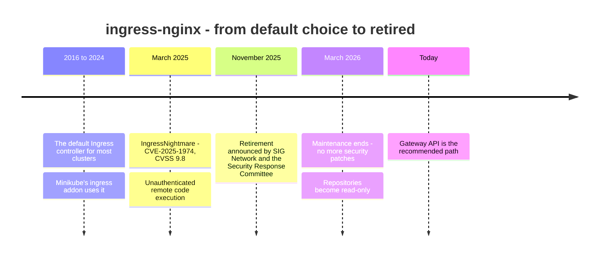

### What "retired" does NOT mean

Read this carefully, because people panic about the wrong thing.

| Statement | True or false |
|---|---|
| The **Ingress API** (`kind: Ingress`, `networking.k8s.io/v1`) has been removed from Kubernetes | **False.** The Ingress API is still in Kubernetes and still works. It is frozen (no new features), not removed. |
| Existing ingress-nginx installations stopped working in March 2026 | **False.** They keep running. Nothing turns off. |
| Existing ingress-nginx installations are now a security risk | **True.** The next critical vulnerability will never be patched. |
| F5's **NGINX Ingress Controller** (`nginxinc/kubernetes-ingress`) is also retired | **False.** That is a different product from a different team. Only the community `kubernetes/ingress-nginx` project retired. Check which one you run. |
| The Day 18 Minikube lab is now useless | **False.** It still teaches the Ingress API, which you will meet in thousands of existing clusters. But for anything new, use Gateway API. |

### The real example that sped this up: IngressNightmare

In **March 2025**, security researchers at Wiz disclosed a set of vulnerabilities in ingress-nginx, the worst being **CVE-2025-1974** with a CVSS score of **9.8 out of 10**.

Here is what made it so serious, in plain words:

1. ingress-nginx runs an **admission webhook**: a small web server that checks every Ingress you create.
2. In a default install, that webhook is reachable **from any pod in the cluster**, with no authentication.
3. An attacker who controlled any pod (say, through a bug in some unrelated web app) could send the webhook a specially crafted Ingress object.
4. Because of how the controller tested NGINX configuration, that crafted object led to **running the attacker's code inside the controller pod**.
5. The controller pod, in a default install, can **read every Secret in every namespace**: database passwords, TLS private keys, cloud credentials.

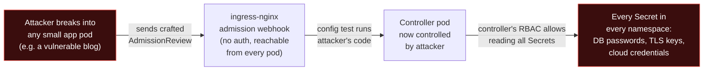

It was patched (versions 1.11.5 and 1.12.1), but it exposed a structural problem. ingress-nginx let users inject raw NGINX configuration through annotations (`configuration-snippet`, `server-snippet`). A huge configuration surface, maintained by a handful of volunteers, sitting in the most privileged position in the cluster, is a security problem by design. The maintainers concluded they could not keep it safe, and the community put its effort into **Gateway API** instead.

> **The lesson for your career:** the component that sits at the edge of your cluster and terminates TLS is the single most attacked piece of your platform. "It works" is not enough; it must be **maintained**. Checking that your edge components are still maintained is part of a DevOps engineer's job.

---

## Real-World Analogy: From a Hotel Receptionist to an Airport

In Day 18 we said Ingress is a **hotel receptionist**: one person at one front door with one instruction sheet. That works for a small hotel. Now think about a big airport like Hyderabad's Rajiv Gandhi International.

- **GatewayClass = the type of terminal and the company that runs it.** "This airport's terminals are run by GMR, built to their standard design." In Kubernetes: "Gateways of class `eg` are run by the Envoy Gateway controller."
- **Gateway = the terminal building itself.** It has entrances (**listeners**): the domestic departures door on one side, the international door with passport control (TLS) on the other. The **airport authority** (platform team) owns the building, decides how many doors it has and who may use them.
- **HTTPRoute = an airline's check-in counter rules.** IndiGo decides "passengers for 6E-xxx flights go to counters 10 to 20". Air India decides its own counters. Each **airline (app team)** manages its own rules **without asking the airport to rebuild the terminal**.
- **allowedRoutes = the airport's list of licensed airlines.** An unlicensed airline cannot just put up a counter and start checking in passengers. (In the lab, a namespace without the right label cannot attach a route.)
- **ReferenceGrant = a signed permission letter.** If the IndiGo counter wants to send baggage onto the Air India conveyor, Air India must sign a letter allowing it. One team cannot route traffic into another team's services unless the other team agrees.
- **Status conditions = the departures board.** Every counter shows whether it is open, delayed or closed and **why**. With Ingress, the receptionist never told you whether she had read your instruction sheet.

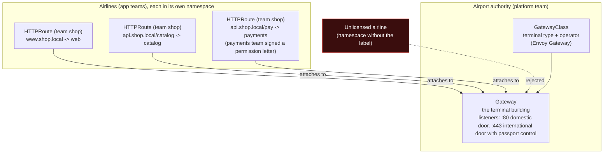

---

## Part 1: What Was Wrong With Ingress (Five Problems)

Gateway API was not built because Ingress was "old". It was built because Ingress had specific design problems that every large company hit. Understand these and you understand every design decision in Gateway API.

### Problem 1: Annotation soup (and it is different for every controller)

The Ingress spec only knows **host**, **path**, **backend** and **TLS secret**. Everything else, such as rewrites, redirects, timeouts, body size limits, CORS, canary weights and rate limits, had to be bolted on through **annotations**, which are just free-text strings that the API server does not validate.

Here is the **same requirement**, "strip the `/catalog` prefix before sending to the backend", on three popular controllers:

```yaml
# ingress-nginx
nginx.ingress.kubernetes.io/rewrite-target: /$2        # plus a regex path like /catalog(/|$)(.*)

# Traefik (needs a separate Middleware object too)
traefik.ingress.kubernetes.io/router.middlewares: shop-strip-catalog@kubernetescrd

# AWS Load Balancer Controller
# (ALB could not rewrite paths at all for years - you had to change the app)
```

Consequences:

- **Not portable.** Moving from one controller to another means rewriting every Ingress.
- **Not validated.** A typo like `nginx.ingress.kubernetes.io/rewrite-targt` is accepted silently and simply does nothing. You find out in production.
- **Not reviewable.** A security reviewer cannot tell from the schema what an annotation does.

### Problem 2: One object mixes two jobs owned by two teams

An Ingress object contains:

- **Infrastructure decisions**: which load balancer, which ports, which TLS certificate. These belong to the **platform team**.
- **Application decisions**: which path goes to which service. These belong to the **app team**.

Kubernetes RBAC works per object type, not per field. So either the app team gets permission to edit Ingress objects (and can also change TLS settings and load balancer annotations), or every path change becomes a ticket to the platform team. Neither is good.

### Problem 3: Only basic HTTP routing

The Ingress spec has no way to express:

- Route by **header** (for example `x-beta-user: true`) or by **query parameter** or **HTTP method**.
- **Split traffic by weight** (90% to v1, 10% to v2).
- **Mirror** traffic to a test service.
- Route **gRPC**, **TCP**, **UDP** or **TLS passthrough** traffic.

ingress-nginx supported canaries only through a hack: a **second** Ingress object with `canary: "true"` and `canary-weight: "10"` annotations, with confusing rules about which Ingress "wins".

### Problem 4: No feedback when you get it wrong

Apply an Ingress with a backend Service name that does not exist. `kubectl apply` says `created`. `kubectl get ingress` looks fine. Traffic returns 503. Nothing tells you why unless you read controller logs. Ingress has almost no **status** reporting.

### Problem 5: No safe multi-tenancy

Two teams in two namespaces can both create an Ingress for `www.shop.com`. What happens depends on the controller (often "the oldest wins", sometimes "they are merged"). A mistake or a malicious team in a shared cluster can **take over another team's hostname**, and nothing in the Ingress API prevents it.

### How Gateway API answers each problem

| Ingress problem | Gateway API answer | Where you see it in the lab |
|---|---|---|
| Annotation soup | Rewrites, redirects, header changes, weights and matches are **typed fields** in the spec, validated by the API server | Step 4: `URLRewrite` filter |
| One object, two owners | **Separate objects**: Gateway (platform team) and HTTPRoute (app team), so RBAC can split them | Steps 1 and 3 |
| Basic routing only | Header, query, method matches; weights; mirroring; GRPCRoute, TCPRoute, UDPRoute, TLSRoute | Step 5: canary and beta header |
| No feedback | Every object has **status conditions** that explain exactly what is wrong | Every step |
| No safe multi-tenancy | `allowedRoutes` on the Gateway and **ReferenceGrant** for cross-namespace references | Steps 7 and 8 |

---

## Part 2: The Gateway API Resource Model

### The objects

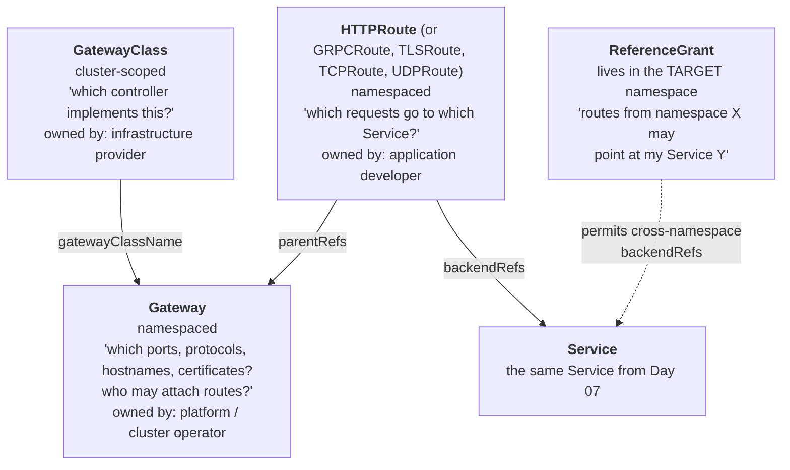

| Object | Scope | Who owns it | One-line purpose | Maturity |
|---|---|---|---|---|
| **GatewayClass** | Cluster | Infra provider (cloud, or whoever installs the controller) | Names the controller that will implement Gateways of this class | GA (Standard channel) since v1.0, Oct 2023 |
| **Gateway** | Namespace | Platform team | A real load balancer or proxy: listeners (port + protocol + hostname + TLS) and who may attach | GA since v1.0 |
| **HTTPRoute** | Namespace | App team | HTTP routing rules: matches, filters, backends, weights | GA since v1.0 |
| **GRPCRoute** | Namespace | App team | Routing for gRPC by service and method | GA since v1.1, May 2024 |
| **ReferenceGrant** | Namespace | Owner of the target | Allows references from another namespace | Standard channel |
| **BackendTLSPolicy** | Namespace | App or platform team | TLS from the Gateway to the backend (re-encryption) | Standard channel since v1.4, Oct 2025 |
| **TCPRoute, UDPRoute** | Namespace | App team | Layer 4 routing | Experimental channel |

> **Release channels:** Gateway API ships two bundles of CRDs. **Standard** contains the stable, GA resources. **Experimental** adds resources and fields still being designed. The latest release at the time of writing is **v1.7.0 (October 2026)**, which promoted HTTPRoute **retries** to Standard. Envoy Gateway v1.9.3, used in this lab, installs the v1.6.1 experimental bundle for you.

### The three personas

This is the heart of the design. Gateway API is built around **who does what** in a real company.

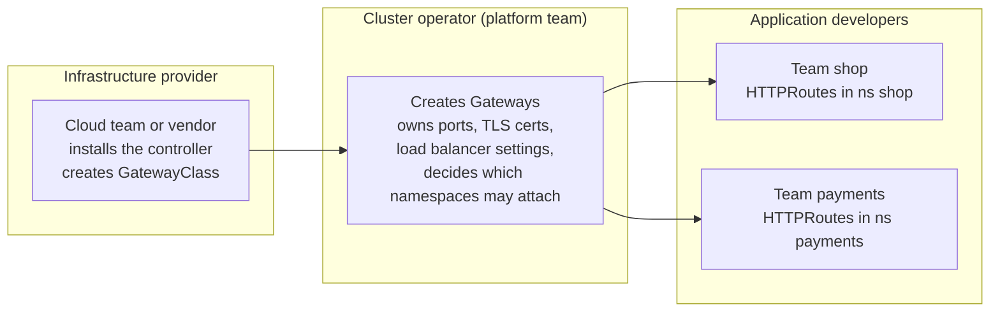

Because each persona edits a **different object kind**, RBAC from Day 17 can now express the real organisation:

```yaml
# App developers in namespace 'shop' can manage routes, but cannot touch Gateways
apiVersion: rbac.authorization.k8s.io/v1
kind: Role
metadata:
  name: route-editor
  namespace: shop
rules:
- apiGroups: ["gateway.networking.k8s.io"]
  resources: ["httproutes", "grpcroutes"]
  verbs: ["get", "list", "watch", "create", "update", "patch", "delete"]
# Note: no "gateways" resource here, and Gateways live in the 'infra' namespace anyway.
```

**Real example.** A Bengaluru fintech with 40 microservice teams runs one shared Gateway per environment. The platform team of four people owns the Gateway, the wildcard certificate `*.api.company.in` and the AWS load balancer. Each squad owns HTTPRoutes in its own namespace and ships routing changes (new paths, canaries) through its own CI pipeline without filing a ticket. That was impossible to do safely with Ingress.

---

## Part 3: How It Works Inside

### What the controller actually does

A Gateway API **implementation** (also called a controller) is a program running in your cluster that watches Gateway API objects and turns them into a real, working proxy. Different implementations use different proxies (Envoy, NGINX, HAProxy, a cloud load balancer), but they all follow the same steps.

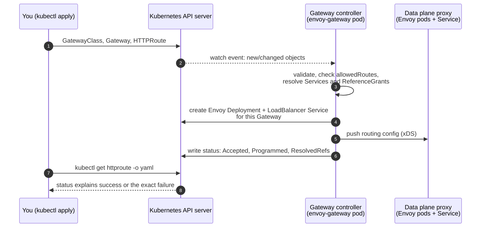

Two things to notice:

1. **The controller and the proxy are separate.** The controller (`envoy-gateway`) is the brain; the Envoy pods are the muscle that carry traffic. If the controller crashes, traffic keeps flowing with the last good configuration.
2. **Status is written back.** Step 6 in the diagram is the feature Ingress never had. You will rely on it in every lab step.

### What one request goes through

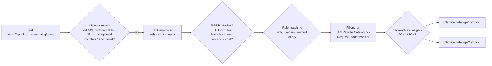

### The status conditions you must know

| Object | Condition | `True` means | Common `False` reasons |
|---|---|---|---|
| GatewayClass | `Accepted` | A controller recognised this class | No controller installed for this `controllerName` |
| Gateway | `Accepted` | Controller took ownership of this Gateway | Invalid listener config, unsupported protocol |
| Gateway | `Programmed` | The data plane is ready **and an address is assigned** | `AddressNotAssigned` (no LoadBalancer IP yet) |
| HTTPRoute (per parent) | `Accepted` | Route successfully attached to the Gateway | `NotAllowedByListeners`, `NoMatchingListenerHostname`, `NoMatchingParent` |
| HTTPRoute (per parent) | `ResolvedRefs` | All backends exist and are permitted | `BackendNotFound`, `RefNotPermitted` |

Read the HTTPRoute status with this one-liner. You will use it constantly:

```bash
kubectl get httproute <name> -n <ns> \
  -o jsonpath='{range .status.parents[*].conditions[*]}{.type}={.status} {.reason}: {.message}{"\n"}{end}'
```

---

## Part 4: Choosing an Implementation

Gateway API is only a **specification**, like the Ingress API. You need an implementation. All of these pass the official conformance tests for the core features, so the YAML you learn today works on all of them.

| Implementation | Proxy | Typical use | Notes |
|---|---|---|---|
| **Envoy Gateway** | Envoy | General purpose, any cluster | CNCF Envoy project; simple Helm install; **used in this lab** |
| **NGINX Gateway Fabric** | NGINX | Teams who want NGINX | From F5/NGINX, actively maintained |
| **Istio** | Envoy | Clusters that also run a service mesh | Gateway API is Istio's recommended ingress API; also used for mesh waypoints (Day 24) |
| **Cilium** | Envoy + eBPF | Clusters already using Cilium as CNI | No separate controller to install |
| **Traefik, Kong, HAProxy** | Their own | Existing users of those products | Full Gateway API support |
| **AWS Load Balancer Controller** | AWS ALB / NLB | EKS | Gateway API support is GA in v3.x; Part 7 |
| **GKE Gateway controller** | Google Cloud LB | GKE | Built in to GKE |

**How to choose, in practice:**

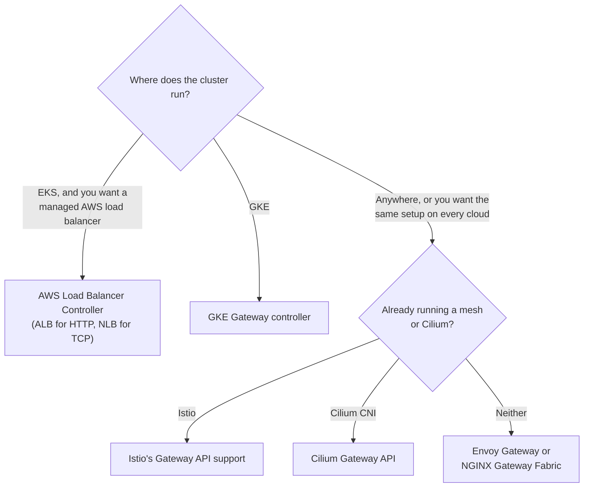

---

## Part 5: Anatomy of the YAML, Field by Field

### GatewayClass

```yaml
apiVersion: gateway.networking.k8s.io/v1
kind: GatewayClass
metadata:
  name: eg                       # Gateways refer to this name in gatewayClassName
spec:
  controllerName: gateway.envoyproxy.io/gatewayclass-controller
  # ^ Must exactly match the name the installed controller announces.
  #   Envoy Gateway:  gateway.envoyproxy.io/gatewayclass-controller
  #   AWS LBC (ALB):  gateway.k8s.aws/alb
  #   Istio:          istio.io/gateway-controller
```

Think of it like a StorageClass from Day 12: a StorageClass says "volumes of this class are made by the EBS CSI driver"; a GatewayClass says "Gateways of this class are made by Envoy Gateway".

### Gateway

```yaml
apiVersion: gateway.networking.k8s.io/v1
kind: Gateway
metadata:
  name: shop-gateway
  namespace: infra                # platform team's namespace
spec:
  gatewayClassName: eg            # which controller builds this Gateway
  listeners:                      # each listener = one "entrance"
  - name: http                    # routes can target a listener by this name (sectionName)
    protocol: HTTP                # HTTP, HTTPS, TLS, TCP, UDP
    port: 80
    hostname: "*.shop.local"      # only requests for these hosts enter through this listener
    allowedRoutes:                # WHO may attach routes to this listener
      namespaces:
        from: Selector            # Same (default) | All | Selector
        selector:
          matchLabels:
            shared-gateway-access: "true"
  - name: https
    protocol: HTTPS
    port: 443
    hostname: "*.shop.local"
    tls:
      mode: Terminate             # decrypt here; Passthrough would forward encrypted bytes
      certificateRefs:
      - kind: Secret
        name: shop-tls            # a kubernetes.io/tls Secret in the SAME namespace as the Gateway
    allowedRoutes:
      namespaces:
        from: Selector
        selector:
          matchLabels:
            shared-gateway-access: "true"
```

**`allowedRoutes.namespaces.from` explained:**

| Value | Who may attach routes | When to use |
|---|---|---|
| `Same` (default) | Only routes in the Gateway's own namespace | One team owns both Gateway and routes |
| `All` | Routes from **any** namespace | Small trusted clusters only; anyone can attach |
| `Selector` | Only namespaces whose **labels** match | Shared Gateways in multi-team clusters (recommended) |

> **Security note:** labelling a namespace usually needs only `patch` on namespaces. In a strict cluster, restrict who can add the `shared-gateway-access` label (with RBAC, or with a policy engine like Kyverno, which you meet in Day 25). Otherwise the label is a lock whose key everyone holds.

### HTTPRoute

```yaml
apiVersion: gateway.networking.k8s.io/v1
kind: HTTPRoute
metadata:
  name: catalog
  namespace: shop                     # app team's namespace
spec:
  parentRefs:                         # which Gateway(s) to attach to
  - name: shop-gateway
    namespace: infra                  # Gateway is in another namespace: allowed by its allowedRoutes
    sectionName: https                # attach ONLY to the 'https' listener (important, see Step 6)
  hostnames:
  - "api.shop.local"                  # must fall inside the listener's hostname (*.shop.local)
  rules:
  - matches:                          # ALL conditions inside one match must be true (AND)
    - path:
        type: PathPrefix              # Exact | PathPrefix | RegularExpression (implementation-specific)
        value: /catalog
      headers:
      - name: x-beta-user
        value: "true"
    filters:                          # change the request/response on the way through
    - type: URLRewrite
      urlRewrite:
        path:
          type: ReplacePrefixMatch
          replacePrefixMatch: /       # /catalog/items/42 -> /items/42
    backendRefs:                      # where to send it
    - name: catalog-v2
      port: 80
```

**The match logic, which trips everyone up:**

- Inside **one match** (one list item under `matches`), all conditions are **ANDed**: path AND headers AND method AND query must all match.
- **Multiple matches** in the same rule are **ORed**: if any one matches, the rule applies.
- When several rules across routes could match the same request, the **most specific wins**, in this order: exact path over prefix; longer prefix over shorter; more header matches over fewer; more query matches over fewer; and finally the **oldest route** (by creation time) wins a tie.

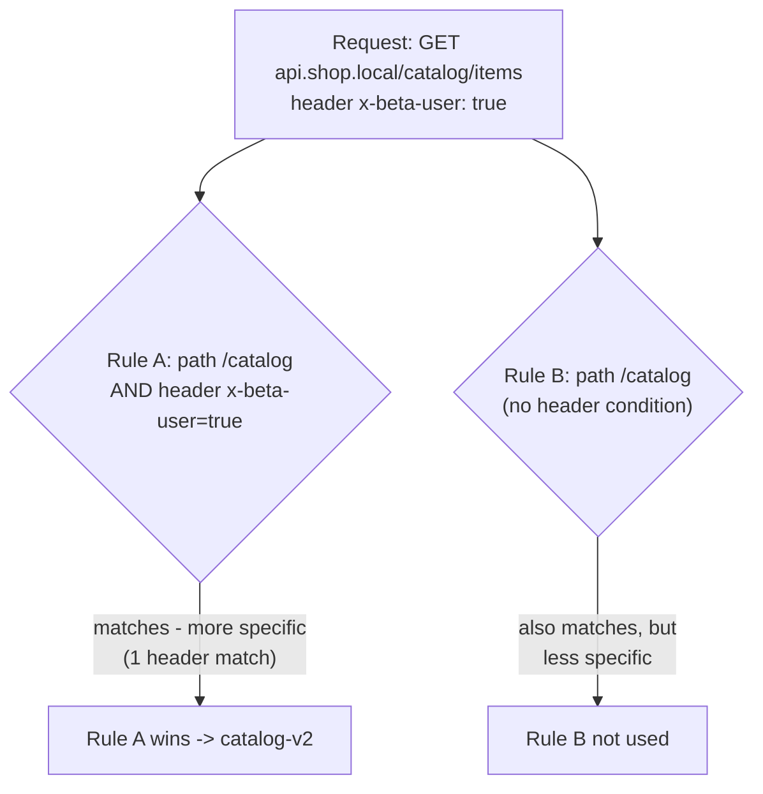

**The core filters:**

| Filter | What it does | Ingress-nginx equivalent |
|---|---|---|
| `RequestRedirect` | Return 301/302 with a new scheme, host, port or path | `ssl-redirect`, `permanent-redirect` annotations |
| `URLRewrite` | Change host or path before forwarding | `rewrite-target` annotation |
| `RequestHeaderModifier` | Add, set or remove request headers | `configuration-snippet` with `proxy_set_header` |
| `ResponseHeaderModifier` | Add, set or remove response headers | `configuration-snippet` with `add_header` |
| `RequestMirror` | Send a copy of traffic to another backend (responses ignored) | `mirror-target` annotation |

---

## Hands-On Lab: ShopKart on One Shared Gateway

### The scenario

You are the DevOps engineer at **ShopKart**, a Hyderabad e-commerce startup. The Diwali sale starts in two weeks. Three teams share one Kubernetes cluster:

- **Platform team** (you): owns the `infra` namespace and the single public entry point.
- **Shop team**: owns the `shop` namespace: the website (`web`) and the product catalog API (`catalog-v1`, plus a new `catalog-v2` with faster search that must be canary-tested before the sale).
- **Payments team**: owns the `payments` namespace. They are careful about who sends them traffic.
- A **marketing intern** has a namespace too, and will try to put a promo page on the homepage.

By the end, the setup looks like this:

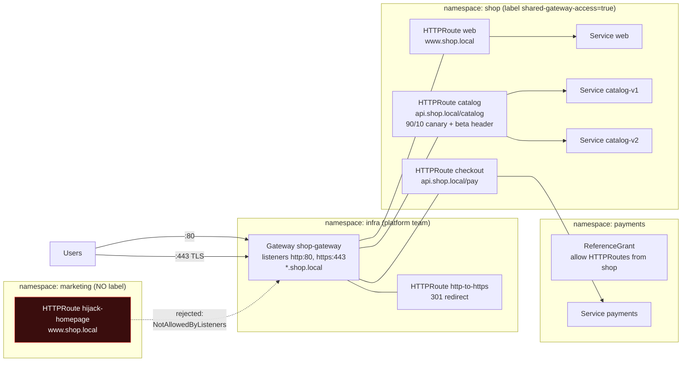

All backends use `registry.k8s.io/gateway-api/echo-basic`, a tiny server from the Gateway API project that replies with JSON describing the request it received: path, host, headers, and the **pod name** that answered. That makes every routing decision visible.

### Step 0: Start a cluster and install Envoy Gateway

```bash
# A separate Minikube profile keeps this lab away from your other work
minikube start -p gw-lab --driver=docker --cpus=2 --memory=4096

# Install Envoy Gateway. This Helm chart also installs the Gateway API CRDs.
helm install eg oci://docker.io/envoyproxy/gateway-helm \
  --version v1.9.3 \
  -n envoy-gateway-system --create-namespace

# Wait for the controller
kubectl wait --timeout=5m -n envoy-gateway-system \
  deployment/envoy-gateway --for=condition=Available
# deployment.apps/envoy-gateway condition met
```

Check that the Gateway API resource types now exist:

```bash
kubectl get crd | grep gateway.networking
# backendtlspolicies.gateway.networking.k8s.io
# gatewayclasses.gateway.networking.k8s.io
# gateways.gateway.networking.k8s.io
# grpcroutes.gateway.networking.k8s.io
# httproutes.gateway.networking.k8s.io
# listenersets.gateway.networking.k8s.io
# referencegrants.gateway.networking.k8s.io
# tcproutes.gateway.networking.k8s.io
# tlsroutes.gateway.networking.k8s.io
# udproutes.gateway.networking.k8s.io
```

> **On a managed cluster** (EKS, GKE, AKS) the provider may already manage the Gateway API CRDs. Do not install a second copy over them; follow the provider's instructions. Two tools fighting over the same CRDs is a classic outage.

### Step 1: The platform team creates the GatewayClass and the Gateway

`01-gatewayclass.yaml`:

```yaml
apiVersion: gateway.networking.k8s.io/v1
kind: GatewayClass
metadata:
  name: eg
spec:
  controllerName: gateway.envoyproxy.io/gatewayclass-controller
```

`02-gateway.yaml`:

```yaml
apiVersion: v1
kind: Namespace
metadata:
  name: infra
---
apiVersion: gateway.networking.k8s.io/v1
kind: Gateway
metadata:
  name: shop-gateway
  namespace: infra
spec:
  gatewayClassName: eg
  listeners:
  - name: http
    protocol: HTTP
    port: 80
    hostname: "*.shop.local"
    allowedRoutes:
      namespaces:
        from: Selector
        selector:
          matchLabels:
            shared-gateway-access: "true"
```

```bash
kubectl apply -f 01-gatewayclass.yaml -f 02-gateway.yaml

kubectl get gatewayclass
# NAME   CONTROLLER                                      ACCEPTED   AGE
# eg     gateway.envoyproxy.io/gatewayclass-controller   True       2m15s

kubectl get gateway -n infra
# NAME           CLASS   ADDRESS   PROGRAMMED   AGE
# shop-gateway   eg                False        2m15s
```

**`PROGRAMMED False`. Is something broken?** Do not guess; read the status:

```bash
kubectl get gateway shop-gateway -n infra \
  -o jsonpath='{range .status.conditions[*]}{.type}={.status} {.reason}: {.message}{"\n"}{end}'
# Accepted=True Accepted: The Gateway has been scheduled by Envoy Gateway
# Programmed=False AddressNotAssigned: No addresses have been assigned to the Gateway
```

And look at what the controller created for you:

```bash
kubectl get pods,svc -n envoy-gateway-system
# pod/envoy-gateway-7c649fd85d-sbzpc                        1/1   Running
# pod/envoy-infra-shop-gateway-024f03a1-6cc848c6b5-cswvp    2/2   Running
# service/envoy-gateway                       ClusterIP      10.105.116.255   <none>
# service/envoy-infra-shop-gateway-024f03a1   LoadBalancer   10.102.15.196    <pending>   80:30310/TCP
```

So the story is clear:

- Envoy Gateway **accepted** our Gateway and started an **Envoy proxy pod** for it (`envoy-infra-shop-gateway-...`).
- It created a **LoadBalancer Service** for that proxy, exactly as a cloud would need.
- Minikube has no cloud load balancer, so the Service stays `<pending>` and the Gateway has **no address**, hence `AddressNotAssigned`.

The proxy itself is running fine. On EKS this would become an AWS load balancer and `PROGRAMMED` would turn `True`. On Minikube you have two options:

```bash
# Option A (used in this lab): port-forward to the Envoy Service
SVC=$(kubectl get svc -n envoy-gateway-system \
  --selector=gateway.envoyproxy.io/owning-gateway-namespace=infra,gateway.envoyproxy.io/owning-gateway-name=shop-gateway \
  -o jsonpath='{.items[0].metadata.name}')
kubectl -n envoy-gateway-system port-forward service/$SVC 8080:80 &

# Option B: in a separate terminal (needs admin rights on Windows/macOS),
# 'minikube tunnel -p gw-lab' gives LoadBalancer Services a real IP,
# and the Gateway becomes PROGRAMMED=True.
```

> **Real-world note:** the controller creates **one proxy Deployment and one load balancer per Gateway**. On a cloud, every Gateway costs a load balancer (an AWS Application Load Balancer in Mumbai costs about ₹1,500 a month just to exist, before traffic charges). That is why companies share a few Gateways across many teams instead of creating one per app.

### Step 2: The shop team deploys its apps

`03-apps.yaml` creates the `shop` namespace **with the label the Gateway asks for**, plus three Deployments and Services. One of the three is shown here; `catalog-v1` and `catalog-v2` are identical apart from the name.

```yaml
apiVersion: v1
kind: Namespace
metadata:
  name: shop
  labels:
    shared-gateway-access: "true"     # the platform team's "licence" to attach routes
---
apiVersion: apps/v1
kind: Deployment
metadata:
  name: web
  namespace: shop
spec:
  replicas: 1
  selector:
    matchLabels:
      app: web
  template:
    metadata:
      labels:
        app: web
    spec:
      containers:
      - name: echo
        image: registry.k8s.io/gateway-api/echo-basic:v1.5.1
        ports:
        - containerPort: 3000
        env:                            # echo-basic reports these in its reply
        - name: POD_NAME
          valueFrom:
            fieldRef:
              fieldPath: metadata.name
        - name: NAMESPACE
          valueFrom:
            fieldRef:
              fieldPath: metadata.namespace
---
apiVersion: v1
kind: Service
metadata:
  name: web
  namespace: shop
spec:
  selector:
    app: web
  ports:
  - port: 80
    targetPort: 3000
# ... repeat the Deployment + Service for catalog-v1 and catalog-v2
```

```bash
kubectl apply -f 03-apps.yaml
kubectl -n shop wait --for=condition=Available deploy --all --timeout=180s
# deployment.apps/catalog-v1 condition met
# deployment.apps/catalog-v2 condition met
# deployment.apps/web condition met
```

### Step 3: Host-based routing for the website

`04-route-web.yaml`:

```yaml
apiVersion: gateway.networking.k8s.io/v1
kind: HTTPRoute
metadata:
  name: web
  namespace: shop
spec:
  parentRefs:
  - name: shop-gateway
    namespace: infra
  hostnames:
  - "www.shop.local"
  rules:
  - backendRefs:
    - name: web
      port: 80
```

No `matches` means "match everything for this hostname" (path prefix `/`).

```bash
kubectl apply -f 04-route-web.yaml

curl -s -H "Host: www.shop.local" http://localhost:8080/
# {
#  "path": "/",
#  "host": "www.shop.local",
#  "method": "GET",
#  ...
#  "namespace": "shop",
#  "pod": "web-ccf965d6b-q475k"
# }

# A hostname nobody configured gets a 404 from the Gateway itself
curl -s -o /dev/null -w "%{http_code}\n" -H "Host: www.other.com" http://localhost:8080/
# 404
```

> We pass `-H "Host: ..."` so you do not have to edit your hosts file. In production, DNS points `www.shop.com` at the load balancer and browsers send the Host header automatically.

### Step 4: Path routing with a rewrite (the Day 18 problem, solved without annotations)

In Day 18 the backend expected `/` but users called `/app1`, so you needed the `nginx.ingress.kubernetes.io/rewrite-target: /` annotation. Here is the same idea as **typed, validated fields**, plus a header that tells the backend the request came through the Gateway.

`05-route-catalog.yaml`:

```yaml
apiVersion: gateway.networking.k8s.io/v1
kind: HTTPRoute
metadata:
  name: catalog
  namespace: shop
spec:
  parentRefs:
  - name: shop-gateway
    namespace: infra
  hostnames:
  - "api.shop.local"
  rules:
  - matches:
    - path:
        type: PathPrefix
        value: /catalog
    filters:
    - type: URLRewrite                  # replaces the rewrite-target annotation
      urlRewrite:
        path:
          type: ReplacePrefixMatch
          replacePrefixMatch: /
    - type: RequestHeaderModifier       # replaces configuration-snippet hacks
      requestHeaderModifier:
        add:
        - name: x-routed-by
          value: shop-gateway
    backendRefs:
    - name: catalog-v1
      port: 80
```

```bash
kubectl apply -f 05-route-catalog.yaml

# Did the route attach and resolve? Ask it.
kubectl get httproute catalog -n shop \
  -o jsonpath='{range .status.parents[*].conditions[*]}{.type}={.status} {.reason}{"\n"}{end}'
# Accepted=True Accepted
# ResolvedRefs=True ResolvedRefs

curl -s -H "Host: api.shop.local" http://localhost:8080/catalog/items/42
# {
#  "path": "/items/42",                   <- /catalog prefix stripped
#  "host": "api.shop.local",
#  "headers": {
#   ...
#   "X-Routed-By": ["shop-gateway"]       <- header added by the Gateway
#  },
#  "pod": "catalog-v1-7c85bf997-trt8k"
# }

# Paths no rule matches get a 404
curl -s -o /dev/null -w "%{http_code}\n" -H "Host: api.shop.local" http://localhost:8080/orders
# 404
```

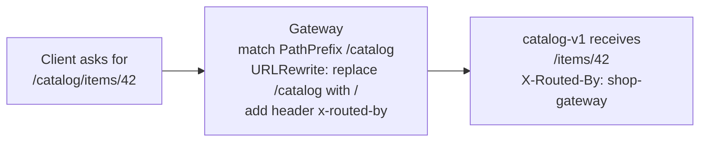

### Step 5: Canary release and header-based routing (the Diwali sale)

**The real situation.** `catalog-v2` has a new search engine. It is faster in testing, but nobody knows how it behaves with real traffic. Two weeks before the sale, the shop team wants to:

1. Send **every request from internal beta testers** (the app adds header `x-beta-user: true` for staff accounts) to v2.
2. Send **10% of real customers** to v2 and watch the error rate and latency dashboards (Day 21).
3. If all is well, go 50/50, then 100% to v2. If anything breaks, go back to 100% v1 **in seconds**.

With ingress-nginx this needed a second "canary" Ingress object and special annotations. Here it is one HTTPRoute with two rules.

`06-route-catalog-canary.yaml`:

```yaml
apiVersion: gateway.networking.k8s.io/v1
kind: HTTPRoute
metadata:
  name: catalog
  namespace: shop
spec:
  parentRefs:
  - name: shop-gateway
    namespace: infra
  hostnames:
  - "api.shop.local"
  rules:
  # Rule 1: beta testers always get v2
  - matches:
    - path:
        type: PathPrefix
        value: /catalog
      headers:
      - name: x-beta-user
        value: "true"
    filters:
    - type: URLRewrite
      urlRewrite:
        path:
          type: ReplacePrefixMatch
          replacePrefixMatch: /
    backendRefs:
    - name: catalog-v2
      port: 80
  # Rule 2: everyone else is split 90/10
  - matches:
    - path:
        type: PathPrefix
        value: /catalog
    filters:
    - type: URLRewrite
      urlRewrite:
        path:
          type: ReplacePrefixMatch
          replacePrefixMatch: /
    backendRefs:
    - name: catalog-v1
      port: 80
      weight: 90
    - name: catalog-v2
      port: 80
      weight: 10
```

```bash
kubectl apply -f 06-route-catalog-canary.yaml

# Send 200 normal requests and count which version answered
for i in $(seq 1 200); do
  curl -s -H "Host: api.shop.local" http://localhost:8080/catalog/items \
    | grep '"pod"' | sed -E 's/.*"(catalog-v[12]).*/\1/'
done | sort | uniq -c
#     181 catalog-v1
#      19 catalog-v2          <- about 10%, as configured

# Beta testers: always v2
for i in $(seq 1 20); do
  curl -s -H "Host: api.shop.local" -H "x-beta-user: true" http://localhost:8080/catalog/items \
    | grep '"pod"' | sed -E 's/.*"(catalog-v[12]).*/\1/'
done | sort | uniq -c
#      20 catalog-v2
```

Weights are **relative**, not percentages: `90` and `10` mean 90/(90+10). `9` and `1` would behave the same. Weighted routing is **per request**, so 181/19 out of 200 is normal randomness around 90/10.

**The rollout and rollback plan, as a timeline:**

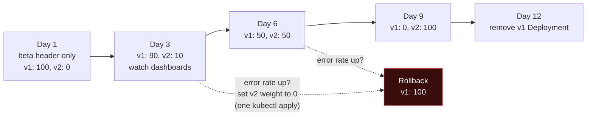

> **In real companies** nobody edits weights by hand at 2 AM. Tools such as **Argo Rollouts** and **Flagger** change the HTTPRoute weights automatically, step by step, and roll back on their own if Prometheus metrics (error rate, p99 latency) cross a threshold. Both can drive Gateway API routes (Argo Rollouts through its Gateway API plugin). This is called **progressive delivery**, and you will see it in the CI/CD module.

### Step 6: HTTPS and the HTTP to HTTPS redirect (with two real mistakes)

**What we want:** all traffic encrypted. Port 80 should only redirect to 443. The certificate is managed by the platform team, so app teams never see the private key.

**6a. Create a certificate.** Self-signed for the lab; in production you would use **cert-manager** with Let's Encrypt, which has native Gateway API support.

```bash
openssl req -x509 -nodes -newkey rsa:2048 -days 365 \
  -keyout shop.key -out shop.crt \
  -subj "/CN=*.shop.local" -addext "subjectAltName=DNS:*.shop.local"

# The Secret lives with the Gateway, in the platform team's namespace
kubectl create secret tls shop-tls -n infra --cert=shop.crt --key=shop.key
# secret/shop-tls created
```

> On Git Bash for Windows, prefix the `openssl` command with `MSYS_NO_PATHCONV=1` so `/CN=...` is not converted into a Windows path.

**6b. Add an HTTPS listener to the Gateway** (`07-gateway-https.yaml`): the same Gateway as Step 1 plus this second listener.

```yaml
  - name: https
    protocol: HTTPS
    port: 443
    hostname: "*.shop.local"
    tls:
      mode: Terminate
      certificateRefs:
      - kind: Secret
        name: shop-tls
    allowedRoutes:
      namespaces:
        from: Selector
        selector:
          matchLabels:
            shared-gateway-access: "true"
```

**6c. Redirect route on the HTTP listener, and move the website to HTTPS** (`08-redirect-and-web-https.yaml`):

```yaml
# Owned by the platform team: anything on port 80 gets a 301 to https
apiVersion: gateway.networking.k8s.io/v1
kind: HTTPRoute
metadata:
  name: http-to-https
  namespace: infra
spec:
  parentRefs:
  - name: shop-gateway
    sectionName: http            # ONLY the port-80 listener
  hostnames:
  - "*.shop.local"
  rules:
  - filters:
    - type: RequestRedirect
      requestRedirect:
        scheme: https
        statusCode: 301
---
# The website now attaches ONLY to the https listener
apiVersion: gateway.networking.k8s.io/v1
kind: HTTPRoute
metadata:
  name: web
  namespace: shop
spec:
  parentRefs:
  - name: shop-gateway
    namespace: infra
    sectionName: https
  hostnames:
  - "www.shop.local"
  rules:
  - backendRefs:
    - name: web
      port: 80
```

```bash
kubectl apply -f 07-gateway-https.yaml -f 08-redirect-and-web-https.yaml

kubectl get httproute http-to-https -n infra \
  -o jsonpath='{range .status.parents[*].conditions[*]}{.type}={.status} {.reason}: {.message}{"\n"}{end}'
# Accepted=False NotAllowedByListeners: No listeners included by this parent ref allowed this attachment.
# ResolvedRefs=True ResolvedRefs: Resolved all the Object references for the Route
```

**Mistake 1, caught by status.** The redirect route lives in the `infra` namespace, but the listeners only accept routes from namespaces labelled `shared-gateway-access: "true"`, and we never labelled `infra`. The Gateway's own namespace gets no special treatment once you use `from: Selector`. With Ingress this would have failed silently; here the status tells you the exact reason.

```bash
kubectl label namespace infra shared-gateway-access=true
# Status now: Accepted=True Accepted

# Port-forward both ports this time
kubectl -n envoy-gateway-system port-forward service/$SVC 8080:80 8443:443 &

curl -s -i -H "Host: www.shop.local" http://localhost:8080/products | head -2
# HTTP/1.1 301 Moved Permanently
# location: https://www.shop.local/products

curl -s -k --resolve www.shop.local:8443:127.0.0.1 https://www.shop.local:8443/products
# {"path": "/products", "host": "www.shop.local:8443", ... "pod": "web-ccf965d6b-q475k"}

# Look at the certificate the Gateway serves
echo | openssl s_client -connect 127.0.0.1:8443 -servername www.shop.local 2>/dev/null \
  | grep -E "subject=|Protocol"
# subject=CN=*.shop.local
# Protocol: TLSv1.3
```

(`-k` tells curl to accept our self-signed certificate. `--resolve` makes curl send the right hostname for TLS SNI while connecting to localhost.)

**Mistake 2, the silent bypass.** Now test the API over plain HTTP:

```bash
curl -s -i -H "Host: api.shop.local" http://localhost:8080/catalog/x | head -1
# HTTP/1.1 200 OK            <- NOT redirected! Plain HTTP still works for the API.
```

Why? The `catalog` route from Step 5 has **no `sectionName`**, so it attached to **both** listeners, including port 80. On the HTTP listener there are now two candidates for `api.shop.local`: the redirect route (hostname `*.shop.local`) and the catalog route (hostname `api.shop.local`). The **more specific hostname wins**, so the catalog route serves the request in plain text and the redirect never runs.

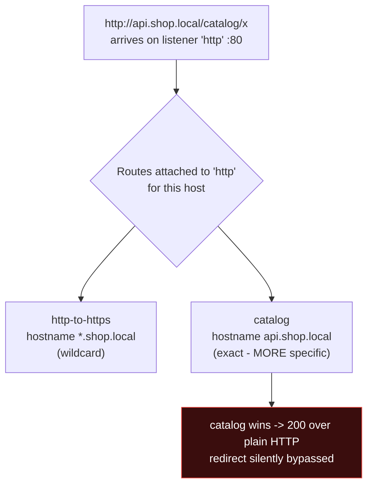

**Fix:** pin the app route to the HTTPS listener (`12-route-catalog-https.yaml`, the canary route with one added line):

```yaml
  parentRefs:
  - name: shop-gateway
    namespace: infra
    sectionName: https          # <- the fix
```

```bash
kubectl apply -f 12-route-catalog-https.yaml

curl -s -i -H "Host: api.shop.local" http://localhost:8080/catalog/x | head -2
# HTTP/1.1 301 Moved Permanently
# location: https://api.shop.local/catalog/x

curl -s -k -o /dev/null -w "%{http_code}\n" --resolve api.shop.local:8443:127.0.0.1 \
  https://api.shop.local:8443/catalog/x
# 200
```

> **Rule to remember:** when a Gateway has both HTTP and HTTPS listeners, **every application route must set `sectionName: https`**. Make it part of your code review checklist, or enforce it with a policy (Day 25).

### Step 7: Cross-namespace backends and ReferenceGrant (the payments team)

The shop team wants `api.shop.local/pay` to reach the payments service, which lives in the **payments** team's namespace. The route is in `shop`, the Service is in `payments`.

`09-payments.yaml` creates the namespace, the Deployment and Service `payments`, and this route in `shop`:

```yaml
apiVersion: gateway.networking.k8s.io/v1
kind: HTTPRoute
metadata:
  name: checkout
  namespace: shop
spec:
  parentRefs:
  - name: shop-gateway
    namespace: infra
    sectionName: https
  hostnames:
  - "api.shop.local"
  rules:
  - matches:
    - path:
        type: PathPrefix
        value: /pay
    backendRefs:
    - name: payments
      namespace: payments          # a Service in ANOTHER namespace
      port: 80
```

```bash
kubectl apply -f 09-payments.yaml

kubectl get httproute checkout -n shop \
  -o jsonpath='{range .status.parents[*].conditions[*]}{.type}={.status} {.reason}: {.message}{"\n"}{end}'
# Accepted=True Accepted: Route is accepted
# ResolvedRefs=False RefNotPermitted: Failed to process route rule 0 backendRef 0:
#   Backend ref to Service payments/payments not permitted by any ReferenceGrant.

curl -s -k -o /dev/null -w "%{http_code}\n" --resolve api.shop.local:8443:127.0.0.1 \
  https://api.shop.local:8443/pay
# 500
```

**This is the security feature working.** If any team could point a route at any Service in any namespace, a compromised or careless team could expose another team's internal admin API to the internet. Gateway API says: **the owner of the target must agree**.

The payments team creates a ReferenceGrant **in their own namespace** (`10-referencegrant.yaml`):

```yaml
apiVersion: gateway.networking.k8s.io/v1beta1
kind: ReferenceGrant
metadata:
  name: allow-shop-routes
  namespace: payments              # lives with the THING BEING REFERENCED
spec:
  from:                            # who may reference
  - group: gateway.networking.k8s.io
    kind: HTTPRoute
    namespace: shop
  to:                              # what they may reference
  - group: ""                      # "" = core API group (Services)
    kind: Service
    name: payments                 # only this one Service, not the whole namespace
```

```bash
kubectl apply -f 10-referencegrant.yaml

kubectl get httproute checkout -n shop \
  -o jsonpath='{range .status.parents[*].conditions[*]}{.type}={.status} {.reason}{"\n"}{end}'
# Accepted=True Accepted
# ResolvedRefs=True ResolvedRefs

curl -s -k --resolve api.shop.local:8443:127.0.0.1 https://api.shop.local:8443/pay | grep -E '"(namespace|pod)"'
#  "namespace": "payments",
#  "pod": "payments-84b7f94bf-w6tks"
```

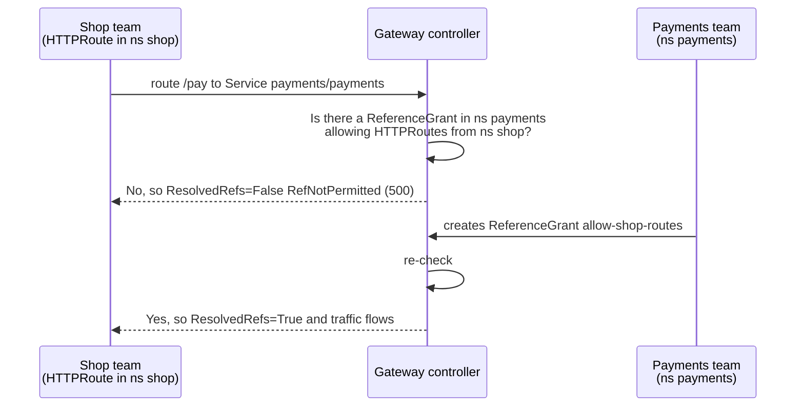

Remember the direction with this sentence: **"the grant lives with the thing being granted."** The same object type also controls a Gateway in one namespace using a certificate Secret from another namespace.

### Step 8: The hostname hijack attempt (the marketing intern)

The marketing intern wants a Diwali promo on the homepage and creates a route for `www.shop.local` in the `marketing` namespace (`11-rogue-route.yaml`):

```yaml
apiVersion: v1
kind: Namespace
metadata:
  name: marketing                    # note: NO shared-gateway-access label
---
apiVersion: gateway.networking.k8s.io/v1
kind: HTTPRoute
metadata:
  name: hijack-homepage
  namespace: marketing
spec:
  parentRefs:
  - name: shop-gateway
    namespace: infra
  hostnames:
  - "www.shop.local"
  rules:
  - backendRefs:
    - name: promo
      port: 80
```

```bash
kubectl apply -f 11-rogue-route.yaml

kubectl get httproute hijack-homepage -n marketing \
  -o jsonpath='{range .status.parents[*].conditions[*]}{.type}={.status} {.reason}: {.message}{"\n"}{end}'
# Accepted=False NotAllowedByListeners: No listeners included by this parent ref allowed this attachment.
# ResolvedRefs=False BackendNotFound: Failed to process route rule 0 backendRef 0: service marketing/promo not found.

# The real homepage is untouched
curl -s -k --resolve www.shop.local:8443:127.0.0.1 https://www.shop.local:8443/ | grep '"pod"'
#  "pod": "web-ccf965d6b-q475k"
```

With a shared Ingress controller and no extra policy, this route would at minimum have competed for the homepage. Here the Gateway refuses it, and the status tells the intern exactly why. Now count what attached where:

```bash
kubectl get gateway shop-gateway -n infra \
  -o jsonpath='{range .status.listeners[*]}{.name}: attachedRoutes={.attachedRoutes}{"\n"}{end}'
# http: attachedRoutes=1        <- only the redirect
# https: attachedRoutes=3       <- web, catalog, checkout
```

That one command is a quick audit of your edge: port 80 has only the redirect, and every app route is on HTTPS.

### Step 9: Clean up

```bash
minikube delete -p gw-lab
```

---

## Part 6: Migrating From Ingress to Gateway API

### Concept mapping

| Ingress (Day 18) | Gateway API |
|---|---|
| IngressClass | GatewayClass |
| The controller's single shared proxy | Gateway (you can have several, each with its own listeners) |
| `spec.tls` + secret in the Ingress | `listeners[].tls.certificateRefs` on the Gateway |
| `spec.rules[].host` | HTTPRoute `hostnames` |
| `spec.rules[].http.paths[]` | HTTPRoute `rules[].matches[].path` |
| `pathType: Prefix` / `Exact` | `PathPrefix` / `Exact` |
| `backend.service.name/port` | `backendRefs[].name/port` |
| `rewrite-target` annotation | `URLRewrite` filter |
| `ssl-redirect` / `force-ssl-redirect` annotation | `RequestRedirect` filter on the HTTP listener |
| `canary` + `canary-weight` annotations (second Ingress) | `weight` on `backendRefs` |
| `canary-by-header` annotation | `matches[].headers` |
| `proxy-body-size`, timeouts, rate limits | Standard `timeouts` field where available; otherwise the implementation's policy objects (for Envoy Gateway: `ClientTrafficPolicy`, `BackendTrafficPolicy`) |
| `configuration-snippet`, `server-snippet` | **No equivalent, on purpose.** Raw config injection was part of the security problem. |

### The ingress2gateway tool

The Kubernetes SIG Network project **ingress2gateway** reads Ingress objects and prints the equivalent Gateway API YAML. Version **1.0** (March 2026) translates more than 30 of the most common ingress-nginx annotations; later releases (v1.2.0, July 2026) have continued to add more.

Install it from the project's GitHub releases page (single binary for Linux, macOS and Windows), with `brew install ingress2gateway`, or with Go:

```bash
go install github.com/kubernetes-sigs/ingress2gateway@v1.2.0
```

Convert the Ingress objects in your current cluster:

```bash
# All namespaces, ingress-nginx annotations understood
ingress2gateway print --providers=ingress-nginx -A > gateway-resources.yaml

# Or from a file, without touching a cluster
ingress2gateway print --providers=ingress-nginx --input-file=path-ingress.yaml

# Emit implementation-specific extras for your target (default is 'standard')
ingress2gateway print --providers=ingress-nginx --emitter=envoy-gateway --input-file=path-ingress.yaml
```

For the Day 18 `path-ingress` (`myapp.local`, `/app1` and `/app2`, `rewrite-target: /`) the output has the following shape. It is shown for illustration; the exact names and fields depend on the version.

```yaml
apiVersion: gateway.networking.k8s.io/v1
kind: Gateway
metadata:
  name: nginx                 # named after the IngressClass
spec:
  gatewayClassName: nginx     # you change this to your real GatewayClass
  listeners:
  - name: myapp-local-http
    hostname: myapp.local
    port: 80
    protocol: HTTP
---
apiVersion: gateway.networking.k8s.io/v1
kind: HTTPRoute
metadata:
  name: path-ingress-myapp-local
spec:
  parentRefs:
  - name: nginx
  hostnames:
  - myapp.local
  rules:
  - matches:
    - path:
        type: PathPrefix
        value: /app1
    filters:
    - type: URLRewrite
      urlRewrite:
        path:
          type: ReplacePrefixMatch
          replacePrefixMatch: /
    backendRefs:
    - name: app1-service
      port: 80
  # ... same for /app2
```

**Treat the output as a first draft, not the answer.** Always review it:

- It may create one Gateway per IngressClass. You probably want your own shared Gateway with `allowedRoutes`.
- It warns about annotations it cannot translate. Each warning is a decision you must make.
- Change `gatewayClassName` to your real implementation.
- Add `sectionName` where you have HTTP and HTTPS listeners (the Step 6 trap).

### A zero-downtime migration runbook

This is how teams actually migrate production, **running both side by side** and moving traffic with DNS, so there is always a fast way back.

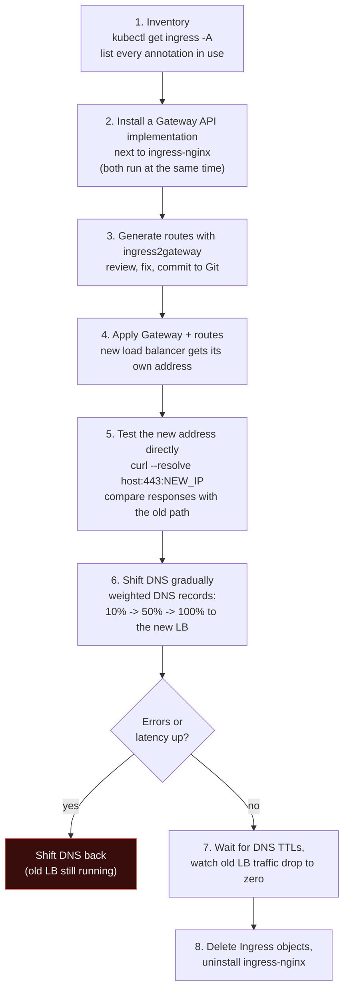

Practical tips from real migrations:

- **Lower DNS TTLs** (for example to 60 seconds) a day before step 6, so traffic moves quickly in both directions.
- **Check client IP handling.** If apps log or rate-limit by client IP, confirm the new proxy passes `X-Forwarded-For` the way the old one did.
- **Check body-size and timeout limits.** ingress-nginx's defaults (for example a 1 MB request body limit) differ from Envoy's. File uploads are a common surprise.
- **Migrate one hostname at a time**, starting with something low-risk such as an internal dashboard.

---

## Part 7: Gateway API on EKS

On EKS, the **AWS Load Balancer Controller** (you installed it in the [Day 18 EKS demo](../day18-ingress-demo/eks-demo.md)) implements Gateway API. Support is **GA since controller v3.0**. Layer 7 HTTPRoute and GRPCRoute (Application Load Balancer) need v2.14 or later, and Layer 4 TCP, UDP and TLS routes (Network Load Balancer) need v2.13.3 or later.

The model is the same as in the lab; only the GatewayClass changes:

```yaml
apiVersion: gateway.networking.k8s.io/v1
kind: GatewayClass
metadata:
  name: aws-alb
spec:
  controllerName: gateway.k8s.aws/alb     # an ALB is created for each Gateway of this class
```

What happens on AWS:

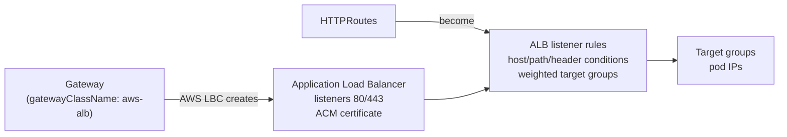

Before you use it, read the controller's Gateway API guide for your version. You need the standard Gateway API CRDs plus the controller's own CRDs (for load balancer settings), and the controller detects the Gateway CRDs to switch the feature on. Not every Gateway API feature maps to an ALB feature; the controller publishes conformance results listing what is supported. On **EKS Auto Mode**, load balancing is built in, so do not also install a self-managed controller that manages the same resources.

---

## Part 8: Beyond HTTP, and the Bridge to Day 24

- **GRPCRoute** routes gRPC calls by service and method (for example send `catalog.Search/*` to v2), stable since v1.1.
- **TLSRoute** routes encrypted traffic by SNI hostname **without decrypting it** (`tls.mode: Passthrough`). Use it when the backend must hold the certificate itself.
- **TCPRoute and UDPRoute** handle Layer 4 traffic such as databases or DNS (experimental channel).
- **Gateway API for service mesh (the GAMMA initiative):** an HTTPRoute can have a **Service** as its parent instead of a Gateway. Then the route controls **east-west** traffic (pod to pod inside the cluster) instead of north-south traffic (internet to cluster). Istio's ambient mode uses exactly this: its L7 proxies, called **waypoints**, are Gateway objects. You will create one in Day 24.

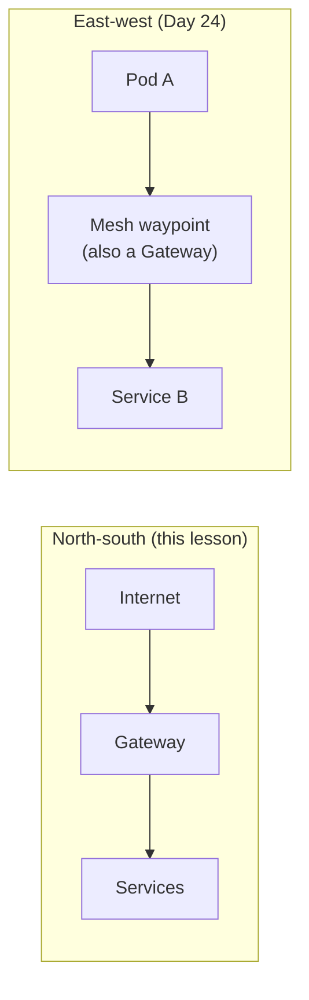

---

## Troubleshooting Guide

Always start with **status**, then the controller logs.

| Symptom | Check | Likely reason | Fix |
|---|---|---|---|
| GatewayClass `ACCEPTED` is empty or `False` | `kubectl get gatewayclass` | No controller with that `controllerName` is running | Install the controller; copy `controllerName` exactly |
| Gateway `PROGRAMMED False`, reason `AddressNotAssigned` | Gateway conditions; `kubectl get svc -n <controller-ns>` | LoadBalancer Service is `<pending>` (Minikube, bare metal) | `minikube tunnel`, port-forward, or MetalLB on bare metal |
| Route `Accepted=False NotAllowedByListeners` | HTTPRoute status | Namespace missing the label in `allowedRoutes`, or `from: Same` | Label the namespace, or fix the listener's `allowedRoutes` |
| Route `Accepted=False NoMatchingListenerHostname` | HTTPRoute status | Route hostname is outside the listener hostname (e.g. `www.shop.com` vs `*.shop.local`) | Fix either hostname |
| Route `ResolvedRefs=False BackendNotFound` | HTTPRoute status | Service name, namespace or port is wrong | `kubectl get svc -n <ns>` and correct `backendRefs` |
| Route `ResolvedRefs=False RefNotPermitted`, client gets **500** | HTTPRoute status | Cross-namespace backend without ReferenceGrant | Target namespace owner creates a ReferenceGrant |
| **404** from the Gateway | `kubectl get gateway ... status.listeners` | No route matches that host/path, or the route is attached to a different listener | Check `hostnames`, `matches`, `sectionName` |
| Plain HTTP still serves an app despite the redirect | Which listeners the route attached to | App route has no `sectionName` and beats the wildcard redirect | Add `sectionName: https` to app routes |
| Canary split looks wrong for 10 requests | Sample size | Weighting is random per request | Test with 200+ requests |
| Everything looks right but traffic is wrong | `kubectl logs -n envoy-gateway-system deploy/envoy-gateway` | Controller-level error or conflict | Read controller logs; check two routes for the same host+path (oldest wins) |

---

## Common Mistakes

1. **Thinking Ingress was removed.** The Ingress API still works. The **ingress-nginx controller** is what retired. Know the difference in an interview.
2. **Installing Gateway API CRDs on a managed cluster that already manages them.** Two owners of the same CRDs leads to version fights.
3. **Forgetting `sectionName: https` on app routes** when the Gateway has an HTTP redirect listener. The redirect gets silently bypassed (Step 6).
4. **Assuming the Gateway's own namespace is automatically allowed** with `from: Selector`. It is not (Step 6, mistake 1).
5. **Putting the ReferenceGrant in the wrong namespace.** It lives in the namespace of the thing being referenced (the Service or Secret), not the namespace of the route.
6. **Using `from: All` on a shared production Gateway.** Any namespace can then attach a route for any hostname under the listener.
7. **Reading `PROGRAMMED False` on Minikube as "broken".** Read the reason: `AddressNotAssigned` only means there is no cloud load balancer.
8. **Expecting exactly 10 out of 100 on a 90/10 split.** It is a probability per request, not a counter.
9. **Running ingress2gateway output straight into production** without reviewing warnings and listener design.
10. **Creating one Gateway per microservice on a cloud.** Each Gateway is a separate load balancer bill. Share Gateways and split ownership with routes.

---

## Interview Questions (with answers)

**Q1. Is Kubernetes Ingress deprecated?**
The Ingress API is frozen but not removed; it is still served and works. What retired in March 2026 is the community **ingress-nginx** controller, which no longer gets security patches. New work should use Gateway API, which the Kubernetes project designed as the successor.

**Q2. What problems does Gateway API solve compared to Ingress?**
Five: annotation-based, non-portable features become typed spec fields; role separation (GatewayClass, Gateway, Route) lets RBAC match real team ownership; richer routing (headers, weights, mirroring, gRPC, TCP/UDP/TLS); status conditions that explain failures; and safe multi-tenancy through `allowedRoutes` and ReferenceGrant.

**Q3. Explain GatewayClass, Gateway and HTTPRoute with an example.**
GatewayClass names the controller (like a StorageClass names a provisioner). A Gateway is an actual load balancer or proxy with listeners, owned by the platform team. An HTTPRoute, owned by an app team, attaches to a Gateway via `parentRefs` and maps hosts and paths to Services. In our lab: GatewayClass `eg` is implemented by Envoy Gateway; the platform team's Gateway `shop-gateway` listens on 80 and 443 for `*.shop.local`; the shop team's `catalog` route sends `api.shop.local/catalog` to catalog-v1 and catalog-v2.

**Q4. How do you do a canary release with Gateway API?**
Two `backendRefs` in one rule with `weight` values, for example 90 and 10. Increase the canary's weight in steps while watching metrics, and set it to 0 to roll back. Add a header match rule to always send internal testers to the canary. In production, Argo Rollouts or Flagger automate the weight changes and rollback.

**Q5. What is a ReferenceGrant and why does it exist?**
It permits an object in one namespace to reference an object in another, such as an HTTPRoute in `shop` pointing at a Service in `payments`. It lives in the target namespace, so the owner of the target consents. Without it, any team could expose another team's internal services through a shared Gateway.

**Q6. How do you stop one team from taking over another team's hostname on a shared Gateway?**
Use `allowedRoutes` with `from: Selector` so only approved, labelled namespaces can attach. Control who can apply that label with RBAC or a policy engine, give each team its own listener hostname where possible, and audit attachments through the Gateway's `status.listeners[].attachedRoutes`.

**Q7. Your HTTPRoute is applied but traffic gets 404. How do you debug?**
Check the route's status per parent: `Accepted` (did it attach? `NotAllowedByListeners` or `NoMatchingListenerHostname`) and `ResolvedRefs` (do the backends exist and are they permitted?). Then confirm the hostname falls under the listener's hostname, the path match is correct, and the route is attached to the listener the request arrives on (`sectionName`). Finally, read the controller logs.

**Q8. How would you migrate a production cluster from ingress-nginx?**
Inventory every Ingress and annotation, install a Gateway API implementation side by side, generate routes with ingress2gateway and review them, test the new load balancer directly, shift DNS gradually with weighted records and low TTLs, keep the old path for rollback, then remove Ingress objects once old traffic reaches zero. Watch for differences in body-size limits, timeouts and client IP headers.

**Q9. North-south vs east-west traffic: where does Gateway API fit?**
North-south is traffic entering the cluster: Gateways and routes attached to them. East-west is service-to-service traffic inside the cluster. Through the GAMMA initiative, routes can attach to a Service and control east-west traffic in a service mesh. Istio ambient waypoints are an example.

---

## Quick Self-Check

1. Which project retired in March 2026: the Ingress API or the ingress-nginx controller?
2. Which object does the platform team own, and which does the app team own?
3. What does `sectionName` do, and what goes wrong without it in Step 6?
4. A route's status says `RefNotPermitted`. What object is missing, and in which namespace must it be created?
5. What is the difference between `allowedRoutes.namespaces.from: Same`, `All` and `Selector`?
6. In one `matches` item you have a path and a header. Are they combined with AND or OR?
7. Why did our Minikube Gateway show `PROGRAMMED False`, and why was that not a real problem?
8. Name one ingress-nginx annotation that has no Gateway API equivalent on purpose, and why.

**Answers:** (1) The ingress-nginx controller; the Ingress API still exists. (2) Platform team: Gateway (and often GatewayClass); app team: HTTPRoute. (3) It attaches a route to one named listener; without it the app route attaches to port 80 too and, being more specific than the wildcard redirect, serves plain HTTP. (4) A ReferenceGrant, in the namespace of the target Service. (5) Only the Gateway's namespace; any namespace; only namespaces whose labels match. (6) AND. (7) Minikube has no cloud load balancer, so the LoadBalancer Service never got an address (`AddressNotAssigned`); the Envoy proxy was running and we reached it with port-forward. (8) `configuration-snippet` or `server-snippet`: raw proxy configuration injection was a large part of ingress-nginx's security problems.

---

## Summary

- The **ingress-nginx controller retired in March 2026** after years as the default and after the IngressNightmare vulnerability. The **Ingress API still works**, but new work should use **Gateway API**.
- Gateway API splits traffic configuration by **persona**: GatewayClass (provider), Gateway (platform team), routes (app teams), so RBAC matches how companies are organised.
- Features that were annotations are now **typed fields**: rewrites, redirects, header changes, header matching, weighted canaries.
- **Status conditions** (`Accepted`, `Programmed`, `ResolvedRefs`) tell you exactly what is wrong.
- **allowedRoutes** and **ReferenceGrant** make shared Gateways safe: no hostname hijacking, no cross-namespace access without consent.
- Migration is a **side-by-side, DNS-shifted** process, helped but not replaced by `ingress2gateway`.
- On EKS the AWS Load Balancer Controller implements Gateway API with ALBs and NLBs; in a mesh, the same API controls east-west traffic, which is where Day 24 begins.

## Key Takeaways

1. Retired means no more security patches, not "stopped working". Edge components must be maintained.
2. Gateway = infrastructure, Route = application. Different owners, different objects.
3. Always read status before guessing.
4. Set `sectionName: https` on application routes when you redirect HTTP.
5. The grant lives with the thing being granted.

---

## Practice / Homework

1. **Rebuild Day 18 on Gateway API.** Take all four Day 18 demos (path, host, TLS, combined) and write the Gateway and HTTPRoutes by hand. Then compare with what `ingress2gateway` produces for the same Ingress files.
2. **Run the full canary.** Move catalog from 90/10 to 50/50 to 0/100 and record the counts of 200 requests at each step. Then do a "rollback drill": go from 50/50 back to 100/0 and time how long it takes.
3. **Mirror traffic.** Add a `RequestMirror` filter that copies all catalog traffic to `catalog-v2` while v1 still answers. Use `kubectl logs` on v2 to prove it received the copies.
4. **Break it on purpose.** Create each failure from the troubleshooting table (wrong hostname, wrong Service name, missing label, missing ReferenceGrant) and write down the exact status message each one produces. This becomes your personal debugging cheat sheet.
5. **RBAC split.** Create a ServiceAccount `shop-dev` with the `route-editor` Role from Part 2. Prove with `kubectl auth can-i` (Day 17) that it can create HTTPRoutes in `shop` but cannot edit the Gateway in `infra`.
6. **Research task.** Check whether your company's (or a sample) cluster runs `kubernetes/ingress-nginx` or F5's `nginxinc/kubernetes-ingress`. How can you tell from the controller image name?

---

## References

- Gateway API official documentation: https://gateway-api.sigs.k8s.io/
- Gateway API releases: https://github.com/kubernetes-sigs/gateway-api/releases
- Envoy Gateway quickstart: https://gateway.envoyproxy.io/docs/tasks/quickstart/
- ingress2gateway: https://github.com/kubernetes-sigs/ingress2gateway
- AWS Load Balancer Controller, Gateway API guide: https://kubernetes-sigs.github.io/aws-load-balancer-controller/latest/guide/gateway/gateway/
- Google Open Source Blog, "The end of an era: transitioning away from Ingress NGINX": https://opensource.googleblog.com/2026/02/the-end-of-an-era-transitioning-away-from-ingress-nginx.html

---

**Previous:** [Day 22 - Helm](../day22-helm/notes.md) | **Next:** [Day 24 - Zero-Trust Networking and Service Mesh](../day24-zero-trust-service-mesh/notes.md)
