# Day 24 - Zero-Trust Networking and Service Mesh

> **Goal:** Understand what a service mesh really solves, what it costs, and when you do not need one. Then build zero-trust networking by hand with Istio's sidecarless **ambient mode**: prove that pod traffic is plaintext on the wire, encrypt it without restarting a single pod, give every workload a cryptographic identity, lock the payments service down to one caller at Layer 4, add method-and-path rules at Layer 7, and run a canary inside the cluster.

> **Pre-requisites:** [Day 17 - RBAC and ServiceAccounts](../day17-rbac-security/notes.md), [Day 20 - Network Policies](../day20-network-policies/notes.md) and [Day 23 - Gateway API](../day23-gateway-api/notes.md). This lesson builds directly on all three: ServiceAccounts become identities, NetworkPolicy's limits become the motivation, and Gateway API becomes the mesh's routing language.

> **Every command and every output in the lab was run on a real cluster** (Minikube v1.38, Kubernetes v1.35, Istio 1.31.3 ambient mode installed with the official Helm charts, October 2026). Pod names, IPs and serial numbers will differ on your machine; the behaviour will not.

---

## Learning Objectives

By the end of this lesson you will be able to:

1. Explain the difference between **north-south** and **east-west** traffic, and why east-west is where attackers move after a break-in.
2. State what NetworkPolicy (Day 20) **cannot** do: no encryption, no identity (only IPs and labels), no HTTP-level rules.
3. Explain the principles of **zero-trust networking** and map each one to a Kubernetes feature.
4. Describe what a **service mesh** provides: mutual TLS, workload identity (SPIFFE), L4 and L7 authorization, traffic control and telemetry.
5. Compare the **sidecar** model with the **sidecarless** models (Istio ambient, Cilium) and explain why the industry moved.
6. Explain Istio ambient internals: **ztunnel**, **HBONE** on port 15008, **waypoint** proxies, and why a waypoint is a Gateway API `Gateway`.
7. Prove with `tcpdump` that traffic is plaintext before the mesh and encrypted after it.
8. Write **L4** (identity-based) and **L7** (method and path) `AuthorizationPolicy` objects, and avoid the waypoint trap that turns everything into 503.
9. Run a canary **inside** the cluster with an HTTPRoute whose parent is a Service.
10. Use **PeerAuthentication STRICT** to reject plaintext from workloads outside the mesh.
11. Decide whether a given company needs a mesh at all, and if so, which one.

---

## Why This Lesson Exists: The Attacker Is Already Inside

Most security training focuses on the front door: firewalls, WAFs, the Gateway from Day 23. But most serious breaches follow the same pattern:

1. The attacker gets into **one small thing**: a vulnerable blog plugin, an old image with a known CVE, a leaked token for a test service.
2. From there they **move sideways** (lateral movement) to the valuable things: the payments service, the database, the secrets.
3. They **read traffic** between services, because inside the cluster everything is plaintext HTTP.

In Day 20 you learned NetworkPolicy, which handles step 2 partly. This lesson closes the rest of the gap.

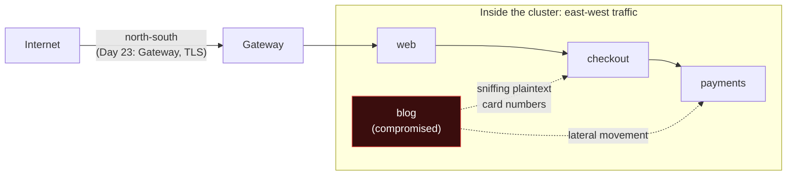

- **North-south traffic** is traffic entering or leaving the cluster. Day 23 secured it with Gateway API and TLS.
- **East-west traffic** is traffic between services inside the cluster. By default it is **unencrypted** and **unauthenticated**: any pod can call any pod, and anyone who can watch the network can read it.

### A real-world style example: the audit question

Picture a Pune-based NBFC (a non-bank lender) running its loan platform on EKS. Its annual security audit, done against RBI's IT and cyber security expectations and PCI DSS for the card data it touches, comes back with one finding:

> "Customer PII and card data travel **unencrypted** between microservices inside the Kubernetes cluster. Any compromised workload on the same network can read them. Encrypt data in transit internally and restrict service-to-service access to what is required."

The team has three months. Rewriting 60 microservices to use TLS, manage certificates and check caller identity is not realistic. This is the exact problem a service mesh was invented for, and by the end of this lesson you will have solved it for one namespace without changing a line of application code.

---

## Real-World Analogy: The Office Building With ID Cards

Think of your cluster as a large office building in HITEC City.

- **Without a mesh** the building has a guarded front gate (the Gateway from Day 23), but inside, anyone wearing any shirt can walk into any room, and every conversation happens loudly in open corridors. NetworkPolicy (Day 20) is like locking some doors by **desk number**: "desk 10.244.0.7 may enter the finance room". Desks get reassigned every day (pod IPs change), and nobody checks **who** is actually sitting at the desk.
- **Zero trust** says: do not trust anyone just because they are inside the building.
- **A service mesh** gives every employee a **photo ID card issued by HR** (a certificate with a SPIFFE identity, issued by the mesh's certificate authority). Every conversation happens in a **sealed, soundproof pod** (mutual TLS). Every door has a **card reader** that checks the card, not the desk (L4 authorization). Some doors, like the treasury, have a **security officer** who also checks **what you are asking for**: "you may check the balance, but you may not issue a refund" (L7 authorization at a waypoint).
- **Sidecar mesh** = every employee gets a **personal bodyguard** who follows them everywhere and handles all their conversations. Very capable, very expensive: one bodyguard per person.
- **Ambient mesh** = one **floor security desk** per floor (ztunnel, one per node) handles ID checks and sealed conversations for everyone on that floor. You add a **security officer** (waypoint) only for the departments that need content-level checks.

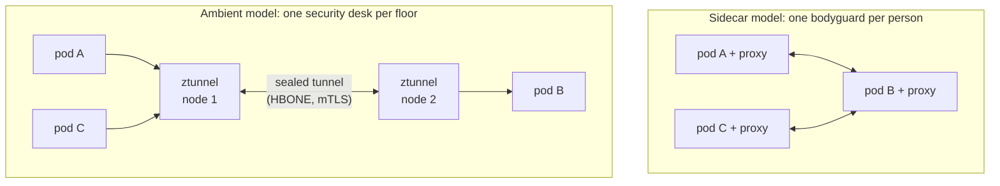

---

## Part 1: What NetworkPolicy Cannot Do

NetworkPolicy is essential and you should keep using it. But be precise about its limits.

| Question | NetworkPolicy | Service mesh |
|---|---|---|
| Can it block pod A from reaching pod B? | Yes, by labels and IPs | Yes, by cryptographic identity |
| Does it **encrypt** traffic? | **No** | Yes, mutual TLS |
| Does it know **who** the caller is? | No. It sees a source IP and maps it to labels. Anyone who can create a pod with the right labels in an allowed namespace gets in | Yes. The caller proves its ServiceAccount identity with a certificate it cannot forge |
| Can it allow `GET /balance` but deny `POST /refund`? | **No**, it only understands IPs and ports (L3/L4) | Yes, with an L7 proxy |
| Can it do canaries, retries, timeouts between services? | No | Yes |
| Does it give per-request metrics between services? | No | Yes |
| Does it need a supporting CNI? | Yes (Calico, Cilium) | Works on most CNIs |
| Cost | Almost free | Extra proxies, memory, latency, operational effort |

**The label problem, concretely.** Suppose your NetworkPolicy says "pods labelled `app: checkout` may reach payments". A developer, or an attacker with permission to create pods in that namespace, starts a debugging pod and simply adds `labels: {app: checkout}`. NetworkPolicy lets it in, because labels are just text anyone with `create pods` permission can set. A mesh identity is tied to the **ServiceAccount**, which is protected by RBAC (Day 17) and proven by a certificate.

> **The professional answer:** NetworkPolicy and a mesh are **layers**, not alternatives. NetworkPolicy is a cheap, kernel-level fence that works even if the mesh is misconfigured. The mesh adds encryption, identity and L7 rules on top. Defence in depth means using both.

---

## Part 2: Zero-Trust Principles, Mapped to Kubernetes

"Zero trust" became a marketing phrase, but the idea is simple and comes from the US NIST guidance (SP 800-207): **network location is not a reason to trust**. Being "inside the cluster" proves nothing.

| Zero-trust principle | What it means | Kubernetes / mesh feature |
|---|---|---|
| Never trust the network | Assume an attacker can see and inject traffic | **mTLS** on every connection |
| Strong identity for every workload | Identify services by who they are, not where they are | **SPIFFE IDs** from ServiceAccounts |
| Least privilege | Allow only the calls a service actually needs | **AuthorizationPolicy** (L4 and L7), NetworkPolicy |
| Verify explicitly, every request | Check identity and intent on each connection or request | ztunnel (per connection), waypoint (per request) |
| Assume breach, limit blast radius | One compromised pod must not reach everything | Default-deny policies per namespace |
| Continuous monitoring | Log who called whom, allowed or denied | Mesh access logs and metrics |
| Short-lived credentials | Stolen credentials should expire quickly | Mesh certificates valid for 24 hours, auto-rotated |

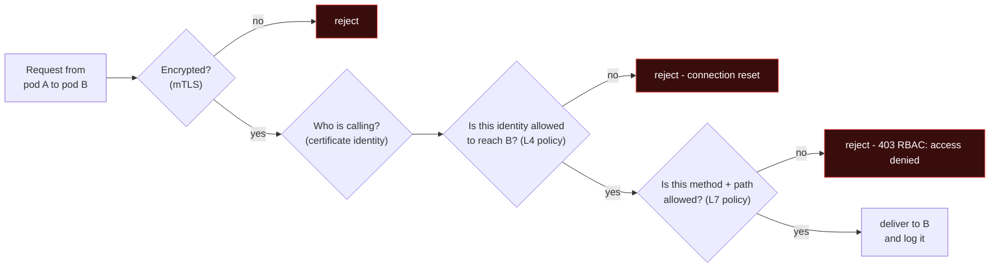

That flowchart is exactly what you will build in the lab.

---

## Part 3: What a Service Mesh Is

A **service mesh** is a layer of proxies, controlled by a central control plane, that sits in the path of service-to-service traffic and adds security, traffic control and observability **without changing application code**.

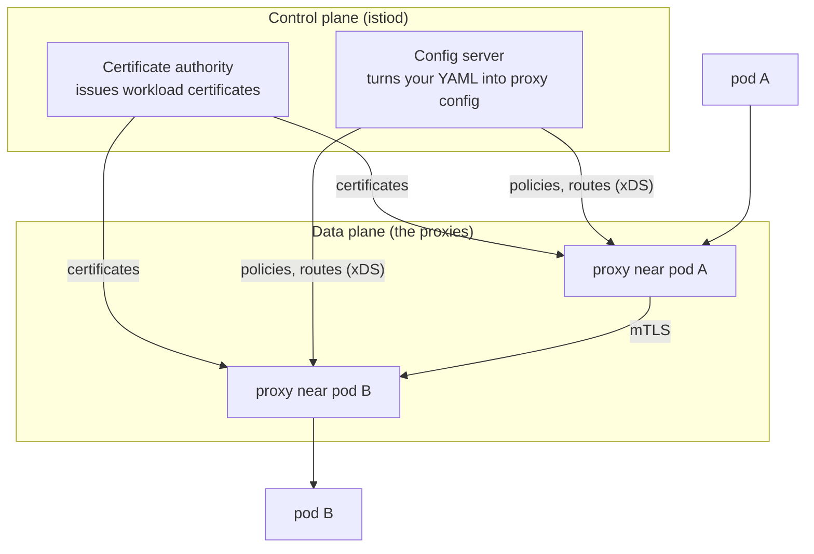

The five things a mesh provides:

1. **Mutual TLS (mTLS).** Normal TLS (your browser and a bank) proves only the **server's** identity. **Mutual** TLS proves **both** sides: the client also presents a certificate. Every connection is encrypted and both ends know who the other is.
2. **Workload identity.** Every workload gets a certificate whose identity is a **SPIFFE ID** (Secure Production Identity Framework For Everyone, a CNCF standard). In Istio the format is:

   ```
   spiffe://cluster.local/ns/<namespace>/sa/<serviceaccount>
   ```

   For example `spiffe://cluster.local/ns/shopkart/sa/checkout`. The identity comes from the **ServiceAccount**, which is why Day 17 matters here.
3. **Authorization.** Rules such as "only checkout may call payments" (**L4**, connection level: who may connect) or "only `GET /balance` and `POST /charge`" (**L7**, request level: what they may ask for).
4. **Traffic control.** Canaries, header-based routing, retries, timeouts, fault injection, all between internal services.
5. **Telemetry.** Who called whom, how often, how fast, how many errors: without adding a single line of logging code.

### L4 versus L7, in one picture

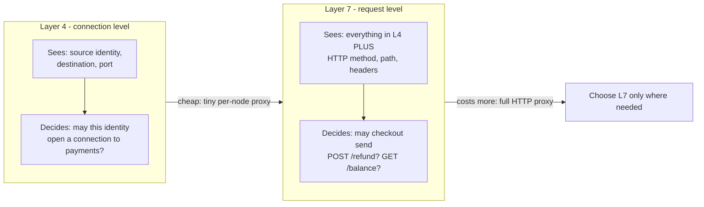

L4 is cheap because the proxy only looks at connections. L7 needs a full HTTP proxy (Envoy) that parses every request, which costs CPU, memory and latency. Ambient mode's main idea is to give everyone L4 for almost nothing and charge for L7 only where you ask for it.

---

## Part 4: Sidecar Versus Sidecarless

### The sidecar model (classic Istio, Linkerd)

From about 2017 to 2023, every mesh worked by **injecting a proxy container** (a sidecar, see the [init and sidecar containers deep dive](../day04-pods/init-and-sidecar-containers.md)) into every pod. All traffic in and out of the pod is redirected through it.

What teams learned the hard way:

| Pain | Why it hurts |
|---|---|
| **Memory and CPU per pod** | A 300-pod cluster runs 300 Envoy proxies. Each needs tens of MB of memory at minimum, often far more in large meshes because each proxy holds config for many services |
| **Restarts to join or upgrade** | Adding a pod to the mesh, or upgrading the mesh, means restarting every application pod to inject a new sidecar |
| **Startup and shutdown races** | App starts before its proxy is ready, or the proxy dies before the app finishes; Jobs never complete because the sidecar keeps running |
| **Every request pays L7 cost** | Even if you only wanted encryption, every request goes through two full HTTP proxies |
| **Blast radius** | A proxy bug affects every pod at once |

### The sidecarless models

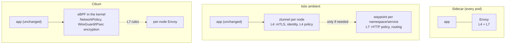

| | Sidecar (classic Istio, Linkerd) | Istio ambient | Cilium (CNI) encryption |
|---|---|---|---|
| Proxy placement | One per pod | One ztunnel per node, optional waypoints | Kernel (eBPF) per node, per-node Envoy for L7 |
| Pod restart to join | Yes | **No** (label the namespace) | No (CNI-level) |
| Encryption | mTLS | mTLS (HBONE) | WireGuard or IPsec |
| Workload identity in the encryption | Yes (SPIFFE) | Yes (SPIFFE) | **No**: keys belong to nodes, not workloads. Cilium identities are label-based |
| L7 policy | Yes, every pod | Yes, at waypoints you choose | Yes, through its Envoy |
| Same-node traffic encrypted | Yes | Yes (we prove it in the lab) | **No** with WireGuard: Cilium's docs state packets to the same node are not encrypted |
| Maturity | Very mature | GA since Istio 1.24 (November 2024) | Mature for encryption; Cilium's own ztunnel integration is Beta |

> **Linkerd** deserves a mention: it is the simplest sidecar mesh, uses its own tiny Rust proxy instead of Envoy, and turns on mTLS with very little configuration. Since 2024, stable release builds are distributed by its sponsor company Buoyant (free for small companies), while the open source project ships edge releases. Check the licence terms before choosing it for a large company.

---

## Part 5: Istio Ambient Mode, Inside

### The components

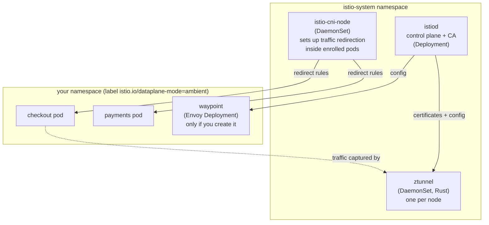

- **istiod** is the control plane. It watches Kubernetes, compiles your policies, and acts as the **certificate authority** that signs workload certificates.
- **istio-cni** runs on every node. When a pod's namespace is enrolled, it sets up redirection rules **inside that pod's network namespace**, so the pod's traffic goes to ztunnel. The pod itself is not modified or restarted.
- **ztunnel** ("zero-trust tunnel") is a small proxy written in Rust, one per node. It holds the certificates for the workloads on its node, encrypts and decrypts traffic, and enforces **L4** policy. It does not parse HTTP.
- **waypoint** is a normal Envoy proxy deployed per namespace (or per service). It handles **L7**: HTTP authorization, routing, retries. You only pay for it where you create it.

### HBONE: how ztunnels talk

When pod A (on node 1) calls pod B, ztunnel on node 1 opens an **HBONE** connection (HTTP-Based Overlay Network Environment) to the destination on **port 15008**. HBONE is mTLS carrying an HTTP/2 `CONNECT` tunnel, inside which the original bytes travel. Many connections can share one tunnel.

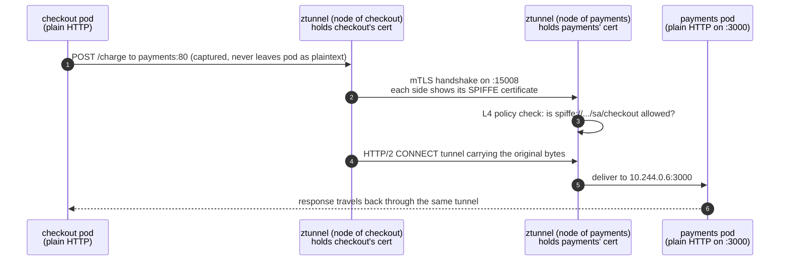

The application still speaks plain HTTP on its own port. It never knows the mesh exists. In the lab you will see exactly this: on the wire, port 3000 disappears and only port 15008 remains.

### Waypoints are Gateway API Gateways

This is where Day 23 pays off. A waypoint is declared as a Gateway API `Gateway` with the special class `istio-waypoint` and a listener on port 15008 using protocol `HBONE`:

```yaml
apiVersion: gateway.networking.k8s.io/v1
kind: Gateway
metadata:
  name: waypoint
  namespace: shopkart
  labels:
    istio.io/waypoint-for: service      # this waypoint handles traffic addressed to Services
spec:
  gatewayClassName: istio-waypoint
  listeners:
  - name: mesh
    port: 15008
    protocol: HBONE
```

And east-west routing uses an **HTTPRoute whose parent is a Service**, not a Gateway (the GAMMA pattern from [Day 23 Part 8](../day23-gateway-api/notes.md#part-8-beyond-http-and-the-bridge-to-day-24)). The same routing language now works for traffic entering the cluster and traffic inside it.

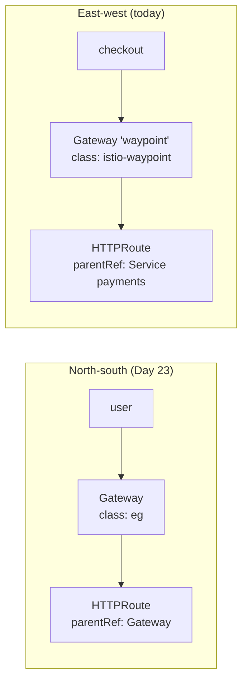

---

## Part 6: Do You Even Need a Mesh?

This is the most important section for your career. Many teams installed a mesh because it was fashionable, then spent a year fighting it. A senior engineer's value is knowing when **not** to.

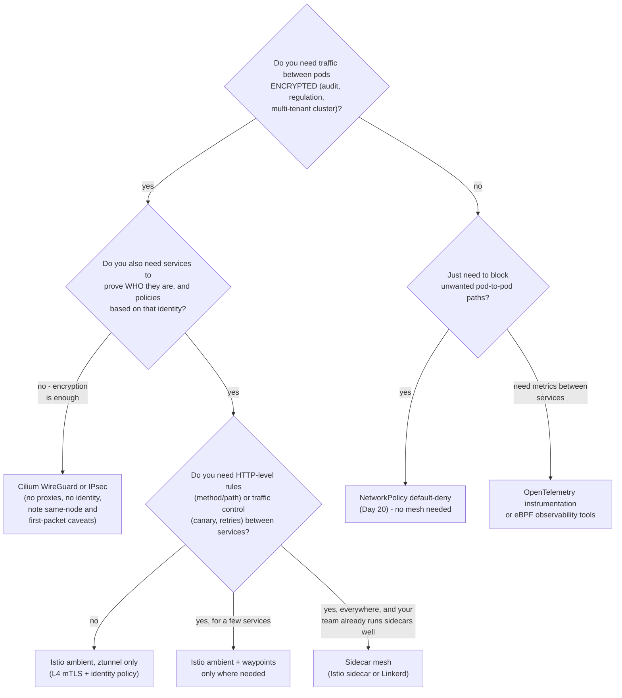

Real-world guidance:

- **A 10-service startup** with no compliance requirement: NetworkPolicy default-deny plus good app-level auth. A mesh is overhead.
- **A fintech or healthtech** with an audit requirement for internal encryption and least privilege: ambient ztunnel gives encryption plus identity policy for very little cost; add waypoints for the two or three sensitive services.
- **A large platform** with hundreds of services, many teams and a need for uniform retries, timeouts and canaries: a full L7 mesh earns its cost.
- **Already on Cilium as CNI** and only need encryption: turn on WireGuard. Know its limits: no workload identity, same-node traffic not encrypted, and Cilium's docs warn that initial packets to an endpoint it has not yet discovered may go out unencrypted unless you enable strict mode.

### The costs, measured

These are real numbers from our lab cluster (idle, `kubectl top`):

```
NAME                    CPU(cores)   MEMORY(bytes)
istio-cni-node-qwzkb    1m           55Mi          <- per node
istiod-56fbd5d4-fszf5   6m           84Mi          <- once per cluster
ztunnel-8g4kl           4m           9Mi           <- per node, serves ALL pods on the node
waypoint-d5df548fb-...  5m           29Mi          <- only in namespaces that need L7
```

Under real load these grow, but the shape is the point: the per-node L4 layer is small and shared; L7 cost is paid only where you place a waypoint. With sidecars, an Envoy runs in **every** pod.

Other costs that do not show up in `kubectl top`:

- **Latency.** Each proxy hop adds a little latency; L7 proxies add more than L4.
- **Operations.** Upgrading the mesh, debugging "is it the app or the mesh?", learning new CRDs. This is usually the biggest cost.
- **Failure modes.** If the mesh breaks, east-west traffic breaks. You need runbooks and monitoring for the mesh itself.

---

## Hands-On Lab: Zero Trust for ShopKart Payments

### The scenario

ShopKart is back from Day 23. The Diwali sale went well. Now the security audit arrives with two findings:

1. **"Card data travels in plaintext between checkout and payments."**
2. **"Any workload in the namespace can call the payments refund endpoint."** The auditors demonstrated it from the team's WordPress-based **blog** pod.

Your job: fix both without changing application code, then use the same mesh to canary a new payments version.

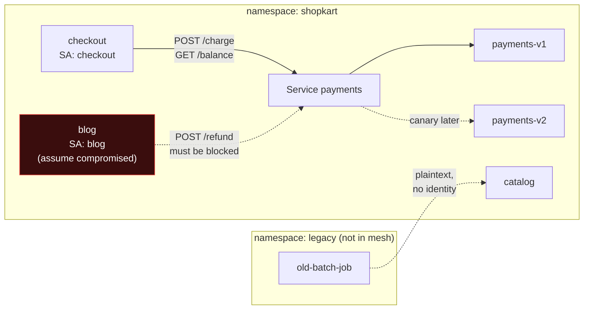

All servers use `registry.k8s.io/gateway-api/echo-basic` (from Day 23), which replies with the method, path, headers and pod name it received. Clients use `curlimages/curl`.

### Step 0: A cluster with room for the mesh

```bash
minikube start -p mesh-lab --driver=docker --cpus=3 --memory=3200
```

### Step 1: Install Istio ambient mode with Helm

Istio's documentation offers `istioctl install --set profile=ambient`, or the official Helm charts. We use Helm (you know it from Day 22, and it is what most companies use with GitOps).

```bash
helm repo add istio https://blob.istio.io/istio-release/charts
helm repo update

# 1. Gateway API CRDs (needed for waypoints and mesh routes)
kubectl apply --server-side -f \
  https://github.com/kubernetes-sigs/gateway-api/releases/download/v1.6.0/experimental-install.yaml

# 2. Istio CRDs and cluster-wide resources
helm install istio-base istio/base -n istio-system --create-namespace --version 1.31.3 --wait

# 3. Control plane, ambient profile
helm install istiod istio/istiod -n istio-system --version 1.31.3 \
  --set profile=ambient --set global.platform=minikube --wait

# 4. CNI node agent (traffic redirection)
helm install istio-cni istio/cni -n istio-system --version 1.31.3 \
  --set profile=ambient --set global.platform=minikube --wait

# 5. ztunnel DaemonSet
helm install ztunnel istio/ztunnel -n istio-system --version 1.31.3 \
  --set global.platform=minikube --wait
```

> **Why `global.platform=minikube`?** Minikube with the Docker driver keeps CNI files in non-standard paths. Istio's platform prerequisites page lists the right setting for each platform (minikube, k3d, k3s, and others). Skipping it is a common reason ambient "installs fine but does nothing".

```bash
helm ls -n istio-system
# NAME        NAMESPACE     REVISION  STATUS    CHART           APP VERSION
# istio-base  istio-system  1         deployed  base-1.31.3     1.31.3
# istio-cni   istio-system  1         deployed  cni-1.31.3      1.31.3
# istiod      istio-system  1         deployed  istiod-1.31.3   1.31.3
# ztunnel     istio-system  1         deployed  ztunnel-1.31.3  1.31.3

kubectl get pods -n istio-system
# NAME                    READY   STATUS    RESTARTS   AGE
# istio-cni-node-qwzkb    1/1     Running   0          28s
# istiod-56fbd5d4-fszf5   1/1     Running   0          46s
# ztunnel-8g4kl           1/1     Running   0          25s
```

Installing the mesh changes nothing yet. No namespace is enrolled.

### Step 2: Deploy ShopKart, outside the mesh for now

`01-shopkart.yaml` (condensed: the full file repeats the Deployment pattern):

```yaml
apiVersion: v1
kind: Namespace
metadata:
  name: shopkart
---
apiVersion: v1
kind: ServiceAccount
metadata:
  name: payments            # payments' identity will be .../sa/payments
  namespace: shopkart
---
apiVersion: v1
kind: Service
metadata:
  name: payments
  namespace: shopkart
spec:
  selector:
    app: payments
  ports:
  - name: http
    port: 80
    targetPort: 3000
---
apiVersion: apps/v1
kind: Deployment
metadata:
  name: payments-v1
  namespace: shopkart
spec:
  replicas: 1
  selector:
    matchLabels:
      app: payments
      version: v1
  template:
    metadata:
      labels:
        app: payments
        version: v1
    spec:
      serviceAccountName: payments
      containers:
      - name: echo
        image: registry.k8s.io/gateway-api/echo-basic:v1.5.1
        ports:
        - containerPort: 3000
        env:
        - name: POD_NAME
          valueFrom:
            fieldRef:
              fieldPath: metadata.name
        - name: NAMESPACE
          valueFrom:
            fieldRef:
              fieldPath: metadata.namespace
---
# checkout and blog: a ServiceAccount + a curl Deployment each
apiVersion: v1
kind: ServiceAccount
metadata:
  name: checkout
  namespace: shopkart
---
apiVersion: apps/v1
kind: Deployment
metadata:
  name: checkout
  namespace: shopkart
spec:
  replicas: 1
  selector:
    matchLabels:
      app: checkout
  template:
    metadata:
      labels:
        app: checkout
    spec:
      serviceAccountName: checkout      # each workload gets its OWN ServiceAccount
      containers:
      - name: curl
        image: curlimages/curl:8.11.1
        command: ["sleep", "infinity"]
# ... the 'blog' ServiceAccount and Deployment are identical with name: blog
```

> **Rule for meshes:** give every workload its **own ServiceAccount**. If everything runs as `default`, every workload has the **same identity** and identity-based policy becomes useless.

```bash
kubectl apply -f 01-shopkart.yaml
kubectl get pods -n shopkart -o wide
# NAME                          READY   STATUS    IP           NODE
# blog-74d7b4f89-flwmz          1/1     Running   10.244.0.8   mesh-lab
# checkout-65d7795757-9nk82     1/1     Running   10.244.0.7   mesh-lab
# payments-v1-6659fc4fd-lmxhz   1/1     Running   10.244.0.6   mesh-lab
```

### Step 3: Prove the problem - plaintext on the wire and open access

To see what is on the network, run a privileged pod on the **host network** of the node with `tcpdump` (the `nicolaka/netshoot` image is a Swiss-army knife of network tools):

```yaml
apiVersion: v1
kind: Pod
metadata:
  name: sniffer
  namespace: default
spec:
  hostNetwork: true            # sees all traffic on the node, including pod veth interfaces
  containers:
  - name: netshoot
    image: nicolaka/netshoot:v0.13
    command: ["sleep", "infinity"]
    securityContext:
      privileged: true
```

> This pod is exactly what an attacker who gets node access would run. Day 25 shows how to **forbid** privileged, host-network pods with Pod Security and Kyverno. Here we use it as the auditor.

In one terminal, capture traffic to the payments port (3000) and the mesh port (15008):

```bash
kubectl exec sniffer -- timeout 12 tcpdump -i any -nn -A "tcp port 3000 or tcp port 15008"
```

In another, make checkout charge a card:

```bash
kubectl -n shopkart exec deploy/checkout -- curl -s -X POST http://payments/charge \
  -H "card-number: 4111-1111-1111-1111" -d 'amount=4999'
```

What the sniffer captured (filtered):

```
07:46:22.278847 bridge Out IP 10.244.0.7.52100 > 10.244.0.6.3000: Flags [S], ...
...
POST /charge HTTP/1.1
card-number: 4111-1111-1111-1111
amount=4999
```

**The card number is readable on the wire.** That is audit finding 1, proven.

Now finding 2: can the blog pod call the refund endpoint?

```bash
kubectl -n shopkart exec deploy/blog -- curl -s -o /dev/null -w "%{http_code}\n" -X POST http://payments/refund
# 200
```

Yes. If the blog is compromised, the attacker can issue refunds.

### Step 4: Enrol the namespace - encryption with zero restarts

```bash
kubectl label namespace shopkart istio.io/dataplane-mode=ambient
# namespace/shopkart labeled

kubectl get pods -n shopkart
# NAME                          READY   STATUS    RESTARTS   AGE
# blog-74d7b4f89-flwmz          1/1     Running   0          2m2s
# checkout-65d7795757-9nk82     1/1     Running   0          2m2s
# payments-v1-6659fc4fd-lmxhz   1/1     Running   0          2m2s
```

Look closely: `READY 1/1` (no sidecar container was added), `RESTARTS 0`, and the age did not reset. The pods joined the mesh **in place**. With a sidecar mesh you would have to restart every Deployment.

The app still works:

```bash
kubectl -n shopkart exec deploy/checkout -- curl -s -X POST http://payments/charge -d 'amount=4999' \
  | grep -E '"(path|pod)"'
#  "path": "/charge",
#  "pod": "payments-v1-6659fc4fd-lmxhz"
```

Run the same capture again and charge the card again:

```
plaintext lines containing "card-number" or "POST /charge":  0

packets seen (interface, direction, address.port):
   9 veth32530dce Out IP 10.244.0.7.60496 >
   6 veth32530dce P   IP 10.244.0.6.15008 >
   6 veth9f121991 Out IP 10.244.0.6.15008 >
   9 veth9f121991 P   IP 10.244.0.7.60496 >
```

Port 3000 has vanished from the wire. All traffic between checkout (10.244.0.7) and payments (10.244.0.6) now goes to **port 15008 (HBONE)**, encrypted with mTLS. **Zero** plaintext matches. And note: both pods are on the **same node**, and the traffic is still encrypted, because ztunnel captures it inside each pod's network namespace.

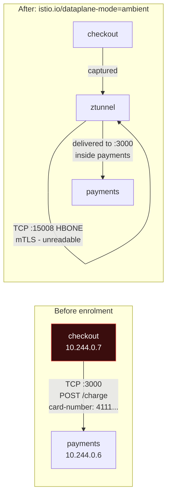

**Audit finding 1: fixed**, for every workload in the namespace, with one label.

### Step 5: Look at the identities

ztunnel writes an access log line for every connection. Each line names **both identities**:

```bash
kubectl logs -n istio-system ds/ztunnel --tail=6 | grep access
```

```
info access connection complete
  src.workload="checkout-65d7795757-9nk82" src.namespace="shopkart"
  src.identity="spiffe://cluster.local/ns/shopkart/sa/checkout"
  dst.addr=10.244.0.6:15008 dst.hbone_addr=10.244.0.6:3000
  dst.service="payments.shopkart.svc.cluster.local"
  dst.workload="payments-v1-6659fc4fd-lmxhz"
  dst.identity="spiffe://cluster.local/ns/shopkart/sa/payments"
  direction="outbound" bytes_sent=193 bytes_recv=577 duration="1ms"
```

(Line breaks added for reading; the real log is one line.) Read it carefully: `dst.addr=...:15008` is the encrypted tunnel; `dst.hbone_addr=...:3000` is the real app port inside the tunnel.

ztunnel also has an admin endpoint that shows the certificates it holds. Port-forward to it and read `config_dump`:

```bash
ZT=$(kubectl get pod -n istio-system -l app=ztunnel -o jsonpath='{.items[0].metadata.name}')
kubectl -n istio-system port-forward pod/$ZT 15000:15000 &
curl -s localhost:15000/config_dump > zt.json
```

Summarised from `zt.json`:

```
certificates:
  spiffe://cluster.local/ns/shopkart/sa/blog      Available  validFrom 2026-10-31T07:44:40Z  expires 2026-11-01T07:46:40Z
  spiffe://cluster.local/ns/shopkart/sa/checkout  Available  validFrom 2026-10-31T07:44:40Z  expires 2026-11-01T07:46:40Z
  spiffe://cluster.local/ns/shopkart/sa/payments  Available  validFrom 2026-10-31T07:44:40Z  expires 2026-11-01T07:46:40Z

workloads (shopkart):
  blog-74d7b4f89-flwmz          sa=blog      protocol=HBONE  ip=10.244.0.8
  checkout-65d7795757-9nk82     sa=checkout  protocol=HBONE  ip=10.244.0.7
  payments-v1-6659fc4fd-lmxhz   sa=payments  protocol=HBONE  ip=10.244.0.6
```

Three facts to take away:

1. **One identity per ServiceAccount**, in SPIFFE format, issued by istiod.
2. Certificates are valid for **24 hours** and rotate automatically. A stolen certificate is useless tomorrow. (The `validFrom` is set slightly in the past to tolerate clock differences between nodes.)
3. Each workload is marked `protocol=HBONE`: ztunnel knows it must tunnel to it.

> If you install `istioctl`, `istioctl ztunnel-config workloads` and `istioctl ztunnel-config certificates` show the same information in a friendlier table.

### Step 6: L4 authorization - only checkout may reach payments

`02-payments-l4-policy.yaml`:

```yaml
apiVersion: security.istio.io/v1
kind: AuthorizationPolicy
metadata:
  name: payments-allow-checkout-only
  namespace: shopkart
spec:
  selector:                         # applies to the payments PODS (enforced by ztunnel)
    matchLabels:
      app: payments
  action: ALLOW
  rules:
  - from:
    - source:
        principals:                 # SPIFFE ID without the "spiffe://" prefix
        - cluster.local/ns/shopkart/sa/checkout
```

How ALLOW policies work: as soon as **any** ALLOW policy selects a workload, everything not matched by an ALLOW rule is **denied**. (Same "selected means isolated" idea as NetworkPolicy in Day 20.)

```bash
kubectl apply -f 02-payments-l4-policy.yaml

kubectl -n shopkart exec deploy/checkout -- curl -s -o /dev/null -w "%{http_code}\n" -X POST http://payments/charge
# 200

kubectl -n shopkart exec deploy/blog -- sh -c 'curl -sS -X POST http://payments/refund; echo "curl exit $?"'
# curl: (56) Recv failure: Connection reset by peer
# curl exit 56
```

The blog is cut off at the **connection** level: ztunnel resets the TCP connection, so curl reports exit code 56. There is no HTTP response at all, because ztunnel does not speak HTTP. ztunnel's log on the payments side says exactly why:

```
error="connection closed due to policy rejection: allow policies exist, but none allowed"
```

And on the blog's side:

```
src.identity="spiffe://cluster.local/ns/shopkart/sa/blog" ... error="http status: 401 Unauthorized"
```

**Audit finding 2: fixed.** And unlike NetworkPolicy, the attacker cannot get around it by copying `app: checkout` labels onto a new pod: the identity comes from the ServiceAccount, and creating pods that run as `checkout` is controlled by RBAC.

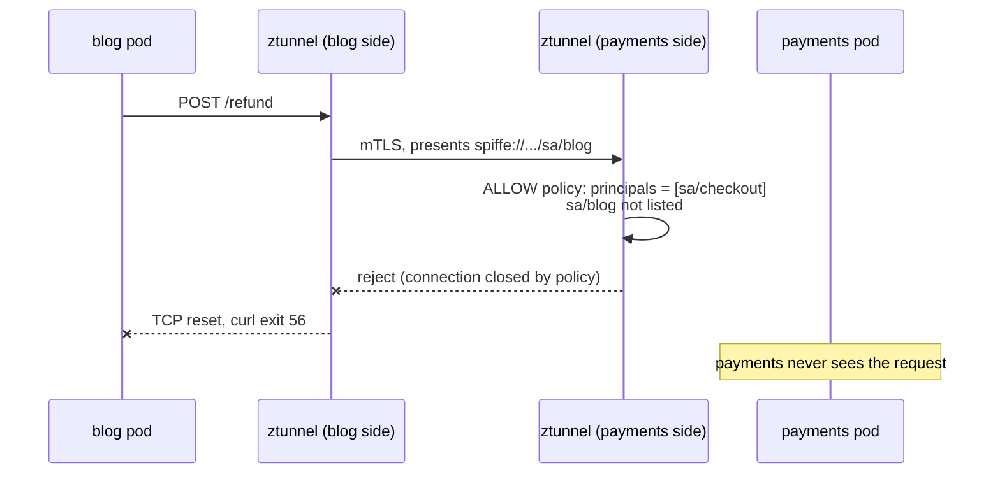

### Step 7: Add a waypoint for L7 rules (and hit the 503 trap)

The security team now wants finer rules: **even checkout** may only call `POST /charge` and `GET /balance`. Refunds are done by a separate back-office service, not by checkout. ztunnel cannot see methods or paths, so we need a **waypoint**.

`03-waypoint.yaml`:

```yaml
apiVersion: gateway.networking.k8s.io/v1
kind: Gateway
metadata:
  name: waypoint
  namespace: shopkart
  labels:
    istio.io/waypoint-for: service
spec:
  gatewayClassName: istio-waypoint
  listeners:
  - name: mesh
    port: 15008
    protocol: HBONE
```

```bash
kubectl apply -f 03-waypoint.yaml
kubectl -n shopkart wait --for=condition=Programmed gateway/waypoint --timeout=180s

# Tell the namespace to send Service traffic through this waypoint
kubectl label namespace shopkart istio.io/use-waypoint=waypoint

kubectl get gateway -n shopkart
# NAME       CLASS            ADDRESS        PROGRAMMED   AGE
# waypoint   istio-waypoint   10.111.148.5   True         21s

kubectl get gatewayclass
# NAME             CONTROLLER                    ACCEPTED
# istio            istio.io/gateway-controller   True
# istio-remote     istio.io/unmanaged-gateway    True
# istio-waypoint   istio.io/mesh-controller      True
```

(If you have `istioctl`, `istioctl waypoint apply --enroll-namespace --wait` does both steps.)

Now test checkout, which worked a minute ago:

```bash
kubectl -n shopkart exec deploy/checkout -- curl -sS -w "\n%{http_code}\n" -X POST http://payments/charge
# upstream connect error or disconnect/reset before headers. reset reason: connection termination
# 503
```

**Everything broke.** This is the most common ambient-mode mistake, so read the ztunnel log on the payments side:

```
src.identity="spiffe://cluster.local/ns/shopkart/sa/waypoint"
error="connection closed due to policy rejection: allow policies exist, but none allowed"
```

**Why:** traffic now flows checkout to **waypoint** to payments. The connection that arrives at payments comes from the **waypoint's** identity (`sa/waypoint`), not from checkout. Our L4 policy only allows `sa/checkout`, so ztunnel blocks the waypoint. The waypoint turns that into an HTTP 503 for checkout.

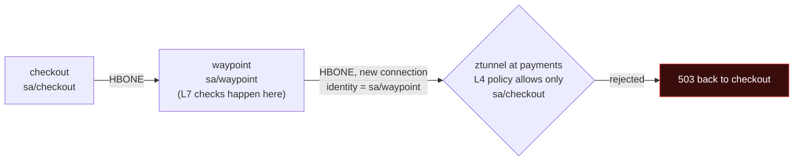

**The correct fix has two parts.**

Part A: at L4, payments must accept connections **from the waypoint** (`04-payments-l4-allow-waypoint.yaml`):

```yaml
apiVersion: security.istio.io/v1
kind: AuthorizationPolicy
metadata:
  name: payments-allow-checkout-only
  namespace: shopkart
spec:
  selector:
    matchLabels:
      app: payments
  action: ALLOW
  rules:
  - from:
    - source:
        principals:
        - cluster.local/ns/shopkart/sa/checkout
        - cluster.local/ns/shopkart/sa/waypoint     # the waypoint now delivers the traffic
```

But watch what that alone does:

```bash
kubectl apply -f 04-payments-l4-allow-waypoint.yaml
kubectl -n shopkart exec deploy/blog -- curl -s -o /dev/null -w "%{http_code}\n" -X POST http://payments/refund
# 200          <- the blog is back in!
```

The blog's request goes to the waypoint, and the waypoint (allowed at L4) forwards it. **Allowing the waypoint at L4 moves the responsibility for checking the original caller to L7.** You must add Part B immediately. In production, apply both in the same change.

Part B: the L7 policy, enforced **by the waypoint**, checking the **original** caller and the request (`05-payments-l7-policy.yaml`):

```yaml
apiVersion: security.istio.io/v1
kind: AuthorizationPolicy
metadata:
  name: payments-l7
  namespace: shopkart
spec:
  targetRefs:                       # attach to the Service: enforced by its waypoint
  - kind: Service
    group: ""
    name: payments
  action: ALLOW
  rules:
  - from:
    - source:
        principals:
        - cluster.local/ns/shopkart/sa/checkout
    to:
    - operation:
        methods: ["POST"]
        paths: ["/charge"]
    - operation:
        methods: ["GET"]
        paths: ["/balance"]
```

Note the difference: L4 policies use `selector` (pods, enforced by ztunnel); L7 policies in ambient use `targetRefs` (a Service or the waypoint Gateway, enforced by the waypoint). ztunnel cannot evaluate HTTP fields, so if a `selector` policy contains them, Istio fails safe: the policy is treated as a DENY, which usually blocks the very traffic you meant to allow. It is a classic mistake.

```bash
kubectl apply -f 05-payments-l7-policy.yaml
```

The full test matrix:

```
caller    method path       -> result
checkout  POST   /charge    -> 200
checkout  GET    /balance   -> 200
checkout  POST   /refund    -> 403
blog      GET    /balance   -> 403
blog      POST   /refund    -> 403
```

```bash
kubectl -n shopkart exec deploy/checkout -- curl -s -X POST http://payments/refund
# RBAC: access denied
```

Notice the different failure style. L4 denials are **connection resets** (curl exit 56, no HTTP). L7 denials are proper **HTTP 403** responses with the body `RBAC: access denied`, because the waypoint speaks HTTP.

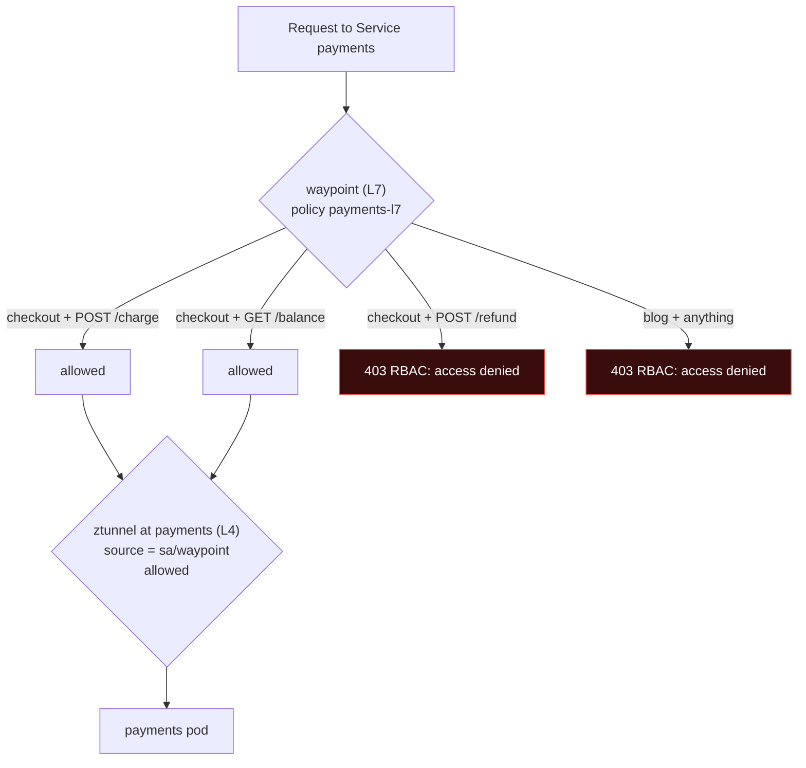

> **Defence in depth bonus:** with the L4 policy in place, a pod that tries to **skip** the waypoint and connect straight to a payments pod IP is still blocked by ztunnel unless it runs as `sa/checkout`. Keep both layers.

### Step 8: A canary inside the cluster

ShopKart's payments team has `payments-v2` with a new UPI retry flow. They want 10% of internal traffic on v2, plus a header that lets testers force v2. This is the Day 23 canary, but **east-west**.

`06-payments-v2.yaml` adds a `payments-v2` Deployment (same as v1 with `version: v2`) and two version-specific Services:

```yaml
apiVersion: v1
kind: Service
metadata:
  name: payments-v1
  namespace: shopkart
spec:
  selector:
    app: payments
    version: v1
  ports:
  - name: http
    port: 80
    targetPort: 3000
---
apiVersion: v1
kind: Service
metadata:
  name: payments-v2
  namespace: shopkart
spec:
  selector:
    app: payments
    version: v2
  ports:
  - name: http
    port: 80
    targetPort: 3000
```

`07-payments-route.yaml`, an HTTPRoute whose **parent is the payments Service**:

```yaml
apiVersion: gateway.networking.k8s.io/v1
kind: HTTPRoute
metadata:
  name: payments
  namespace: shopkart
spec:
  parentRefs:
  - group: ""              # core API group
    kind: Service          # a Service, not a Gateway: this is east-west (GAMMA)
    name: payments
    port: 80
  rules:
  - matches:
    - headers:
      - name: x-canary
        value: "true"
    backendRefs:
    - name: payments-v2
      port: 80
  - backendRefs:
    - name: payments-v1
      port: 80
      weight: 90
    - name: payments-v2
      port: 80
      weight: 10
```

```bash
kubectl apply -f 06-payments-v2.yaml -f 07-payments-route.yaml

kubectl get httproute payments -n shopkart \
  -o jsonpath='{range .status.parents[*].conditions[*]}{.type}={.status} {.reason}{"\n"}{end}'
# Accepted=True Accepted
# ResolvedRefs=True ResolvedRefs
# ResolvedWaypoints=True ResolvedWaypoints      <- mesh-specific: a waypoint will apply this route

# 100 calls from checkout
for i in $(seq 1 100); do
  kubectl -n shopkart exec deploy/checkout -- curl -s http://payments/balance \
    | grep '"pod"' | sed -E 's/.*"(payments-v[12]).*/\1/'
done | sort | uniq -c
#      90 payments-v1
#      10 payments-v2

# Testers force v2
for i in $(seq 1 10); do
  kubectl -n shopkart exec deploy/checkout -- curl -s -H "x-canary: true" http://payments/balance \
    | grep '"pod"' | sed -E 's/.*"(payments-v[12]).*/\1/'
done | sort | uniq -c
#      10 payments-v2
```

The checkout code still calls `http://payments`. It has no idea a canary exists. And the L7 security policy from Step 7 still applies, because it is attached to the `payments` Service that checkout addresses.

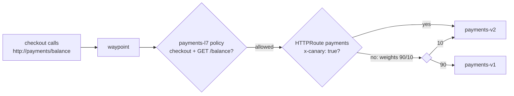

### Step 9: PeerAuthentication STRICT - no plaintext from outside the mesh

By default, ambient workloads also **accept plaintext** from clients that are not in the mesh. This is called **PERMISSIVE** mode, and it exists so you can migrate gradually. But it means a pod in a non-enrolled namespace can still talk to your services in plaintext, with no identity.

Let us prove it. `08-catalog-and-legacy.yaml` adds a `catalog` service in `shopkart` (no authorization policy on it) and an `old-batch-job` curl pod in a `legacy` namespace that is **not** enrolled in the mesh.

```bash
kubectl apply -f 08-catalog-and-legacy.yaml

kubectl -n legacy exec deploy/old-batch-job -- curl -s -o /dev/null -w "%{http_code}\n" \
  http://catalog.shopkart/items
# 200          <- plaintext, no identity, accepted (PERMISSIVE)

kubectl -n legacy exec deploy/old-batch-job -- curl -sS http://payments.shopkart/balance
# curl: (56) Recv failure: Connection reset by peer
#              <- payments is protected anyway: its ALLOW policy needs an identity
```

Payments is safe because it has an ALLOW policy, and a plaintext client has no identity to match. Catalog has no policy, so it is open. Now require mTLS for the whole namespace (`09-peerauth-strict.yaml`):

```yaml
apiVersion: security.istio.io/v1
kind: PeerAuthentication
metadata:
  name: default            # "default" in a namespace = namespace-wide setting
  namespace: shopkart
spec:
  mtls:
    mode: STRICT           # only mTLS (mesh) traffic is accepted
```

```bash
kubectl apply -f 09-peerauth-strict.yaml

kubectl -n legacy exec deploy/old-batch-job -- curl -sS http://catalog.shopkart/items
# curl: (56) Recv failure: Connection reset by peer

kubectl -n shopkart exec deploy/checkout -- curl -s -o /dev/null -w "%{http_code}\n" http://catalog/items
# 200          <- mesh workloads are unaffected
```

ztunnel's reason:

```
error="connection closed due to policy rejection: explicitly denied by: istio-system/istio_converted_static_strict"
```

Istio converted the STRICT PeerAuthentication into a deny rule for anything that is not mTLS.

| Mode | Accepts mTLS from mesh workloads | Accepts plaintext from non-mesh workloads | Use when |
|---|---|---|---|
| `PERMISSIVE` (default) | Yes | Yes | During migration, while some clients are not yet in the mesh |
| `STRICT` | Yes | **No** | Once all legitimate clients are enrolled; the target state for regulated data |

**A safe rollout order in a real company:** enrol namespaces one by one (PERMISSIVE), check the ztunnel logs and metrics for remaining plaintext clients, enrol or retire them, then switch to STRICT, one namespace at a time, then mesh-wide by putting a PeerAuthentication named `default` in `istio-system`.

### Step 10: Clean up

```bash
minikube delete -p mesh-lab
```

### What you built

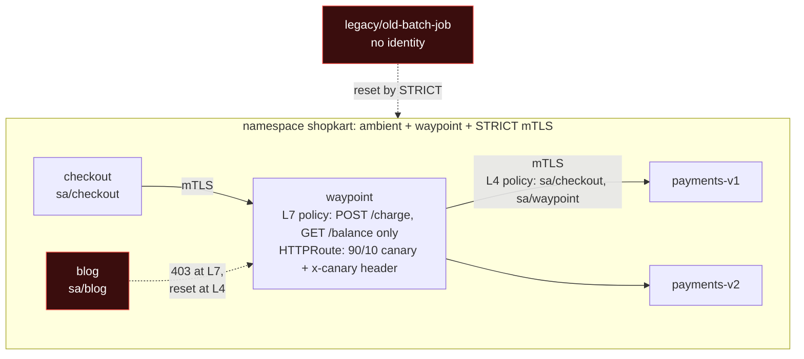

And not one line of application code changed.

---

## Part 7: The Alternative Without a Mesh - Cilium Transparent Encryption

If your requirement is **only** "encrypt traffic between nodes" and you already use Cilium as your CNI, you may not need a mesh at all. Cilium can encrypt traffic in the kernel using **WireGuard** (modern, simple, fast) or **IPsec** (older, sometimes required by compliance teams).

Enabling WireGuard at install time (from Cilium's documentation):

```bash
helm install cilium cilium/cilium --namespace kube-system \
  --set encryption.enabled=true \
  --set encryption.type=wireguard

# Verify from a Cilium agent pod
kubectl -n kube-system exec ds/cilium -- cilium-dbg status | grep Encryption
# Encryption: Wireguard [cilium_wg0 (Pubkey: <..>, Port: 51871, Peers: 2)]
```

(This snippet is from the official docs and was not run in our Minikube lab, which uses a different CNI.)

What you get and what you do not:

| | Cilium WireGuard | Istio ambient (lab) |
|---|---|---|
| Pod-to-pod across nodes encrypted | Yes | Yes |
| Pod-to-pod on the **same node** encrypted | **No** (Cilium docs: packets destined to the same node are not encrypted) | Yes (proved in Step 4) |
| Who holds the keys | Each **node** | Each **workload identity** (ServiceAccount) |
| Policy based on cryptographic workload identity | No (Cilium policies use label-based identities) | Yes |
| First packets before the destination is known | Cilium docs warn initial packets may go out unencrypted; strict mode mitigates (IPv4 only, with conditions) | Not applicable: no tunnel, no delivery |
| Extra proxies | None for encryption | ztunnel per node |
| L7 rules | Via Cilium's Envoy | Via waypoints |

**Good choice when** the audit says "encrypt in transit between hosts" and you trust workloads on the same node equally. **Not enough when** the requirement is "authenticate the calling service" or "least privilege between services".

---

## Common Mistakes

1. **Running every workload as the `default` ServiceAccount.** Every pod gets the same identity, and identity policy cannot tell them apart. One ServiceAccount per workload.
2. **Adding a waypoint while an L4 ALLOW policy lists only client identities.** Everything returns 503 because traffic now arrives from `sa/waypoint` (Step 7).
3. **Allowing the waypoint at L4 without an L7 policy that checks the original caller.** You silently reopen access to everyone (Step 7, the blog got 200).
4. **Putting HTTP fields (methods, paths) in a `selector`-based policy in ambient mode.** ztunnel cannot evaluate L7, so the policy fails safe and acts as a DENY. Use `targetRefs` to a Service or waypoint.
5. **Switching to STRICT before all clients are enrolled.** Legacy jobs, monitoring scrapers and CronJobs outside the mesh suddenly fail. Check the logs for plaintext clients first.
6. **Forgetting `global.platform` on Minikube, k3d or k3s.** Ambient installs, but traffic is never captured.
7. **Treating the mesh as a replacement for NetworkPolicy.** Keep both: NetworkPolicy works even if the mesh is misconfigured or bypassed.
8. **Installing a mesh because it is fashionable.** Without a clear need (encryption, identity policy, L7 traffic control), you pay the operational cost for nothing.
9. **Assuming Cilium WireGuard gives workload identity or same-node encryption.** It does neither.
10. **Expecting denied L4 calls to return 403.** L4 denials are connection resets (curl exit 56). Only L7 denials return HTTP 403.

---

## Troubleshooting Guide

| Symptom | Where to look | Likely cause | Fix |
|---|---|---|---|
| Namespace labelled but traffic still plaintext on port 3000 | `kubectl get pods -n istio-system`; ztunnel logs show no entries for your pods | istio-cni not configured for the platform, or ztunnel not running | Reinstall with the right `global.platform`; check istio-cni-node logs |
| `curl: (56) Recv failure: Connection reset by peer` | ztunnel logs on the destination side, search `policy rejection` | L4 AuthorizationPolicy or STRICT PeerAuthentication rejected the caller | Add the caller's principal, or enrol the caller in the mesh |
| `503 ... reset reason: connection termination` right after adding a waypoint | ztunnel log shows `src.identity=.../sa/waypoint` rejected | L4 policy does not allow the waypoint identity | Add `sa/waypoint` to L4 principals AND add an L7 policy with `targetRefs` |
| `403 RBAC: access denied` | Waypoint logs; your L7 policy | L7 policy does not allow this method/path/caller | Correct the `to.operation` or `from.source` rules |
| L7 policy seems ignored | `kubectl get gateway -n <ns>`; namespace labels | No waypoint, or namespace/service not labelled `istio.io/use-waypoint`, or policy uses `selector` | Create and attach the waypoint; use `targetRefs` |
| HTTPRoute with Service parent has no effect | Route status `ResolvedWaypoints` | No waypoint for that Service | Create a waypoint and label the namespace or Service |
| Waypoint Gateway `PROGRAMMED False` | `kubectl describe gateway waypoint` | Gateway API CRDs missing or wrong version; istiod not ready | Install the Gateway API CRDs version listed in Istio's docs |
| Monitoring scrape or old Job fails after STRICT | ztunnel log: `istio_converted_static_strict` | Plaintext client outside the mesh | Enrol the client namespace, or use PERMISSIVE for that namespace until migrated |

The single most useful command in ambient mode:

```bash
kubectl logs -n istio-system ds/ztunnel --tail=50 | grep -E "error|policy"
```

---

## Interview Questions (with answers)

**Q1. What does a service mesh give you that NetworkPolicy does not?**
Encryption of service-to-service traffic (mTLS), cryptographic workload identity instead of IPs and labels, L7 authorization on methods and paths, traffic control (canaries, retries, timeouts) between services, and uniform telemetry. NetworkPolicy is an L3/L4 allow-list by labels and IPs, with no encryption and no proof of identity. They complement each other.

**Q2. What is mTLS and how is it different from normal TLS?**
Normal TLS authenticates only the server. Mutual TLS authenticates both sides: the client also presents a certificate. In a mesh, both certificates carry SPIFFE identities derived from ServiceAccounts, so the server knows exactly which workload is calling, and the connection is encrypted.

**Q3. What is a SPIFFE ID? Give an example.**
A standard URI format for workload identity: `spiffe://<trust-domain>/<path>`. Istio uses `spiffe://cluster.local/ns/<namespace>/sa/<serviceaccount>`, for example `spiffe://cluster.local/ns/shopkart/sa/checkout`. It is embedded in a short-lived X.509 certificate (24 hours by default in Istio) issued by the mesh's CA.

**Q4. Explain Istio ambient mode. How does it differ from sidecars?**
Ambient removes per-pod sidecars. A per-node Rust proxy, ztunnel, captures traffic from enrolled pods (set up by istio-cni inside the pod's network namespace) and provides mTLS, identity and L4 policy over HBONE tunnels on port 15008. L7 features are added only where needed with waypoint proxies, which are Envoy deployments declared as Gateway API Gateways. Pods join by labelling the namespace, with no restart, and the per-pod resource cost disappears.

**Q5. You add a waypoint and suddenly all calls to a service return 503. Why?**
Traffic now reaches the destination from the waypoint's identity, and an existing L4 ALLOW policy lists only the original clients. ztunnel rejects the waypoint. Allow the waypoint's principal at L4 and move the client-identity check into an L7 policy targeted at the Service, applied together so there is no gap.

**Q6. Difference between L4 and L7 authorization in practice?**
L4 decides whether an identity may open a connection to a workload; it is cheap and enforced by ztunnel, and denials are connection resets. L7 decides whether a specific HTTP request (method, path, headers) is allowed; it needs an HTTP proxy (waypoint or sidecar), and denials are HTTP 403 responses.

**Q7. What do PERMISSIVE and STRICT mean in PeerAuthentication?**
PERMISSIVE accepts both mTLS and plaintext, to allow gradual migration. STRICT accepts only mTLS, so clients outside the mesh are rejected. Migrate namespace by namespace, confirm no plaintext clients remain, then switch to STRICT.

**Q8. When would you NOT use a service mesh?**
Small systems with no requirement for internal encryption or identity-based policy, teams without capacity to operate it, or when NetworkPolicy plus app-level auth meets the requirement. If only node-to-node encryption is needed and the CNI is Cilium, WireGuard encryption may be enough.

**Q9. Compare Cilium WireGuard encryption with Istio ambient mTLS.**
Cilium encrypts in the kernel with node-level keys, needs no proxies, but provides no workload identity, does not encrypt same-node traffic, and may send initial packets unencrypted before endpoint discovery unless strict mode is configured. Istio ambient encrypts per workload with SPIFFE identities, including same-node traffic, and supports identity-based L4 policy, at the cost of a per-node proxy and the mesh control plane.

**Q10. How does Gateway API relate to service mesh?**
Through the GAMMA initiative, HTTPRoutes can have a Service as their parent to control east-west traffic. Istio ambient uses Gateway API Gateways (class `istio-waypoint`) as waypoints, so one API covers both ingress and in-mesh routing.

---

## Quick Self-Check

1. Name three things NetworkPolicy cannot do that a mesh can.
2. What single command enrolled the ShopKart pods into the mesh, and how many pods restarted?
3. Which port carries HBONE traffic, and what did `tcpdump` show before and after enrolment?
4. What is the SPIFFE ID of the checkout workload, and where does it come from?
5. Why did the blog get `curl exit 56` in Step 6 but `403` in Step 7?
6. After adding the waypoint, why did checkout get 503, and what two changes fix it?
7. Which field attaches an L7 policy to a Service in ambient mode: `selector` or `targetRefs`?
8. A monitoring tool outside the mesh stops working after you apply STRICT. Why?
9. Give one limitation of Cilium WireGuard encryption compared with ambient mTLS.

**Answers:** (1) Encryption, cryptographic identity, L7 (method/path) rules; also traffic control and telemetry. (2) `kubectl label namespace shopkart istio.io/dataplane-mode=ambient`; zero restarts. (3) Port 15008; before, plaintext HTTP on port 3000 including the card number; after, only port 15008 and no plaintext. (4) `spiffe://cluster.local/ns/shopkart/sa/checkout`, from the pod's ServiceAccount, in a certificate issued by istiod. (5) Step 6 was an L4 denial by ztunnel (connection reset); Step 7 was an L7 denial by the waypoint (HTTP 403). (6) The traffic reached payments with the waypoint's identity, which the L4 policy did not allow; allow `sa/waypoint` at L4 and add an L7 policy checking `sa/checkout`. (7) `targetRefs`. (8) It sends plaintext without a mesh identity, and STRICT rejects non-mTLS traffic. (9) Any of: no workload identity, same-node traffic not encrypted, possible unencrypted initial packets without strict mode.

---

## Summary

- East-west traffic is where attackers move after a break-in. By default it is plaintext and unauthenticated.
- NetworkPolicy is necessary but cannot encrypt, prove identity or understand HTTP. A service mesh adds **mTLS**, **SPIFFE workload identity**, **L4 and L7 authorization**, traffic control and telemetry.
- The industry is moving from **sidecars** to **sidecarless** designs. Istio ambient gives every workload L4 security through a per-node **ztunnel** and adds L7 **waypoints** only where needed. Waypoints are Gateway API Gateways, and in-mesh routing uses HTTPRoutes with a Service parent.
- In the lab, one namespace label encrypted all traffic (proved with tcpdump) with zero restarts. An L4 policy locked payments to checkout. A waypoint plus an L7 policy limited even checkout to two endpoints. An HTTPRoute ran a 90/10 canary. STRICT mTLS rejected plaintext clients.
- Not every cluster needs a mesh. Use the decision flowchart: NetworkPolicy for basic segmentation, Cilium WireGuard for node-level encryption, ambient ztunnel for identity and encryption, waypoints or a full mesh for L7.

## Key Takeaways

1. Zero trust: being inside the cluster proves nothing. Encrypt and authenticate every connection.
2. Identity comes from the ServiceAccount, so give every workload its own.
3. L4 denies with a reset, L7 denies with a 403. Know which layer you are debugging.
4. When you add a waypoint, allow it at L4 and check the real caller at L7, in the same change.
5. A mesh is a tool with a running cost. Justify it with a requirement.

---

## Practice / Homework

1. **Repeat the proof.** Run the tcpdump capture before and after enrolment yourself. Then remove the namespace label (`kubectl label namespace shopkart istio.io/dataplane-mode-`) and show that plaintext returns.
2. **Back-office refunds.** Create a `refunds-admin` ServiceAccount and Deployment. Extend the L7 policy so only `refunds-admin` may call `POST /refund`. Prove checkout still gets 403 on refunds.
3. **Header-based authorization.** Add an L7 rule that allows `GET /balance` only when the request carries header `x-tenant: shopkart`. (Hint: `when` conditions on `request.headers[...]`.)
4. **Move the canary.** Change the payments route to 50/50, then 0/100. Measure with 100 calls at each step. Then add a `timeout` to the route and observe it with a slow backend.
5. **Layer it.** Add a Day 20 NetworkPolicy that allows ingress to payments only from pods in `shopkart`. Confirm the mesh still works, and explain which layer blocks what.
6. **Measure the cost.** Enable `metrics-server` (`minikube addons enable metrics-server -p mesh-lab`) and record `kubectl top pods -n istio-system` and the waypoint while sending a loop of 1,000 requests.
7. **Research.** Read Istio's ambient documentation on how ztunnel handles traffic to workloads outside the mesh, and write three sentences on why PERMISSIVE exists.

---

## References

- Istio ambient mode overview: https://istio.io/latest/docs/ambient/overview/
- Istio ambient getting started: https://istio.io/latest/docs/ambient/getting-started/
- Install ambient with Helm: https://istio.io/latest/docs/ambient/install/helm/
- Platform-specific prerequisites (minikube, k3d, k3s): https://istio.io/latest/docs/ambient/install/platform-prerequisites/
- Enforce authorization policies in ambient: https://istio.io/latest/docs/ambient/getting-started/enforce-auth-policies/
- SPIFFE: https://spiffe.io/
- Cilium transparent encryption: https://docs.cilium.io/en/stable/security/network/encryption/
- Cilium WireGuard: https://docs.cilium.io/en/stable/security/network/encryption-wireguard/
- Gateway API mesh support (GAMMA): https://gateway-api.sigs.k8s.io/mesh/
- NIST SP 800-207, Zero Trust Architecture: https://csrc.nist.gov/pubs/sp/800/207/final

---

**Previous:** [Day 23 - Gateway API](../day23-gateway-api/notes.md) | **Next:** [Day 25 - Policy, Supply Chain and Runtime Security](../day25-policy-supply-chain-runtime/notes.md)
