# Day 25 - Policy, Supply Chain and Runtime Security

> **Goal:** Learn the three security layers that sit around every container in production: **policy** (what is allowed into the cluster), **supply chain** (can you trust the image), and **runtime** (what the container actually does once it runs). Then build all three for ShopKart: native CEL policies, Kyverno validate/mutate/generate policies, an SBOM and vulnerability scan, image signing with cosign checked at admission, and Falco and Tetragon catching (and killing) an attacker inside a pod.

> **Pre-requisites:** [Day 17 - RBAC and Security](../day17-rbac-security/notes.md) (the three gates, Pod Security), [Day 20 - Network Policies](../day20-network-policies/notes.md), [Day 23 - Gateway API](../day23-gateway-api/notes.md) and [Day 24 - Zero-Trust Networking and Service Mesh](../day24-zero-trust-service-mesh/notes.md). ShopKart, the Hyderabad e-commerce startup from Day 23, is our running example again.

> **Every command and output in the labs was run on a real cluster** in October 2026: Minikube v1.38, Kubernetes v1.35, Kyverno v1.19.2 (Helm chart 3.9.2), Falco 0.45.2 (chart 9.2.2) with Falcosidekick 2.35.1, Tetragon 1.8.0, cosign v3.1.4, Trivy 0.76.1 and Syft 1.55.0. Pod names, digests and timestamps will differ on your machine; the behaviour will not. The one block that was **not** run is the GitHub Actions workflow in Part 9, which needs a real GitHub repository; it is marked clearly.

---

## Learning Objectives

By the end of this lesson you will be able to:

1. Draw the container lifecycle (build, registry, admission, runtime) and name the control that protects each stage.
2. Explain how **admission control** works (mutating, then validating) and why admission webhooks are themselves an attack surface.
3. Say what **Pod Security Admission** can and cannot do, and why a policy engine is still needed.
4. Write a native **ValidatingAdmissionPolicy** in CEL and bind it to namespaces with Deny, Warn or Audit actions.
5. Choose between **ValidatingAdmissionPolicy, Kyverno and OPA Gatekeeper** for a given team.
6. Write Kyverno **ValidatingPolicy, MutatingPolicy, GeneratingPolicy and ImageValidatingPolicy** objects, roll them out with Audit before Deny, and read **PolicyReports**.
7. Explain the big **software supply chain attacks** (SolarWinds, Codecov, xz-utils, tj-actions, the 2026 Trivy compromise) and the defence each one teaches.
8. Generate an **SBOM** with Syft, scan with **Trivy**, sign with **cosign** (key pair and keyless), and verify signatures at admission time.
9. Explain why you deploy by **digest**, not tag, and demonstrate a tag-swap attack being blocked.
10. Explain how **Falco** and **Tetragon** use eBPF to watch system calls, write a custom Falco rule, send alerts to Slack or a SIEM with Falcosidekick, and use Tetragon to **kill** a malicious process in the kernel.

---

## Why This Lesson Exists: Three Bad Nights at ShopKart

It is a week before the Diwali sale. ShopKart's platform is now on Gateway API (Day 23), traffic between services is encrypted with mTLS (Day 24), every namespace has a default-deny NetworkPolicy (Day 20), and RBAC is tight (Day 17). The security team still has three incidents in one week:

1. **Monday: the "temporary" debug pod.** An engineer deploys a `privileged: true` busybox pod into production to debug a disk problem, then forgets it. A privileged container can see the host's devices and can usually escape to the node. RBAC allowed it, because the engineer is allowed to create pods in that namespace. RBAC answers **who** may create a pod, not **what kind** of pod.
2. **Wednesday: the swapped image.** A contractor's laptop with registry push access is compromised. The attacker pushes a different image under the existing tag `catalog:1.0.0`. The next time a pod restarts, Kubernetes pulls the attacker's image. Nothing in Days 17 to 24 checks **where an image came from**.
3. **Friday, 3 AM: the miner.** An old, unpatched pod gets exploited through a web vulnerability. The attacker opens a shell, reads `/etc/shadow`, downloads a crypto-miner and connects it to a mining pool. NetworkPolicy blocks some of it, but nobody **notices** until the AWS bill arrives.

Each incident happened at a different stage of the container's life, and each needs a different control:

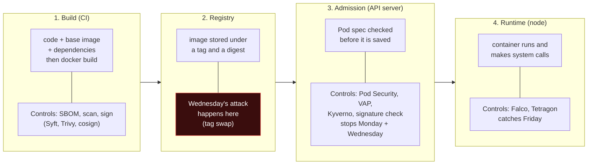

> **The big idea of this lesson:** no single control stops everything. Security is **defence in depth**: several independent layers, so an attacker who gets past one is caught by the next. Days 17, 20, 23 and 24 built the network and identity layers. Today adds the layers around the **workload itself**.

---

## Real-World Analogy: Airport Security, Continued

In Day 23 the Gateway was an airport terminal. Today, think about how the airport keeps dangerous luggage off planes.

- **Build = the factory and the packing.** A suitcase is made and packed. A **manufacturer's seal** (the image **signature**) proves who packed it and that nobody opened it afterwards. A **packing list** (the **SBOM**) lists everything inside.
- **Registry = the baggage warehouse.** Bags wait here with a **tag**. Tags can be peeled off and stuck on another bag; the **barcode printed into the bag itself** (the **digest**) cannot.
- **Admission = the check-in counter and X-ray.** Before a bag is accepted, staff check the rules: no liquids over 100 ml (**policy**), seal intact and from an approved packer (**signature verification**), and they add a priority sticker if needed (**mutation**).
- **Runtime = CCTV and the air marshal.** Even after all checks, people watch the cameras (**Falco**, detection) and an air marshal can stop a passenger mid-flight (**Tetragon**, enforcement).

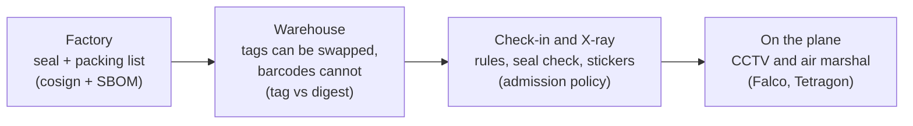

---

## Part 1: The Defence-in-Depth Map

Here is where every security topic in this module sits. Use this table to answer the classic interview question "how do you secure a Kubernetes cluster?" in an organised way.

| Layer | Question it answers | Kubernetes tools | Day |
|---|---|---|---|
| **Identity and access** | Who can call the API, and what can they do? | RBAC, ServiceAccounts, cloud IAM bridges | 17 |
| **Workload baseline** | Is this pod obviously dangerous (privileged, root, host access)? | Pod Security Admission | 17, 25 |
| **Network segmentation** | Which pods may talk to which? | NetworkPolicy, Cilium policies | 20 |
| **Edge** | Who can reach the cluster from outside, over what protocol? | Gateway API, TLS, WAF | 23 |
| **Service identity and encryption** | Is service-to-service traffic encrypted and authenticated? | mTLS, Istio ambient, Cilium | 24 |
| **Custom policy (policy as code)** | Does this object follow *our* rules (tags, labels, limits, registries)? | ValidatingAdmissionPolicy, Kyverno, OPA Gatekeeper | 25 |
| **Supply chain** | Can we trust this image? What is inside it? | Syft (SBOM), Trivy (scan), cosign (sign), admission verification | 25 |
| **Runtime** | Is the running container doing something it should not? | Falco (detect), Tetragon (detect and enforce) | 25 |
| **Secrets** | Are credentials stored and delivered safely? | External Secrets, Vault, Sealed Secrets | 10 |

---

## Part 2: Admission Control Refresher

In Day 17 you learned that every API request passes **three gates**: authentication (who are you?), authorization (RBAC: are you allowed?), and **admission** (is this object acceptable?). Today is all about the third gate, so let us zoom in.

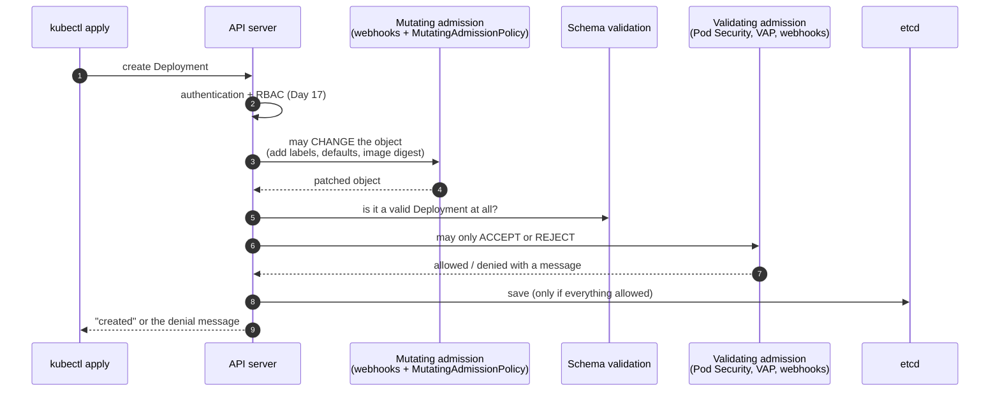

Key facts:

- **Mutating runs before validating.** So a validating policy always sees the final object, including anything a mutating policy added.
- There are **two ways** to run admission logic:
  - **In-process CEL policies** (ValidatingAdmissionPolicy): the API server evaluates the rules itself. No extra network hop, nothing extra to keep running.
  - **Admission webhooks**: the API server sends the object over HTTPS to a service in the cluster (Kyverno, Gatekeeper) and waits for an answer.
- Each webhook has a **failurePolicy**: `Fail` (if the webhook is down, reject the request) or `Ignore` (if the webhook is down, allow the request). `Fail` is safer but means a broken policy engine can stop **all** deployments. `Ignore` keeps the cluster working but lets everything through while the engine is down.

> **Connect it to Day 23.** IngressNightmare (CVE-2025-1974) was a bug in an **admission webhook**: ingress-nginx's own validating webhook, reachable from every pod with no authentication. Policy engines are powerful precisely because they sit in the API request path, and that makes them high-value targets. Run them with minimal RBAC, keep them patched, restrict network access to their webhook service, and prefer in-process CEL where it is enough.

---

## Part 3: Pod Security Admission, and Where It Stops

Pod Security Admission (PSA) is built into Kubernetes. You label a namespace with one of three **Pod Security Standards**:

| Level | Meaning |
|---|---|
| `privileged` | No restrictions |
| `baseline` | Blocks the obviously dangerous: privileged containers, host namespaces, hostPath, adding dangerous capabilities |
| `restricted` | Baseline plus hardening: must run as non-root, drop ALL capabilities, no privilege escalation, a seccomp profile |

Each level can be applied in three modes: `enforce` (reject), `audit` (record in the audit log), `warn` (show the user a warning).

Real output from our lab, with the namespace labelled `pod-security.kubernetes.io/enforce=restricted`:

```bash
kubectl create ns psa-demo
kubectl label ns psa-demo \
  pod-security.kubernetes.io/enforce=restricted \
  pod-security.kubernetes.io/enforce-version=latest

kubectl -n psa-demo run root-shell --image=busybox:1.37 -- sleep 3600
# Error from server (Forbidden): pods "root-shell" is forbidden: violates PodSecurity "restricted:latest":
#   allowPrivilegeEscalation != false (container "root-shell" must set securityContext.allowPrivilegeEscalation=false),
#   unrestricted capabilities (container "root-shell" must set securityContext.capabilities.drop=["ALL"]),
#   runAsNonRoot != true (pod or container "root-shell" must set securityContext.runAsNonRoot=true)
```

PSA did its job. Now watch what it does **not** catch. A fully hardened pod that uses `nginx:latest`:

```bash
kubectl -n psa-demo run tagged-latest --image=nginx:latest --overrides='{"spec":{"securityContext":
  {"runAsNonRoot":true,"runAsUser":101,"seccompProfile":{"type":"RuntimeDefault"}},
  "containers":[{"name":"tagged-latest","image":"nginx:latest","securityContext":
  {"allowPrivilegeEscalation":false,"capabilities":{"drop":["ALL"]}}}]}}'
# pod/tagged-latest created
```

**PSA has fixed rules.** It cannot express:

- "Images must have a version tag, never `:latest`."
- "Images must come from `registry.shopkart.in` only."
- "Every Deployment must have an `owner` label and resource limits."
- "Images must be **signed** by our CI pipeline."
- "Every new namespace must **get** a default-deny NetworkPolicy automatically."
- "HTTPRoutes must set `sectionName: https`" (the Day 23 trap).

For those you need **policy as code**. PSA stays on as your safety net; policy engines add your organisation's own rules on top.

---

## Part 4: Three Ways to Write Policy as Code

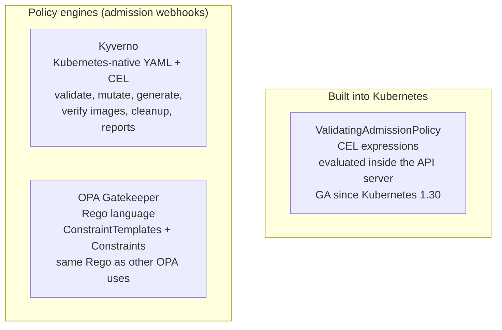

| | ValidatingAdmissionPolicy (native) | Kyverno | OPA Gatekeeper |
|---|---|---|---|
| Language | CEL | CEL (new policy types) and YAML; older ClusterPolicy used patterns and JMESPath | Rego |
| Runs where | Inside the API server | Webhook (pods in the cluster) | Webhook (pods in the cluster) |
| Install needed | No | Yes (Helm) | Yes (Helm) |
| Validate | Yes | Yes | Yes |
| Mutate | Native MutatingAdmissionPolicy exists but is newer; check your Kubernetes version | Yes | Yes (assign / modify set) |
| Generate new resources | No | **Yes** | No |
| Verify image signatures | No | **Yes** | Not built in (needs external data provider) |
| Reports on existing resources | No (audit annotations only) | **PolicyReports** (background scans) | Audit results on constraints |
| Learning curve | Low if you know CEL | Low to medium | Higher (Rego) |
| Best for | Simple rules, no extra component, platform-critical guardrails | Most Kubernetes teams; the widest feature set | Organisations already using OPA/Rego elsewhere (Terraform, APIs) |

**How to choose, in practice:**

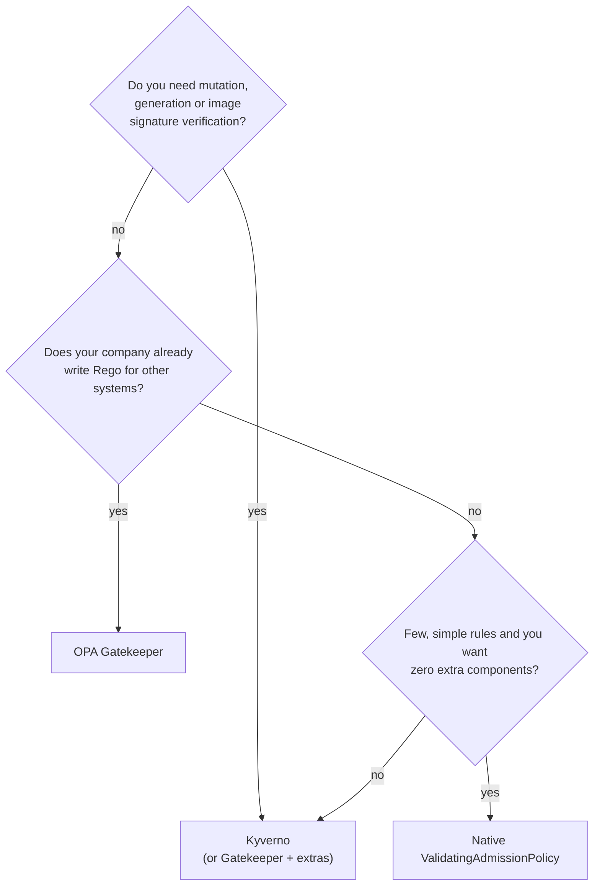

> **Real example from this lab:** when we installed the Gateway API v1.7.0 CRDs, the install also created a ValidatingAdmissionPolicy called `safe-upgrades.gateway.networking.k8s.io`. Projects now ship their own guardrails as native CEL policies, because every cluster can run them with nothing extra installed.

> **Important Kyverno news (2026):** Kyverno moved to CEL-based policy types: **ValidatingPolicy, MutatingPolicy, GeneratingPolicy, ImageValidatingPolicy and DeletingPolicy** (`policies.kyverno.io/v1`, stable since Kyverno 1.18), each with a namespaced variant. The classic `ClusterPolicy` (`kyverno.io/v1`) is **deprecated in v1.19** and scheduled for removal in **v1.20** (estimated November 2026). You will still see `ClusterPolicy` in blog posts and existing clusters, but this lesson teaches the new types, and Kyverno prints a deprecation warning if you create an old one.

---

## Part 5: A CEL Crash Course (Enough for Every Policy in This Lesson)

CEL (Common Expression Language) is a small, safe expression language. It cannot loop forever or touch the network, which is why the API server is willing to run it. Every expression returns a value; validation expressions must return `true` (allow) or `false` (deny).

| CEL | Meaning | Example |
|---|---|---|
| `object` | The object being created or updated | `object.metadata.name` |
| `oldObject` | The previous version (on UPDATE) | `oldObject.spec.replicas` |
| `has(x.y)` | Does the field exist? | `has(object.metadata.labels)` |
| `x.?y.orValue(d)` | Optional access with a default | `c.?securityContext.?privileged.orValue(false)` |
| `list.all(v, cond)` | Condition true for every item | `object.spec.containers.all(c, ...)` |
| `list.exists(v, cond)` | True for at least one item | `...exists(c, c.image.startsWith('docker.io/'))` |
| `list.map(v, expr)` | Transform each item | `containers.map(c, c.image)` |
| `'k' in map` | Key present in a map | `'memory' in c.resources.limits` |
| String functions | `startsWith`, `endsWith`, `contains`, `split`, `matches` | `c.image.endsWith(':latest')` |

**A real bug we hit while writing the lab**, and the lesson in it: the first version of the "must have a tag" rule was `c.image.contains(':')`. An image like `registry.shopkart.in:5000/catalog` contains a colon (the registry port) but has **no tag** at all, so it would pass. The fix checks only the part after the last `/`:

```
c.image.split('/')[size(c.image.split('/')) - 1].contains(':')
```

Policies are code. Test them with tricky inputs exactly like you test application code.

---

## Lab Setup

```bash
# A dedicated profile so the lab never touches your other clusters
minikube start -p policy-lab --driver=docker --cpus=3 --memory=3200
kubectl config use-context policy-lab
```

---

## Lab Part A: Native ValidatingAdmissionPolicy

**Requirement from the ShopKart platform team:** in production namespaces, every Deployment must use a pinned image tag (or a digest), never `:latest` or no tag, and every container must have a memory limit and a CPU request (Day 16 explained why).

A native policy has **two objects**: the **policy** (the rules) and the **binding** (where they apply and what happens on failure). One policy can have several bindings, for example Deny in production and Warn in staging.

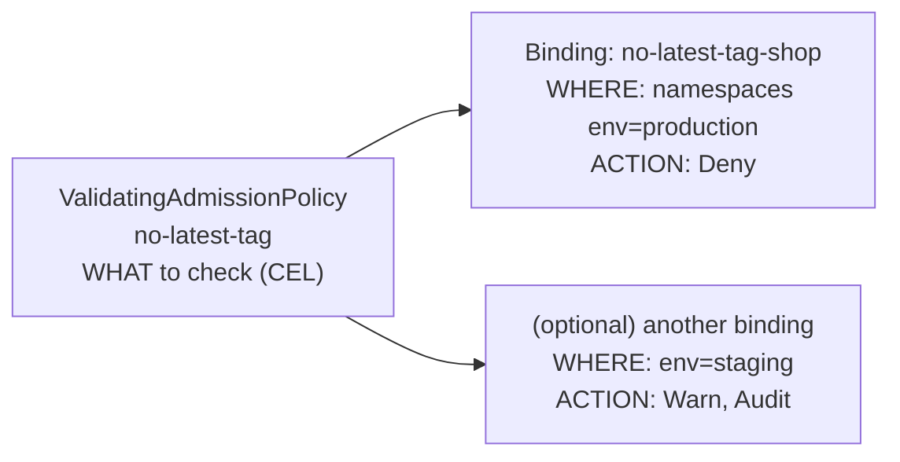

`01-vap-no-latest.yaml`:

```yaml
apiVersion: admissionregistration.k8s.io/v1
kind: ValidatingAdmissionPolicy
metadata:
  name: no-latest-tag
spec:
  failurePolicy: Fail                 # if the CEL itself errors, reject (safe default)
  matchConstraints:
    resourceRules:
    - apiGroups: ["apps"]
      apiVersions: ["v1"]
      operations: ["CREATE", "UPDATE"]
      resources: ["deployments"]
  validations:
  - expression: >-
      object.spec.template.spec.containers.all(c,
        c.image.contains('@sha256:') ||
        (c.image.split('/')[size(c.image.split('/')) - 1].contains(':') &&
         !c.image.endsWith(':latest')))
    message: "Every container image must use an explicit version tag, not ':latest' or no tag."
    reason: Invalid
  - expression: >-
      object.spec.template.spec.containers.all(c,
        has(c.resources) && has(c.resources.limits) &&
        'memory' in c.resources.limits && 'cpu' in c.resources.requests)
    messageExpression: "'Deployment ' + object.metadata.name + ': every container needs a memory limit and a CPU request.'"
---
apiVersion: admissionregistration.k8s.io/v1
kind: ValidatingAdmissionPolicyBinding
metadata:
  name: no-latest-tag-shop
spec:
  policyName: no-latest-tag
  validationActions: ["Deny"]         # Deny | Warn | Audit (Warn and Audit can be combined)
  matchResources:
    namespaceSelector:
      matchLabels:
        env: production
```

```bash
kubectl apply -f 01-vap-no-latest.yaml
kubectl create namespace shop && kubectl label namespace shop env=production
```

Now try the four interesting cases (`03-bad-deploy.yaml` uses `nginx:latest` with no resources):

```bash
# 1) :latest in production
kubectl apply -f 03-bad-deploy.yaml
# The deployments "catalog" is invalid: : ValidatingAdmissionPolicy 'no-latest-tag' with binding
#   'no-latest-tag-shop' denied request: Every container image must use an explicit version tag,
#   not ':latest' or no tag.

# 2) A registry with a port but no tag (the CEL bug from Part 5, now fixed)
#    image: registry.shopkart.in:5000/catalog
# The deployments "catalog2" is invalid: ... denied request: Every container image must use an explicit version tag, ...

# 3) Pinned tag, but no resource limits: the second rule and its messageExpression
# The deployments "catalog" is invalid: ... denied request: Deployment catalog: every container needs
#   a memory limit and a CPU request.

# 4) Same bad Deployment in 'default' (no env=production label): the binding does not match
kubectl apply -f 03-bad-deploy.yaml -n default
# deployment.apps/catalog created
```

A digest instead of a tag is accepted (`nginx@sha256:...`), which is what we want (Part 7 explains why digests are the gold standard).

**Rolling out safely with Warn and Audit.** Before you enforce a rule on a busy cluster, switch the binding to `validationActions: ["Warn", "Audit"]`. Nothing is blocked; users see warnings, and the API server audit log records violations:

```bash
kubectl apply -f 03-bad-deploy.yaml      # (binding switched to Warn + Audit, deployment named legacy-report)
# Warning: Validation failed for ValidatingAdmissionPolicy 'no-latest-tag' with binding 'no-latest-tag-shop':
#   Every container image must use an explicit version tag, not ':latest' or no tag.
# Warning: Validation failed for ValidatingAdmissionPolicy 'no-latest-tag' with binding 'no-latest-tag-shop':
#   Deployment legacy-report: every container needs a memory limit and a CPU request.
# deployment.apps/legacy-report created
```

> **Notice the scope:** this policy matches **Deployments**. A bare Pod, a StatefulSet or a CronJob with `:latest` would still get in. Native policies only check exactly the resources you list. Kyverno's **autogen** (next part) solves this automatically for pod controllers.

---

## Part 6: Kyverno in Depth

### Architecture

Kyverno runs as four controllers in the `kyverno` namespace:

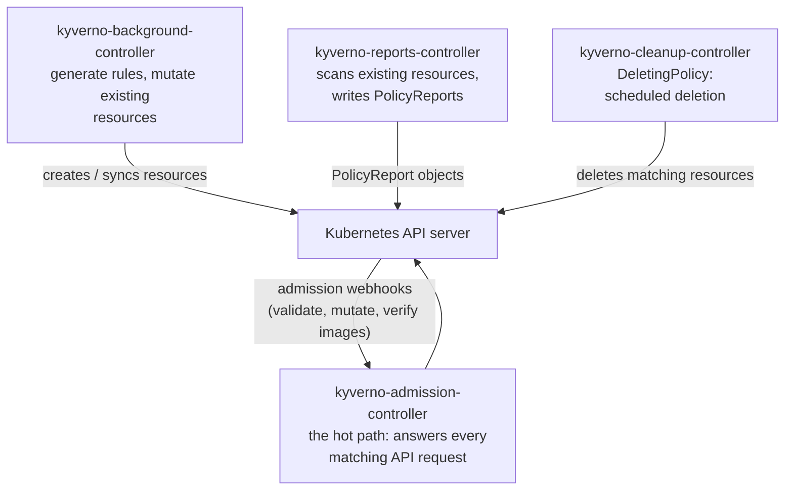

Install (as run in the lab):

```bash
helm repo add kyverno https://kyverno.github.io/kyverno/
helm repo update
helm install kyverno kyverno/kyverno -n kyverno --create-namespace --version 3.9.2

kubectl get pods -n kyverno
# kyverno-admission-controller-74ccfb6869-4cpqn    1/1   Running
# kyverno-background-controller-54478495f-q5nbl    1/1   Running
# kyverno-cleanup-controller-597f6857c4-m8qzv      1/1   Running
# kyverno-reports-controller-86cbfc5499-s4zh6      1/1   Running
```

> For production, run the admission controller with **3 replicas** and read Kyverno's "security vs operability" guidance on excluding system namespaces. With `failurePolicy: Fail`, a Kyverno outage blocks pod creation, including the pods Kyverno itself needs to recover. The Helm install prints this warning for a reason.

### The policy types

| Kyverno type | What it does | ShopKart use in this lab |
|---|---|---|
| **ValidatingPolicy** | Allow or reject (Deny), or just record (Audit, Warn) | No privileged containers; must run as non-root; Gateway guardrails |
| **MutatingPolicy** | Change objects on the way in (or existing ones in the background) | Add a default seccomp profile |
| **GeneratingPolicy** | Create new resources when something happens | Default-deny NetworkPolicy for every new namespace |
| **ImageValidatingPolicy** | Verify image signatures and attestations; can pin images to digests | Only images signed by the ShopKart release key |
| **DeletingPolicy** | Delete matching resources on a schedule | (Homework: delete pods in `Failed` state nightly) |
| **PolicyException** | Exempt specific resources from a policy, with an audit trail | (Homework: exempt the Falco DaemonSet) |

### Audit vs Deny, and PolicyReports

`validationActions: [Audit]` records violations in **PolicyReports** but blocks nothing. `[Deny]` rejects. The safe rollout pattern in every real company:

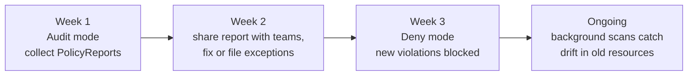

### Autogen: write for Pods, protect every controller

You almost never create Pods directly; Deployments, StatefulSets, Jobs and CronJobs create them. If a policy only checked Pods, a bad Deployment would be **accepted**, and then its ReplicaSet would fail to create pods, which is confusing. Kyverno's **autogen** rewrites a Pod policy into matching rules for the pod controllers, so the **Deployment itself** is rejected with a clear message. You will see this in Part B.

---

## Lab Part B: Kyverno Validate, Mutate, Generate

### B1. The legacy workload that already exists

Before any Kyverno policy exists, an old privileged "agent" is running in `shop` (`05-legacy-privileged.yaml`, busybox with `securityContext.privileged: true`). This is Monday's forgotten debug pod.

```bash
kubectl apply -f 05-legacy-privileged.yaml
# deployment.apps/legacy-agent created
```

### B2. Validate in Audit mode first

`06-kyv-restrict.yaml`:

```yaml
apiVersion: policies.kyverno.io/v1
kind: ValidatingPolicy
metadata:
  name: restrict-privileged-and-root
spec:
  validationActions:
  - Audit                               # start in Audit
  autogen:
    podControllers:
      controllers:                      # also check these controllers' pod templates
      - deployments
      - statefulsets
      - daemonsets
      - jobs
      - cronjobs
  matchConstraints:
    resourceRules:
    - apiGroups: ['']
      apiVersions: ['v1']
      operations: ['CREATE', 'UPDATE']
      resources: ['pods']
    namespaceSelector:
      matchLabels:
        env: production
  validations:
  - message: "Privileged containers are not allowed."
    expression: >-
      object.spec.containers.all(c,
        !(c.?securityContext.?privileged.orValue(false)))
  - message: "Containers must run as non-root: set securityContext.runAsNonRoot to true."
    expression: >-
      object.spec.?securityContext.?runAsNonRoot.orValue(false) ||
      object.spec.containers.all(c, c.?securityContext.?runAsNonRoot.orValue(false))
```

```bash
kubectl apply -f 06-kyv-restrict.yaml

kubectl get validatingpolicy
# NAME                           AGE   READY
# restrict-privileged-and-root   5s    true
```

Kyverno's status shows the autogen result: it generated rules for `deployments`, `statefulsets`, `daemonsets`, `jobs` (paths rewritten to `object.spec.template.spec...`) and for `cronjobs` (`object.spec.jobTemplate.spec.template.spec...`). You write the rule once.

Wait about 30 seconds for the background scan, then read the reports:

```bash
kubectl get policyreport -n shop
# NAME                                   KIND   NAME                            PASS   FAIL   WARN   ERROR   SKIP
# 0b337d08-d35a-49d7-b759-b47b78aa9371   Pod    catalog-79c6878ff7-k9gh6        0      1      0      0       0
# b1e0fb35-8eff-48b1-9e18-7d82f33f8a5e   Pod    legacy-agent-754b96c978-wgmlp   0      1      0      0       0

kubectl get policyreport -n shop -o jsonpath='{range .items[*]}{.scope.kind}/{.scope.name}{"\n"}{range .results[*]}  {.policy} {.result}: {.message}{"\n"}{end}{end}'
# Pod/catalog-79c6878ff7-k9gh6
#   restrict-privileged-and-root fail: Containers must run as non-root: set securityContext.runAsNonRoot to true.
# Pod/legacy-agent-754b96c978-wgmlp
#   restrict-privileged-and-root fail: Privileged containers are not allowed.
```

The report found **both** problems already in the cluster: the forgotten privileged agent, and the catalog (from Part A) which runs nginx as root. Nobody was blocked. This is exactly the data you take to the teams in week 2.

### B3. Switch to Deny

Change `- Audit` to `- Deny` (`07-kyv-restrict-deny.yaml`) and apply. Now test:

```bash
# A new privileged Deployment: rejected at the Deployment level, thanks to autogen
# Error from server: error when creating "STDIN": admission webhook "vpol.validate.kyverno.svc-fail"
#   denied the request: Policy restrict-privileged-and-root failed: Privileged containers are not allowed.

# kubectl run a root pod
kubectl -n shop run shell --image=busybox:1.37 -- sleep 3600
# Error from server: admission webhook "vpol.validate.kyverno.svc-fail" denied the request:
#   Policy restrict-privileged-and-root failed: Containers must run as non-root: set securityContext.runAsNonRoot to true.

# The existing legacy pod? Still running.
kubectl get pods -n shop
# catalog-79c6878ff7-k9gh6        1/1   Running
# legacy-agent-754b96c978-wgmlp   1/1   Running
```

**Admission policies only act when something is created or updated.** Existing violations stay until someone touches them. That is why the reports matter: they are your list of what to clean up.

Fix the catalog properly (`08-catalog-hardened.yaml`): a non-root nginx image, `runAsNonRoot: true`, `runAsUser: 101`, drop all capabilities, no privilege escalation, and resources.

```bash
kubectl apply -f 08-catalog-hardened.yaml
# deployment.apps/catalog configured
# deployment "catalog" successfully rolled out
```

### B4. A surprising gotcha: scaling a non-compliant Deployment

```bash
# Try to change the legacy Deployment
kubectl -n shop set env deploy/legacy-agent LOG_LEVEL=debug
# error: failed to patch env update to pod template: admission webhook "vpol.validate.kyverno.svc-fail"
#   denied the request: Policy restrict-privileged-and-root failed: Privileged containers are not allowed.

# But scaling works...
kubectl -n shop scale deploy/legacy-agent --replicas=2
# deployment.apps/legacy-agent scaled

kubectl -n shop get deploy legacy-agent
# NAME           READY   UP-TO-DATE   AVAILABLE
# legacy-agent   1/2     1            1              <- the second pod never appears

kubectl -n shop get events --field-selector reason=FailedCreate
# legacy-agent-754b96c978   Error creating: admission webhook "vpol.validate.kyverno.svc-fail" denied the
#   request: Policy restrict-privileged-and-root failed: Privileged containers are not allowed.
```

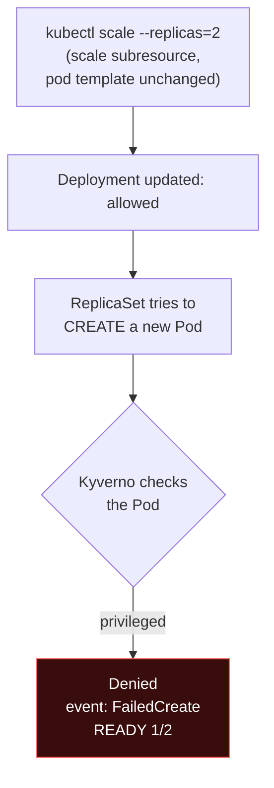

The scale request only changed the replica count, so it passed. But the **new Pod** is checked on CREATE and denied. In real life this shows up as "my Deployment is stuck at 1/2 and nobody knows why" during an incident. Always look at **events** (Day 21) when READY does not match DESIRED.

### B5. Mutate: add a default seccomp profile (and a real Kyverno gotcha)

Requirement: every pod should use the container runtime's default seccomp profile (it blocks dozens of rarely needed, dangerous system calls), unless it already sets one. Rather than asking 40 teams to edit YAML, we **mutate** pods on the way in.

First attempt (`09a-kyv-mutate-autogen-bug.yaml`), no autogen settings:

```yaml
apiVersion: policies.kyverno.io/v1
kind: MutatingPolicy
metadata:
  name: default-seccomp-runtime
spec:
  matchConstraints:
    resourceRules:
    - apiGroups: ['']
      apiVersions: ['v1']
      operations: ['CREATE']
      resources: ['pods']
  matchConditions:
  - name: seccomp-not-already-set          # only mutate when nothing is set
    expression: >-
      !has(object.spec.securityContext) ||
      !has(object.spec.securityContext.seccompProfile)
  mutations:
  - patchType: ApplyConfiguration           # "merge this partial object in"
    applyConfiguration:
      expression: >
        Object{
          metadata: Object.metadata{
            labels: Object.metadata.labels{
              seccomp_defaulted: "true"
            }
          },
          spec: Object.spec{
            securityContext: Object.spec.securityContext{
              seccompProfile: Object.spec.securityContext.seccompProfile{
                type: "RuntimeDefault"
              }
            }
          }
        }
```

A bare pod is mutated correctly:

```bash
kubectl -n default run plain --image=busybox:1.37 -- sleep 3600
kubectl -n default get pod plain -o jsonpath='{.metadata.labels} {.spec.securityContext}'
# {"run":"plain","seccomp_defaulted":"true"} {"seccompProfile":{"type":"RuntimeDefault"}}
```

But creating a Deployment **fails**:

```bash
kubectl -n default create deploy fresh --image=busybox:1.37 -- sleep 3600
# error: failed to create deployment: admission webhook "mpol.validate.kyverno.svc-fail-finegrained-default-seccomp-runtime"
#   denied the request: Resource: default/fresh, Kind: Deployment, Errors: [Policy default-seccomp-runtime:
#   failed to evaluate policy: type mismatch: unexpected type name "Object.metadata", expected
#   "Object.spec.template.metadata", which matches field name path from root Object type]
```

What happened: for MutatingPolicy, Kyverno **autogen was on by default** and rewrote our Pod mutation for Deployments and ReplicaSets. It rewrote the field paths (`object.spec.template...`) but not the type name `Object.metadata` inside our expression, so the generated policy failed to evaluate, and because the webhook uses `Fail`, **every new Deployment in the cluster was rejected**. One innocent-looking mutation policy blocked all deployments.

The fix: turn autogen off for this policy, so Kyverno mutates the **Pods themselves** (which the ReplicaSet creates anyway):

```yaml
spec:
  autogen:
    podControllers:
      controllers: []       # mutate the Pods themselves, not the Deployment templates
```

```bash
kubectl apply -f 09-kyv-mutate-seccomp.yaml
kubectl -n default create deploy fresh --image=busybox:1.37 -- sleep 3600
# deployment.apps/fresh created
kubectl -n default get deploy fresh -o jsonpath='{.spec.template.spec.securityContext}'
# {}                                                      <- Deployment template unchanged
kubectl -n default get pod -l app=fresh -o jsonpath='{.items[0].metadata.labels} {.items[0].spec.securityContext}'
# {"app":"fresh",...,"seccomp_defaulted":"true"} {"seccompProfile":{"type":"RuntimeDefault"}}   <- Pod mutated

kubectl -n shop rollout restart deploy/catalog
kubectl -n shop get pod -l app=catalog -o jsonpath='{range .items[*]}{.metadata.name} {.spec.securityContext}{"\n"}{end}'
# catalog-df4bc4df5-zbv6g {"runAsNonRoot":true,"runAsUser":101,"seccompProfile":{"type":"RuntimeDefault"}}
```

> **Lessons from this real failure:** (1) Test every mutating policy against a Pod **and** a Deployment before rolling out. (2) A broken policy with `failurePolicy: Fail` is an outage. Roll out mutations in a staging cluster first. (3) Mutating Pods instead of templates means `kubectl get deploy -o yaml` no longer shows what actually runs; check the Pod when debugging.

### B6. Generate: every new namespace gets a default-deny NetworkPolicy

Day 20 taught "start with default deny". People forget. A GeneratingPolicy makes it automatic, and **keeps it there**.

Kyverno's background controller needs permission to manage NetworkPolicies. Kyverno uses RBAC **aggregation**: any ClusterRole with the right label is merged into its role.

`10-kyv-generate-netpol.yaml`:

```yaml
# 1) Let Kyverno's background controller manage NetworkPolicies
apiVersion: rbac.authorization.k8s.io/v1
kind: ClusterRole
metadata:
  name: kyverno:generate-networkpolicies
  labels:
    rbac.kyverno.io/aggregate-to-background-controller: "true"
rules:
- apiGroups: ["networking.k8s.io"]
  resources: ["networkpolicies"]
  verbs: ["get", "list", "watch", "create", "update", "patch", "delete"]
---
# 2) Every new namespace gets a default-deny NetworkPolicy (Day 20)
apiVersion: policies.kyverno.io/v1
kind: GeneratingPolicy
metadata:
  name: default-deny-for-new-namespaces
spec:
  evaluation:
    synchronize:
      enabled: true          # if someone deletes or edits it, Kyverno puts it back
  matchConstraints:
    resourceRules:
    - apiGroups: ['']
      apiVersions: ['v1']
      operations: ['CREATE']
      resources: ['namespaces']
  matchConditions:
  - name: skip-system-namespaces
    expression: "!object.metadata.name.startsWith('kube-')"
  variables:
  - name: nsName
    expression: object.metadata.name
  generate:
  - template:
      interpolate: cel
      value: |
        apiVersion: networking.k8s.io/v1
        kind: NetworkPolicy
        metadata:
          name: default-deny-all
          namespace: (( variables.nsName ))
        spec:
          podSelector: {}
          policyTypes:
          - Ingress
          - Egress
```

```bash
kubectl apply -f 10-kyv-generate-netpol.yaml

kubectl create namespace offers
kubectl get networkpolicy -n offers
# NAME               POD-SELECTOR   AGE
# default-deny-all   <none>         6s

kubectl get networkpolicy default-deny-all -n offers -o jsonpath='{.metadata.labels}'
# {"app.kubernetes.io/managed-by":"kyverno","generate.kyverno.io/policy-name":"default-deny-for-new-namespaces",
#  "generate.kyverno.io/trigger-kind":"Namespace","generate.kyverno.io/trigger-name":"offers",...}

# Someone "fixes" a connectivity problem by deleting it...
kubectl delete networkpolicy default-deny-all -n offers
kubectl get networkpolicy -n offers
# NAME               POD-SELECTOR   AGE
# default-deny-all   <none>         8s          <- Kyverno recreated it
```

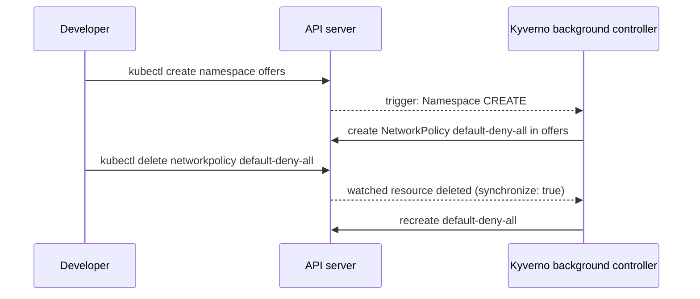

> **Remember from Day 20:** a NetworkPolicy is only enforced if the CNI supports it. Minikube's default bridge CNI does not enforce, so in this lab the policy exists but does not block traffic. On EKS with the VPC CNI network policy agent, Calico or Cilium, it does. Also plan an **allow** policy for DNS and for the namespace's real traffic; a default deny with nothing else breaks everything (Day 20, Part 7).

### B7. Guardrails for Day 23: enforce the Gateway API lessons

Day 23 ended with two rules to "enforce with a policy": never use `allowedRoutes.namespaces.from: All` on a shared Gateway, and always set `sectionName: https` on app routes. Here they are. (The lab installed the Gateway API v1.7.0 standard CRDs first: `kubectl apply --server-side -f https://github.com/kubernetes-sigs/gateway-api/releases/download/v1.7.0/standard-install.yaml`.)

`11-kyv-gateway-guardrails.yaml`:

```yaml
apiVersion: policies.kyverno.io/v1
kind: ValidatingPolicy
metadata:
  name: gateway-guardrails
spec:
  validationActions:
  - Deny
  matchConstraints:
    resourceRules:
    - apiGroups: ['gateway.networking.k8s.io']
      apiVersions: ['v1']
      operations: ['CREATE', 'UPDATE']
      resources: ['gateways', 'httproutes']
  validations:
  # Day 23, Common Mistake 6: no "from: All" on shared Gateways
  - expression: >-
      object.kind != 'Gateway' ||
      object.spec.listeners.all(l,
        l.?allowedRoutes.?namespaces.?from.orValue('Same') != 'All')
    message: "Gateway listeners must not use allowedRoutes.namespaces.from: All. Use Selector."
  # Day 23, Step 6 trap: app routes must pin to the https listener
  - expression: >-
      object.kind != 'HTTPRoute' ||
      object.metadata.namespace == 'infra' ||
      object.spec.parentRefs.all(p, p.?sectionName.orValue('') == 'https')
    message: "HTTPRoutes outside 'infra' must set parentRefs[].sectionName: https (see Day 23, Step 6)."
```

```bash
kubectl apply -f 12-bad-gateway-and-route.yaml
# Error from server: ... denied the request: Policy gateway-guardrails failed:
#   Gateway listeners must not use allowedRoutes.namespaces.from: All. Use Selector.
# Error from server: ... denied the request: Policy gateway-guardrails failed:
#   HTTPRoutes outside 'infra' must set parentRefs[].sectionName: https (see Day 23, Step 6).

# Same route with sectionName: https added
# httproute.gateway.networking.k8s.io/catalog created
```

This is the real value of policy as code: every lesson your team learns the hard way becomes a rule that stops the **next** person from repeating it.

---

## Part 7: Software Supply Chain Security

### What "supply chain" means

Your image is not just your code. It is your code, plus a **base image**, plus hundreds of **OS packages** and **libraries**, built by a **CI system** using **third-party actions and tools**, pushed to a **registry**. An attacker who compromises **any** of those gets into production without ever attacking your cluster directly.

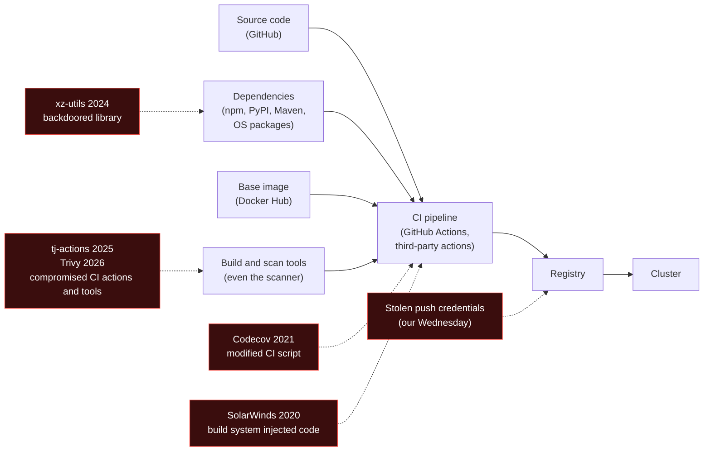

### Real attacks, and the defence each one teaches

| Year | Incident | What happened | Defence it teaches |
|---|---|---|---|
| 2020 | **SolarWinds (SUNBURST)** | Attackers compromised the build system of SolarWinds Orion and inserted a backdoor into official, signed updates. Around 18,000 customers installed them, including US government agencies. | Harden and isolate build systems; **provenance** (proof of how and where an artifact was built), not just a signature |
| 2021 | **Codecov** | Codecov's Bash Uploader script, which thousands of CI pipelines downloaded and ran, was modified to send the CI environment variables (secrets) to the attacker for about two months. | Never `curl \| bash` in CI without verifying a checksum or signature; keep secrets out of steps that do not need them |
| 2024 | **xz-utils backdoor (CVE-2024-3094)** | After years of building trust as a maintainer, an attacker shipped a backdoor in xz/liblzma 5.6.0 and 5.6.1 that targeted SSH on some Linux distributions. A Microsoft engineer, Andres Freund, noticed SSH logins were about half a second slower and found it before it reached most stable distributions. | Know what is inside your images (**SBOM**), so you can answer "are we affected?" in minutes |
| 2025 | **tj-actions/changed-files (CVE-2025-30066)** | Attackers moved the version tags of a popular GitHub Action (used by over 20,000 repositories) to a malicious commit that printed CI secrets into the workflow logs. | **Pin actions to a full commit SHA**, not a tag; tags can be moved |
| 2026 | **Trivy compromise (CVE-2026-33634)** | Using stolen credentials, attackers published a malicious Trivy v0.69.4 release and pointed `trivy-action` and `setup-trivy` tags at malicious commits on 19 March 2026. Even the security scanner can be the attack. | Pin by SHA or digest, verify signatures of the tools themselves, rotate CI secrets after any incident |

### The four supply chain controls

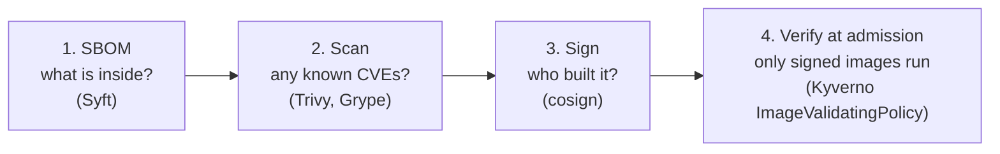

1. **SBOM (Software Bill of Materials).** A machine-readable list of every package in an image, in a standard format (**SPDX** or **CycloneDX**). When the next xz-style CVE is announced, you search your SBOMs instead of guessing.
2. **Vulnerability scanning.** Compare the packages against CVE databases. Fail the CI build on fixable CRITICAL issues.
3. **Signing.** CI signs the image after it passes the checks. The signature proves "this exact image was produced by our pipeline".
4. **Verification at admission.** The cluster refuses any image without a valid signature. This is the step that actually **stops** an attack; the first three only produce information.

### Tags vs digests

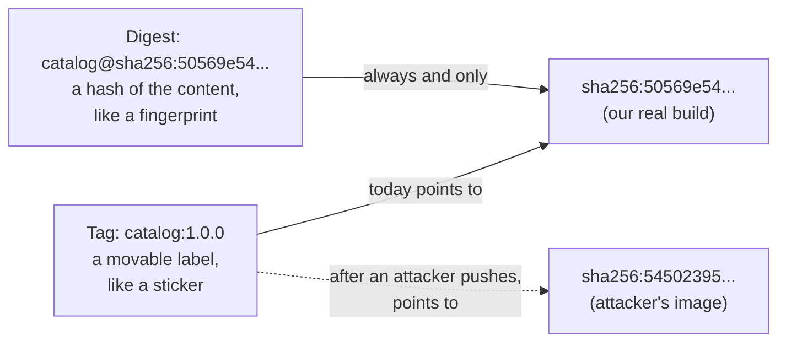

A tag is a pointer that anyone with push access can move. A **digest** is the SHA-256 hash of the image manifest: change one byte and the digest changes. Signatures are attached to the **digest**, which is why the tag-swap attack in the lab fails.

### Signing: key pair vs keyless

**Key pair signing** (used in our lab): you generate a private key, sign with it, and give the public key to the cluster. Simple, but you now have a long-lived secret to protect and rotate.

**Keyless signing** (the Sigstore way, recommended for CI): no long-lived key at all.

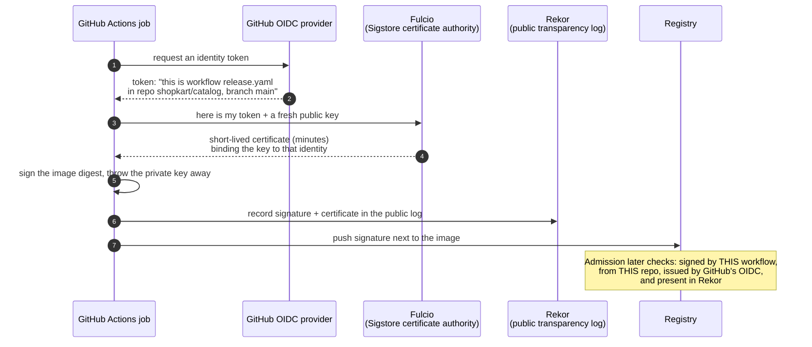

With keyless, the policy says **who** may sign ("the release workflow on the main branch of `github.com/shopkart/catalog`"), not "whoever holds this key file". There is no key to steal, and every signature is publicly logged, so a rogue signature is detectable.

> **SLSA** (Supply-chain Levels for Software Artifacts, pronounced "salsa") is the industry framework that grades how trustworthy your build process is, from basic provenance to hardened, isolated builders. If an interviewer asks how mature a company's supply chain is, SLSA levels are the vocabulary.

---

## Lab Part C: SBOM, Scan, Sign, Verify, and a Tag-Swap Attack

The tools run from their **official container images**, so you do not install anything.

### C1. SBOM with Syft

```bash
docker run --rm anchore/syft:v1.55.0 nginxinc/nginx-unprivileged:1.29-alpine -q
# NAME                       VERSION               TYPE
# alpine-baselayout          3.7.2-r0              apk
# alpine-baselayout-data     3.7.2-r0              apk
# alpine-keys                2.6-r0                apk
# alpine-release             3.23.4-r0             apk
# aom-libs                   3.13.1-r1             apk
# apk-tools                  3.0.6-r0              apk
# brotli-libs                1.2.0-r0              apk
# busybox                    1.37.0-r30            apk
# ...                        (71 packages in total)

# A standard CycloneDX SBOM file, the format you store next to every release
docker run --rm anchore/syft:v1.55.0 nginxinc/nginx-unprivileged:1.29-alpine -q -o cyclonedx-json > sbom.cdx.json
# format CycloneDX 1.7, 1308 components (packages plus the files they own)
```

**Real-time use:** a CVE is announced in curl. Instead of a war room, you search the SBOMs of every image you run:

```bash
docker run --rm anchore/syft:v1.55.0 nginxinc/nginx-unprivileged:1.29-alpine -q | grep -E "^(curl|libcurl|libcrypto3) "
# curl                       8.17.0-r1             apk
# libcrypto3                 3.5.6-r0              apk
# libcurl                    8.17.0-r1             apk
```

### C2. Vulnerability scanning with Trivy

```bash
# An old image: nginx 1.21 on Debian 11.3
docker run --rm -v trivy-cache:/root/.cache aquasec/trivy:0.76.1 image \
  --quiet --timeout 15m --severity HIGH,CRITICAL --ignore-unfixed --scanners vuln nginx:1.21
# Total: 164 (HIGH: 142, CRITICAL: 22)

# Its CRITICAL list includes, for example:
# curl  CVE-2023-38545  CRITICAL  fixed  7.74.0-1.3+deb11u1  ->  7.74.0-1.3+deb11u10
#       curl: heap based buffer overflow in the SOCKS5 proxy handshake

# The current image we actually deploy
docker run --rm -v trivy-cache:/root/.cache aquasec/trivy:0.76.1 image \
  --quiet --timeout 15m --severity HIGH,CRITICAL --ignore-unfixed --scanners vuln \
  nginxinc/nginx-unprivileged:1.29-alpine
# Total: 47 (HIGH: 46, CRITICAL: 1)
# Most findings: curl (11), libcurl (11), libexpat (7), libuuid (6), pcre2 (4), libcrypto3 (2)

# In CI you want a failing exit code, not a table
docker run --rm -v trivy-cache:/root/.cache aquasec/trivy:0.76.1 image \
  --quiet --severity HIGH,CRITICAL --scanners vuln --exit-code 1 nginx:1.21 ; echo "exit code = $?"
# exit code = 1
```

Two honest lessons from these real numbers:

- **Even a current, official image had 47 fixable HIGH/CRITICAL findings** on the day we scanned it, all in OS packages with fixes already published. Images go stale between releases. Rebuild regularly (weekly is common), and consider minimal bases (distroless, Chainguard/Wolfi, scratch) that ship fewer packages.
- **Use `--ignore-unfixed` for gates.** Failing a build on a CVE with no available fix just teaches people to disable the scanner. Gate on what you can fix; track the rest.
- (Our first Trivy run failed with `context deadline exceeded`: downloading the vulnerability database and unpacking the image took longer than the default 5-minute timeout. Hence `--timeout 15m`, and a `trivy-cache` volume so later runs reuse the database.)

### C3. A private registry inside the cluster

We need a registry the cluster can pull from and Kyverno can query. Minikube's container runtime already trusts plain-HTTP registries in the Service range `10.96.0.0/12`, so we give our registry a fixed ClusterIP there (`13-registry.yaml`):

```yaml
apiVersion: v1
kind: Service
metadata:
  name: registry
  namespace: registry
spec:
  clusterIP: 10.96.100.100      # fixed IP inside minikube's insecure-registry range
  selector: {app: registry}
  ports:
  - port: 5000
    targetPort: 5000
# (plus a Namespace and a Deployment running registry:2.8.3)
```

Build two images inside the Minikube node and push them: `1.0.0` (the real release, will be signed) and `1.0.1-hotfix` (someone's unreviewed hotfix, never signed).

```bash
# app/Dockerfile:
#   FROM nginxinc/nginx-unprivileged:1.29-alpine
#   COPY index.html /usr/share/nginx/html/index.html
minikube -p policy-lab image build -t 10.96.100.100:5000/shopkart/catalog:1.0.0 app/
minikube -p policy-lab image build -t 10.96.100.100:5000/shopkart/catalog:1.0.1-hotfix app/   # different index.html
minikube -p policy-lab ssh -- "docker push -q 10.96.100.100:5000/shopkart/catalog:1.0.0; \
  docker push -q 10.96.100.100:5000/shopkart/catalog:1.0.1-hotfix; \
  curl -s http://10.96.100.100:5000/v2/shopkart/catalog/tags/list"
# {"name":"shopkart/catalog","tags":["1.0.0","1.0.1-hotfix"]}
```

### C4. Sign with cosign (key pair)

We run cosign's official image inside the node (so it can reach the registry):

```bash
minikube -p policy-lab ssh
# --- inside the node ---
mkdir -p ~/keys && chmod 777 ~/keys
docker run --rm -e COSIGN_PASSWORD=lab-only-password -v ~/keys:/keys -w /keys \
  ghcr.io/sigstore/cosign/cosign:v3.1.4 generate-key-pair
# Private key written to cosign.key
# Public key written to cosign.pub

cat ~/keys/cosign.pub
# -----BEGIN PUBLIC KEY-----
# MFkwEwYHKoZIzj0CAQYIKoZIzj0DAQcDQgAE/8ERbt4XCgrloqnTvjDLX1suPUZ+
# l6S1fp5I0g4E2Pr2XfSrGZG1LXN2J0IaqV05weUkFf/vWusQ40UyEcDq2w==
# -----END PUBLIC KEY-----
```

(The `chmod` is needed because the cosign container runs as a non-root user, UID 65532, and could not write into a root-owned folder: our first attempt failed with `open cosign.key: permission denied`.)

Sign **by digest**, never by tag:

```bash
DIG=$(curl -sI -H "Accept: application/vnd.oci.image.manifest.v1+json" \
  -H "Accept: application/vnd.docker.distribution.manifest.v2+json" \
  http://10.96.100.100:5000/v2/shopkart/catalog/manifests/1.0.0 \
  | grep -i docker-content-digest | tr -d '\r' | cut -d' ' -f2)
echo $DIG
# sha256:50569e545ccda6414c70139432a1b5c91e2391ba21698432cedc6e3c0e02284e

docker run --rm --network host -e COSIGN_PASSWORD=lab-only-password -v ~/keys:/keys \
  ghcr.io/sigstore/cosign/cosign:v3.1.4 sign --key /keys/cosign.key \
  --allow-insecure-registry --use-signing-config=false --tlog-upload=false \
  --new-bundle-format=false --yes \
  10.96.100.100:5000/shopkart/catalog@$DIG
# Signing artifact...
# Pushing signature to: 10.96.100.100:5000/shopkart/catalog

curl -s http://10.96.100.100:5000/v2/shopkart/catalog/tags/list
# {"name":"shopkart/catalog","tags":["sha256-50569e545ccda6414c70139432a1b5c91e2391ba21698432cedc6e3c0e02284e.sig","1.0.0","1.0.1-hotfix"]}
```

The signature is stored **in the registry, next to the image**, under a tag named after the digest (`sha256-<digest>.sig`).

> **About those flags (cosign v3 changed defaults).** cosign v3 signs with the new **Sigstore bundle format** and uploads to the public **Rekor** transparency log by default, configured through a "signing config". Our lab is offline and private, so we turned the log upload off and used the classic signature format. cosign printed deprecation notices for `--tlog-upload` and `--new-bundle-format`, so expect these lab flags to change in future versions. In real CI use **keyless signing with the transparency log on** (Part 9). That is the default for a reason.

Verify from the command line:

```bash
C="docker run --rm --network host -v ~/keys:/keys ghcr.io/sigstore/cosign/cosign:v3.1.4"

$C verify --key /keys/cosign.pub --allow-insecure-registry --insecure-ignore-tlog=true \
  --new-bundle-format=false 10.96.100.100:5000/shopkart/catalog:1.0.0
# [{"critical":{"identity":{"docker-reference":"10.96.100.100:5000/shopkart/catalog"},
#   "image":{"docker-manifest-digest":"sha256:50569e545ccda6414c70139432a1b5c91e2391ba21698432cedc6e3c0e02284e"},
#   "type":"cosign container image signature"},"optional":null}]
# Verification for 10.96.100.100:5000/shopkart/catalog:1.0.0 --
# The following checks were performed on each of these signatures:
#   - The cosign claims were validated
#   - The signatures were verified against the specified public key

$C verify --key /keys/cosign.pub --allow-insecure-registry --insecure-ignore-tlog=true \
  --new-bundle-format=false 10.96.100.100:5000/shopkart/catalog:1.0.1-hotfix
# WARNING: Skipping tlog verification is an insecure practice that lacks transparency and auditability ...
# Error: no signatures found
```

### C5. Verify at admission with an ImageValidatingPolicy

Checking signatures by hand is useless if the cluster runs unsigned images anyway. `14-kyv-verify-images.yaml`:

```yaml
apiVersion: policies.kyverno.io/v1
kind: ImageValidatingPolicy
metadata:
  name: verify-shopkart-images
spec:
  webhookConfiguration:
    timeoutSeconds: 15                 # registry lookups take time
  evaluation:
    background:
      enabled: false
  validationActions: [Deny]
  matchConstraints:
    resourceRules:
    - apiGroups: ['']
      apiVersions: ['v1']
      operations: ['CREATE', 'UPDATE']
      resources: ['pods']
  matchImageReferences:
  - glob: '10.96.100.100:5000/shopkart/*'   # only our images; public images handled separately
  credentials:
    allowInsecureRegistry: true        # lab only: our registry speaks plain HTTP
  attestors:
  - name: cosign
    cosign:
      key:
        data: |
          -----BEGIN PUBLIC KEY-----
          MFkwEwYHKoZIzj0CAQYIKoZIzj0DAQcDQgAE/8ERbt4XCgrloqnTvjDLX1suPUZ+
          l6S1fp5I0g4E2Pr2XfSrGZG1LXN2J0IaqV05weUkFf/vWusQ40UyEcDq2w==
          -----END PUBLIC KEY-----
      ctlog:
        insecureIgnoreTlog: true       # lab only: we signed without a transparency log
  validations:
  - expression: >-
      images.containers.map(image, verifyImageSignatures(image, [attestors.cosign])).all(e, e > 0)
    message: "Image is not signed by the ShopKart release key."
```

```bash
kubectl apply -f 14-kyv-verify-images.yaml
kubectl get imagevalidatingpolicy
# NAME                     AGE   READY
# verify-shopkart-images   8s    true

# The signed release (pod-level securityContext keeps our B3 policy happy too)
kubectl -n shop run signed --image=10.96.100.100:5000/shopkart/catalog:1.0.0 \
  --overrides='{"spec":{"securityContext":{"runAsNonRoot":true,"runAsUser":101}}}'
# pod/signed created

# The unsigned hotfix
kubectl -n shop run hotfix --image=10.96.100.100:5000/shopkart/catalog:1.0.1-hotfix \
  --overrides='{"spec":{"securityContext":{"runAsNonRoot":true,"runAsUser":101}}}'
# Error from server: admission webhook "ivpol.validate.kyverno.svc-fail-finegrained-verify-shopkart-images"
#   denied the request: Policy verify-shopkart-images failed: Image is not signed by the ShopKart release key.

# Look at what actually got stored for the signed pod
kubectl -n shop get pod signed -o jsonpath='{.spec.containers[0].image}'
# 10.96.100.100:5000/shopkart/catalog:1.0.0@sha256:50569e545ccda6414c70139432a1b5c91e2391ba21698432cedc6e3c0e02284e
```

Look at that last line: Kyverno **rewrote the image to include the verified digest**. The pod is now pinned to exactly the bytes whose signature was checked, so even if the tag moves later, a restarted container pulls the same verified image.

> **A note from our first attempt:** the first version of this policy denied the signed image too. The reason was a shell mistake: on Windows Git Bash the command that pasted the public key into the YAML mangled the path, so the policy contained an error message instead of a key. When a signature policy denies everything, check that the key in the policy is actually the key you signed with.

### C6. The Wednesday attack: tag swap

The attacker has push access and overwrites `catalog:1.0.0` with their own image:

```bash
minikube -p policy-lab ssh -- 'docker tag 10.96.100.100:5000/shopkart/catalog:1.0.1-hotfix \
  10.96.100.100:5000/shopkart/catalog:1.0.0 && docker push -q 10.96.100.100:5000/shopkart/catalog:1.0.0'
# The tag 1.0.0 now resolves to a new digest:
# Docker-Content-Digest: sha256:545023953066549b26c97fe8919af2477e8ebd7bfcfc9b94e5cba8af1f66b220

kubectl -n shop run swapped --image=10.96.100.100:5000/shopkart/catalog:1.0.0 \
  --overrides='{"spec":{"securityContext":{"runAsNonRoot":true,"runAsUser":101}}}'
# Error from server: admission webhook "ivpol.validate.kyverno.svc-fail-finegrained-verify-shopkart-images"
#   denied the request: Policy verify-shopkart-images failed: Image is not signed by the ShopKart release key.

# The original release, by digest, still works
kubectl -n shop run pinned \
  --image=10.96.100.100:5000/shopkart/catalog@sha256:50569e545ccda6414c70139432a1b5c91e2391ba21698432cedc6e3c0e02284e \
  --overrides='{"spec":{"securityContext":{"runAsNonRoot":true,"runAsUser":101}}}'
# pod/pinned created
```

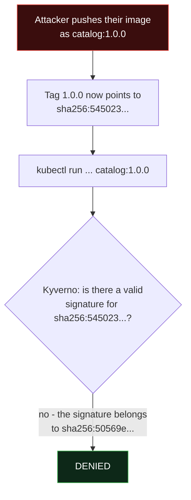

The attacker can move a tag, but they cannot produce a valid signature for their digest without the private key (or, with keyless signing, without being your CI workflow).

---

## Part 8: Runtime Security

### Why admission is not enough

Everything so far checks a workload **before** it runs. But:

- The image can contain an **unknown (zero-day) vulnerability**, like Log4Shell in December 2021, which was exploited in the wild before most scanners knew about it.
- A perfectly signed, perfectly configured app can be **exploited** through its own logic (an SQL injection, an unsafe file upload).
- **Stolen credentials** let someone `kubectl exec` into a pod legitimately.
- **Existing workloads** created before your policies (our legacy agent) are never re-checked at admission.

Runtime security watches what containers **do**.

### How it works: system calls and eBPF

Every meaningful thing a process does goes through the Linux kernel as a **system call**: `execve` (run a program), `openat` (open a file), `connect` (open a network connection). Containers share the host kernel, so a tool that watches system calls on the node sees every container on it.

**eBPF** lets small, verified programs run safely inside the kernel, attached to these events, without changing the kernel or loading risky kernel modules. Both Falco and Tetragon use it.

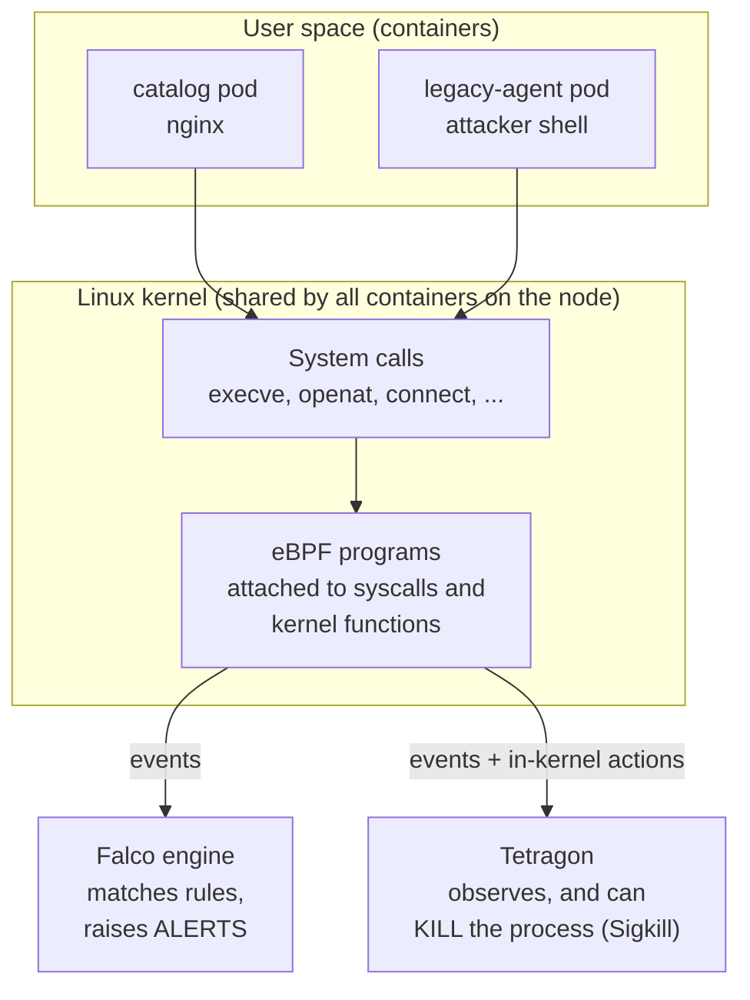

### Falco vs Tetragon

| | Falco | Tetragon |
|---|---|---|
| Project | CNCF graduated | Part of the Cilium project (CNCF) |
| Main job | **Detection**: rich rule library, alerts | **Observability and enforcement**: in-kernel filtering and actions |
| Rules | YAML rules with conditions on syscall fields, large default rule set (MITRE ATT&CK tagged) | TracingPolicy objects (kprobes, tracepoints) |
| Can stop an attack? | No (it alerts; you respond, or automate response) | **Yes**: `Sigkill` the process, or `Override` the syscall's return value where the kernel supports it |
| Alert routing | Falcosidekick to Slack, Teams, PagerDuty, SIEMs, webhooks and more | JSON events to logs, gRPC; usually shipped by your log pipeline |
| Typical use | "Tell me when something suspicious happens anywhere" | "This must never happen in this namespace, kill it in the kernel" |

Many companies run **both**: Falco for broad detection and alerting, Tetragon for a few hard rules where killing is safer than alerting.

### Anatomy of a Falco rule

```yaml
- rule: Read sensitive file untrusted            # name shown in alerts
  desc: ...                                      # why it exists
  condition: >                                   # filter on syscall fields
    open_read and sensitive_files and ...        # (macros expand to evt.type, fd.name, proc.name ...)
  output: >                                      # the alert text, with fields filled in
    Sensitive file opened for reading by non-trusted program | file=%fd.name ...
  priority: WARNING                              # EMERGENCY ... DEBUG
  tags: [maturity_stable, container, filesystem, mitre_credential_access, T1555]
```

Fields come from the event (`evt.type`), the process (`proc.cmdline`, `proc.name`), the file or socket (`fd.name`, `fd.sport`), the container (`container.image.repository`) and Kubernetes (`k8s.ns.name`, `k8s.pod.name`).

---

## Lab Part D: Catching (and Killing) the Friday Attacker

### D1. Install Falco with the modern eBPF driver

```bash
helm repo add falcosecurity https://falcosecurity.github.io/charts
helm repo update
helm install falco falcosecurity/falco --version 9.2.2 \
  -n falco --create-namespace \
  --set tty=true \
  --set driver.kind=modern_ebpf

kubectl -n falco logs ds/falco -c falco | head
# Falco version: 0.45.2 (x86_64)
# System info: Linux version 6.6.87.2-microsoft-standard-WSL2 ...
# Loading rules from:
#    /etc/falco/falco_rules.yaml | schema validation: ok
# Opening 'syscall' source with modern BPF probe.
```

The modern eBPF driver needs a kernel with BTF type information (generally 5.8 or newer). It worked here on Docker Desktop's WSL2 kernel 6.6, with no kernel module to build. The default rule set loaded 25 rules, including `Terminal shell in container`, `Read sensitive file untrusted`, `Drop and execute new binary in container`, `Search Private Keys or Passwords`, `Contact K8S API Server From Container` and `Detect release_agent File Container Escapes`.

### D2. Play the attacker

We use the old privileged `legacy-agent` pod, which policies cannot touch because it existed before them.

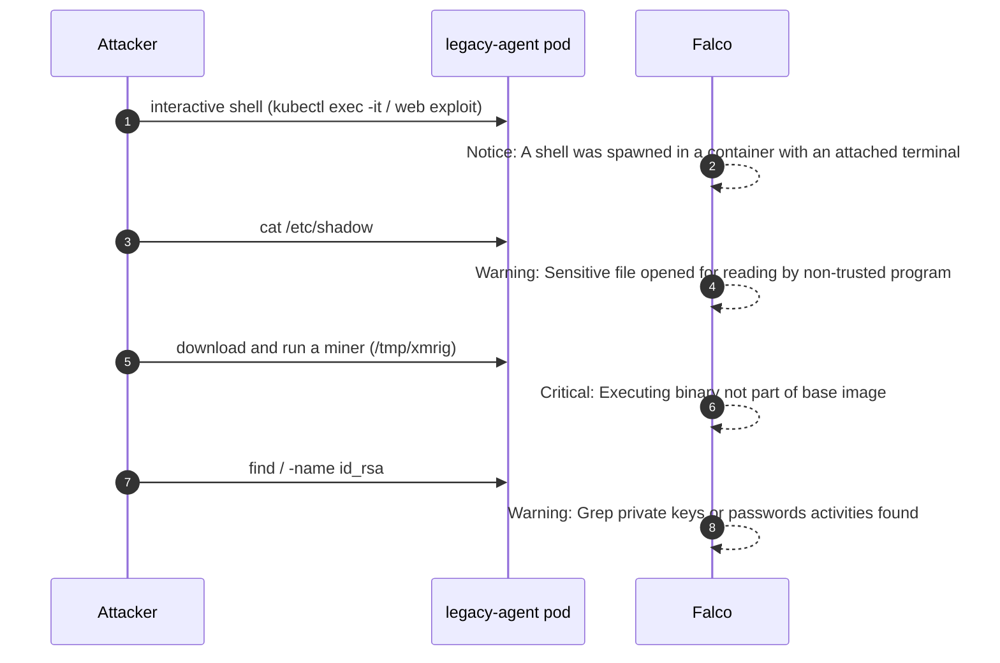

```bash
# 1) Interactive shell + read /etc/shadow (an interactive terminal is needed for the first rule;
#    'kubectl exec -it' from your own terminal does the same)
kubectl -n shop exec -it deploy/legacy-agent -- sh -c "id; cat /etc/shadow | head -2"
# uid=0(root) gid=0(root) groups=0(root),10(wheel)
# root:*:::::::
# daemon:*:::::::

# 2) The miner pattern: drop a new binary into the container and execute it
kubectl -n shop exec deploy/legacy-agent -- sh -c 'cp /bin/busybox /tmp/xmrig && chmod +x /tmp/xmrig && /tmp/xmrig echo pretending-to-mine'

# 3) Hunt for SSH keys
kubectl -n shop exec deploy/legacy-agent -- sh -c 'find / -name "id_rsa" 2>/dev/null | head -1'
```

Falco's alerts, exactly as logged (long lines shortened with `...`):

```
08:19:52.070637382: Notice A shell was spawned in a container with an attached terminal
  | evt_type=execve user=root user_uid=0 process=sh proc_exepath=/bin/sh
  command=sh -c id; cat /etc/shadow | head -2 terminal=34816 exe_flags=EXE_WRITABLE|EXE_LOWER_LAYER
  container_image_repository=busybox container_image_tag=1.37
  k8s_pod_name=legacy-agent-754b96c978-wgmlp k8s_ns_name=shop

08:19:52.547267971: Warning Sensitive file opened for reading by non-trusted program
  | file=/etc/shadow evt_type=openat user=root process=cat proc_exepath=/bin/cat parent=sh
  command=cat /etc/shadow ... k8s_pod_name=legacy-agent-754b96c978-wgmlp k8s_ns_name=shop

08:19:54.551873797: Critical Executing binary not part of base image
  | proc_exe=/tmp/xmrig ... process=xmrig proc_exepath=/tmp/xmrig
  command=xmrig echo pretending-to-mine exe_flags=EXE_WRITABLE|EXE_UPPER_LAYER
  container_image_repository=busybox ... k8s_ns_name=shop

08:19:55.139398572: Warning Grep private keys or passwords activities found
  | evt_type=execve user=root process=find command=find / -name id_rsa ... k8s_ns_name=shop
```

Notice `EXE_UPPER_LAYER` on the miner alert. A container image is built from read-only **lower** layers; anything written at runtime goes to the writable **upper** layer. A program that was **not in the image** but is being executed is a classic sign of an attacker dropping tools. This is why Falco marked it **Critical**.

> **Real-world note: noise.** In the same minute Falco also raised `Notice Redirect stdout/stdin to network connection` for a `healthcheck.sh` script in containers that were not even part of this cluster. On Docker Desktop all containers share one kernel, and Falco sees all of them. In production you will see the same thing with legitimate tools (backup agents, health checks, debugging sidecars). Every real Falco rollout includes a **tuning** phase: add exceptions for known-good behaviour, or nobody will read the alerts.

### D3. A custom rule: the crypto-miner pool connection

The default rules do not include a mining-pool rule, so ShopKart writes one. Mining software talks to pools using the **stratum** protocol, usually on a small set of well-known ports.

`16-falco-values.yaml` (Helm values for an upgrade):

```yaml
tty: true
driver:
  kind: modern_ebpf
falcosidekick:
  enabled: true
  config:
    webhook:
      address: http://alert-receiver.falco.svc.cluster.local/
      minimumpriority: warning
    # Real Slack would be:
    # slack:
    #   webhookurl: https://hooks.slack.com/services/XXX/YYY/ZZZ
    #   minimumpriority: warning
customRules:
  shopkart-rules.yaml: |-
    - list: miner_pool_ports
      items: [3333, 4444, 5555, 7777, 14444, 45700]

    - rule: Outbound Connection to Crypto Mining Pool Port
      desc: >
        A container opened a TCP connection to a port commonly used by
        cryptocurrency mining pools (stratum protocol).
      condition: >
        evt.type = connect
        and container.id != host
        and fd.l4proto = tcp
        and fd.sport in (miner_pool_ports)
      output: >
        Possible crypto-miner pool connection
        (command=%proc.cmdline connection=%fd.name pod=%k8s.pod.name
        ns=%k8s.ns.name image=%container.image.repository)
      priority: CRITICAL
      tags: [shopkart, container, network, mitre_impact, T1496]
```

**A real lesson from writing it:** our first version used `evt.type = connect and evt.dir = <` (the classic way to match the end of a system call). Falco 0.45 loaded it "with warnings":

```
LOAD_DEPRECATED_ITEM (Used deprecated item: field 'evt.dir'): due to the drop of enter events,
'evt.dir = <' always evaluates to true, and 'evt.dir = >' always evaluates to false.
The rule expression can be simplified by removing the condition on 'evt.dir'
```

Falco no longer captures syscall **enter** events, so many older rules found on the internet have conditions that are now meaningless. Always read Falco's startup log after adding rules.

The `alert-receiver` is a tiny HTTP echo server (`15-alert-receiver.yaml`, image `mendhak/http-https-echo:37`) that stands in for Slack or a SIEM and logs everything it receives.

```bash
kubectl apply -f 15-alert-receiver.yaml
helm upgrade falco falcosecurity/falco --version 9.2.2 -n falco -f 16-falco-values.yaml

kubectl -n falco logs ds/falco -c falco | grep shopkart
#    /etc/falco/rules.d/shopkart-rules.yaml | schema validation: ok
```

Create a fake "mining pool" (a pod listening on 3333 in `offers`) and connect to it from the compromised pod:

```bash
kubectl -n offers run fake-pool --image=busybox:1.37 -- sh -c 'nc -lk -p 3333 -e cat'
POOL=$(kubectl -n offers get pod fake-pool -o jsonpath='{.status.podIP}')     # 10.244.0.25

kubectl -n shop exec deploy/legacy-agent -- sh -c "echo '{\"method\":\"login\"}' | nc -w 2 $POOL 3333"
```

Falco's JSON alert (Falcosidekick turns on JSON output):

```json
{
  "priority": "Critical",
  "rule": "Outbound Connection to Crypto Mining Pool Port",
  "output": "08:22:22.870789056: Critical Possible crypto-miner pool connection (command=nc -w 2 10.244.0.25 3333 connection=10.244.0.10:42859->10.244.0.25:3333 pod=legacy-agent-754b96c978-wgmlp ns=shop image=busybox) ...",
  "output_fields": {
    "container.image.repository": "busybox",
    "container.image.tag": "1.37",
    "fd.name": "10.244.0.10:42859->10.244.0.25:3333",
    "k8s.ns.name": "shop",
    "k8s.pod.name": "legacy-agent-754b96c978-wgmlp",
    "proc.cmdline": "nc -w 2 10.244.0.25 3333"
  },
  "source": "syscall",
  "tags": ["T1496", "container", "mitre_impact", "network", "shopkart"],
  "time": "2026-10-31T08:22:22.870789056Z"
}
```

### D4. Alerts that reach people: Falcosidekick

An alert in a pod log at 3 AM helps nobody. **Falcosidekick** receives Falco's events and forwards them to dozens of outputs: Slack, Microsoft Teams, PagerDuty, Opsgenie, Elasticsearch, Loki, AWS Security Hub, Kafka, generic webhooks and more, with a minimum priority per output.

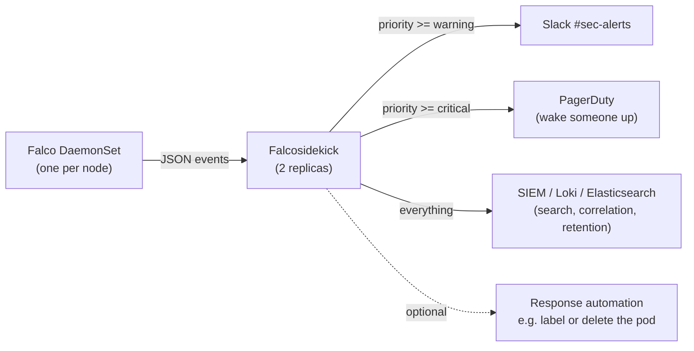

In our lab the webhook target received every alert:

```bash
kubectl -n falco logs deploy/falco-falcosidekick | tail -3
# [INFO]  : Falcosidekick version: 2.35.1
# [INFO]  : Enabled Outputs: [Webhook]
# [INFO]  : Webhook - POST OK (200)

kubectl -n falco logs deploy/alert-receiver | tail -3
# ...
#         "rule": "Read sensitive file untrusted",
# ::ffff:10.244.0.22 - - [31/Oct/2026:08:22:23 +0000] "POST / HTTP/1.1" 200 3898 "-" "Falcosidekick"
```

To send to Slack instead, set `falcosidekick.config.slack.webhookurl` (and keep the URL in a Secret, not in Git).

### D5. Tetragon: from "alert" to "stop it in the kernel"

Falco told us the attacker read `/etc/shadow`. For a few things you never want to allow at all, Tetragon can stop the action itself.

```bash
helm repo add cilium https://helm.cilium.io
helm install tetragon cilium/tetragon -n kube-system --version 1.8.0
```

`17-tetragon-block-shadow.yaml`, scoped to the `shop` namespace:

```yaml
apiVersion: cilium.io/v1alpha1
kind: TracingPolicyNamespaced
metadata:
  name: block-shadow-read
  namespace: shop
spec:
  kprobes:
  - call: "security_file_open"      # kernel function called on every file open
    syscall: false
    args:
    - index: 0
      type: "file"
    selectors:
    - matchArgs:
      - index: 0
        operator: "Equal"
        values:
        - "/etc/shadow"
      matchActions:
      - action: Sigkill               # kill the process before the read happens
```

```bash
kubectl apply -f 17-tetragon-block-shadow.yaml

# In 'shop' (policy applies)
kubectl -n shop exec deploy/legacy-agent -- sh -c 'cat /etc/shadow; echo "exit code: $?"'
# Killed
# exit code: 137                 <- 128 + 9 (SIGKILL); nothing was printed

# In 'offers' (namespaced policy does not apply)
kubectl -n offers exec fake-pool -- sh -c 'cat /etc/shadow | head -1; echo "exit code: $?"'
# root:*:::::::
# exit code: 0
```

Tetragon's event for the kill (from `tetra getevents -o json --event-types PROCESS_KPROBE`, trimmed):

```json
{
  "function_name": "security_file_open",
  "action": "KPROBE_ACTION_SIGKILL",
  "policy_name": "block-shadow-read",
  "args": [
    { "file_arg": { "path": "/etc/shadow", "permission": "-rw-------" } }
  ]
}
```

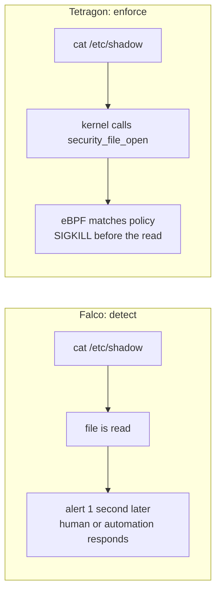

> **Be careful with enforcement.** A `Sigkill` policy that matches something your application legitimately does will crash production instantly. Run every Tetragon policy in observe mode first (no `matchActions`, just events), look at what it matches for a while, then add the kill. Scope it with namespaced policies and pod selectors.

### D6. Clean up

```bash
minikube delete -p policy-lab
```

---

## Part 9: Putting It Together, the ShopKart Pipeline

This is the target design that ties every layer together:

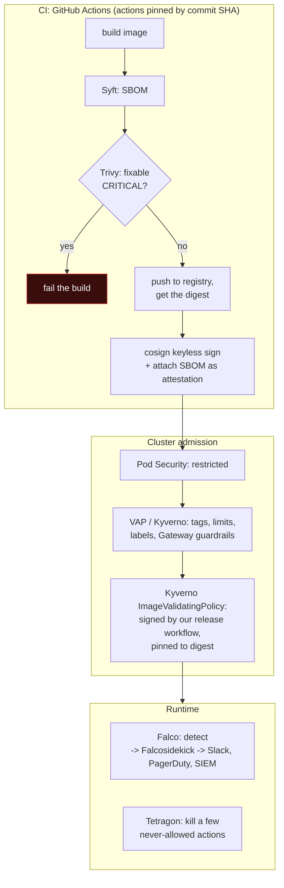

**Illustrative only (not run in this lab, because it needs a real GitHub repository and registry):** the signing steps of a release workflow with keyless cosign.

```yaml
# .github/workflows/release.yaml (excerpt)
permissions:
  contents: read
  id-token: write          # lets the job get a GitHub OIDC token for keyless signing
  packages: write
jobs:
  release:
    runs-on: ubuntu-latest
    steps:
    - uses: actions/checkout@<full-commit-sha>              # pin by SHA: tj-actions and trivy-action lessons
    - uses: sigstore/cosign-installer@<full-commit-sha>
    - name: Build and push
      id: push
      run: |
        docker build -t ghcr.io/shopkart/catalog:${GITHUB_SHA} .
        docker push ghcr.io/shopkart/catalog:${GITHUB_SHA}
        echo "digest=$(docker inspect --format='{{index .RepoDigests 0}}' ghcr.io/shopkart/catalog:${GITHUB_SHA} | cut -d@ -f2)" >> "$GITHUB_OUTPUT"
    - name: Sign (keyless, logged in Rekor)
      run: cosign sign --yes ghcr.io/shopkart/catalog@${{ steps.push.outputs.digest }}
```

The matching admission rule replaces the public key with a **keyless identity**: in the ImageValidatingPolicy `attestors`, use `cosign.keyless.identities` with `subject` set to the workflow (for example `https://github.com/shopkart/catalog/.github/workflows/release.yaml@refs/heads/main`) and `issuer: https://token.actions.githubusercontent.com`, and point `ctlog.url` at Rekor. Now only images signed **by that workflow on main** can run.

---

## Troubleshooting Guide

| Symptom | Likely cause | How to confirm | Fix |
|---|---|---|---|
| Every new Deployment rejected after adding a MutatingPolicy | Policy evaluation error + `failurePolicy: Fail` (our autogen type mismatch) | The error says `failed to evaluate policy` | Fix the expression, or set `autogen.podControllers.controllers: []`; test in staging |
| Deployment accepted but stuck at `1/2`, no new pods | Pod-level policy denies the Pod CREATE | `kubectl get events --field-selector reason=FailedCreate` | Fix the pod template, or enable autogen so the Deployment is rejected up front |
| Native VAP does nothing | Binding missing, or `matchResources` does not match the namespace | `kubectl get validatingadmissionpolicybinding`; check namespace labels | Create or fix the binding |
| Policy blocks a bare Pod but not a CronJob | Native VAP only checks listed resources | Check `matchConstraints.resourceRules` | Add the resources, or use Kyverno autogen |
| `kubectl get policyreport` empty | Background scan not run yet, or policy has background disabled | Wait 30 to 60 seconds; check `evaluation.background` | Enable background evaluation for audit policies |
| GeneratingPolicy creates nothing | Kyverno background controller lacks RBAC for that kind | `kubectl logs -n kyverno deploy/kyverno-background-controller` | Add a ClusterRole with label `rbac.kyverno.io/aggregate-to-background-controller: "true"` |
| Signed image denied | Wrong public key in policy, or signed a different digest, or Kyverno cannot reach or authenticate to the registry | `cosign verify` from outside; Kyverno admission controller logs | Re-check the key; sign by digest; add registry credentials (secrets in the Kyverno namespace) |
| Signature check times out | Slow registry lookups | Webhook timeout errors | Raise `webhookConfiguration.timeoutSeconds` (max 30); place registry close to the cluster |
| `cosign generate-key-pair` permission denied in Docker | Container runs as UID 65532 | Error `open cosign.key: permission denied` | Make the mounted folder writable |
| Falco pod crash-loops on start | Kernel lacks BTF or is too old for modern eBPF | Falco logs at startup | Use a supported kernel, or the `kmod` / legacy `ebpf` driver |
| Falco rule "loaded with warnings" | Deprecated fields (`evt.dir`) | Falco startup log | Remove the deprecated condition |
| Too many Falco alerts | Untuned rules, other workloads on the same kernel | Group alerts by rule and process | Add exceptions or override macros for known-good behaviour |
| Tetragon kills a legitimate process | Over-broad selector | `tetra getevents` | Observe first; narrow with namespaces, pod selectors, `matchBinaries` |

---

## Common Mistakes

1. **Thinking RBAC is enough.** RBAC decides **who** can create a pod; it says nothing about **what** the pod is allowed to be.
2. **Going straight to Deny.** Always start in Audit (or Warn), read the reports, fix or exempt, then enforce.
3. **Forgetting existing resources.** Admission only checks creates and updates; use PolicyReports to find old violations.
4. **Writing policies only for Pods** (native VAP) and forgetting Deployments, CronJobs and Jobs, or the reverse.
5. **Testing a mutating policy only with a Pod.** Our real autogen failure blocked every Deployment.
6. **Signing by tag.** Always sign and deploy by **digest**.
7. **Keeping a long-lived signing key in a CI secret** when keyless signing is available.
8. **Pinning GitHub Actions to tags** like `@v4`. Tags can be moved (tj-actions 2025, Trivy 2026). Pin to a full commit SHA.
9. **Failing builds on unfixable CVEs.** Teams will disable the scanner. Gate on fixable ones.
10. **Deploying Falco without routing or tuning alerts.** Alerts in a pod log are invisible; untuned alerts are ignored.
11. **Enforcing with Tetragon before observing.** A wrong kill policy is a self-inflicted outage.
12. **Running a policy engine with `failurePolicy: Fail` and one replica.** If it dies, nothing can be deployed, including its own replacement.

---

## Interview Questions (with answers)

**Q1. How would you secure workloads in a Kubernetes cluster, end to end?**
By layer along the lifecycle. Build: SBOM, vulnerability scanning, signing in CI with actions pinned by SHA. Registry: restricted push access, immutable tags if supported. Admission: Pod Security Admission at `restricted`, policy as code (VAP or Kyverno) for organisation rules, and signature verification so only signed images run. Runtime: Falco for detection with alerts routed to on-call, Tetragon for a few enforced rules. Around all of this: RBAC, NetworkPolicy default deny, mTLS between services, and secrets management.

**Q2. Pod Security Admission vs Kyverno: why both?**
PSA is built in, fast and covers the standard baseline and restricted rules, but they are fixed. Kyverno adds custom rules (tags, registries, labels, limits, Gateway fields), mutation, generation, image verification and reports on existing resources. Keep PSA as a safety net and use Kyverno for your own rules.

**Q3. When would you choose native ValidatingAdmissionPolicy over Kyverno or Gatekeeper?**
For simple validation rules where you want nothing extra running: no webhook to keep available, no added latency, works on every cluster. Choose Kyverno when you need mutation, generation, image verification or reports; choose Gatekeeper if the organisation already standardises on OPA and Rego.

**Q4. What is the difference between Audit and Enforce, and how do you roll out a new policy?**
Audit records violations (PolicyReports) without blocking; Enforce (Deny) rejects. Roll out in Audit, share the reports, fix or add exceptions, then switch to Deny, and keep background scans on to catch drift.

**Q5. Why deploy images by digest instead of tag?**
A tag is a movable pointer; anyone with push access can point it at different content. A digest is a hash of the content and cannot change. Signatures are tied to digests. In our lab an attacker moved `catalog:1.0.0` to their image and Kyverno rejected it because the new digest had no valid signature.

**Q6. Explain keyless signing.**
The CI job gets an OIDC token from its platform (for example GitHub), exchanges it with Sigstore's Fulcio for a short-lived certificate that binds a fresh key to the workflow identity, signs the image digest, records the signature in the Rekor transparency log and discards the key. Verifiers check the identity (repository, workflow, branch) and issuer instead of a long-lived public key.

**Q7. What is an SBOM and how does it help during an incident?**
A machine-readable inventory of every package in an image, in SPDX or CycloneDX format. When a CVE like the xz backdoor is announced, you search the SBOMs of all deployed images to know within minutes which ones are affected, instead of scanning everything again or guessing.

**Q8. Falco vs Tetragon?**
Both use eBPF to observe kernel events. Falco is a detection engine with a large rule library and rich alert routing through Falcosidekick. Tetragon focuses on observability and in-kernel enforcement: it can kill a process or override a syscall at the moment it happens. Common pattern: Falco for broad detection, Tetragon for a few must-never-happen rules.

**Q9. Give an example of a supply chain attack and what would have prevented it.**
In March 2025 the tags of the `tj-actions/changed-files` GitHub Action were moved to a malicious commit that dumped CI secrets into logs. Pinning actions to a full commit SHA would have prevented it; restricting which secrets each job can see would have limited the damage. The 2026 Trivy compromise teaches the same lesson for security tools themselves.

**Q10. A Deployment shows READY 1/2 after you scaled it. What do you check?**
Events for the ReplicaSet (`FailedCreate`). A common cause is an admission policy that denies the new Pod even though the scale request itself was allowed, as in our lab where Kyverno denied the privileged pod.

---

## Quick Self-Check

1. Which runs first in admission: mutating or validating? Why does it matter?
2. Name two rules Pod Security Admission cannot express.
3. What two objects make up a native ValidatingAdmissionPolicy setup, and what does each do?
4. What happens to a non-compliant pod that already exists when you switch a Kyverno policy to Deny?
5. What does Kyverno autogen do, and how did it cause an outage in our lab?
6. Why did the tag-swap attack fail?
7. What does `EXE_UPPER_LAYER` in a Falco alert tell you?
8. What is the exit code of a process killed by Tetragon's `Sigkill`, and why?
9. Which Kyverno policy type is deprecated in v1.19, and what replaces it?
10. Why should GitHub Actions be pinned to a commit SHA?

**Answers:** (1) Mutating first, so validating policies see the final object including any added fields. (2) Any two of: no `:latest` tags, allowed registries only, required labels or limits, signed images only, Gateway field rules. (3) The ValidatingAdmissionPolicy (the CEL rules) and the ValidatingAdmissionPolicyBinding (where they apply and the action: Deny, Warn or Audit). (4) Nothing; it keeps running. Admission only checks creates and updates. It appears in PolicyReports, and any update or new pod from it will be denied. (5) It rewrites a Pod policy into rules for Deployments, ReplicaSets, Jobs and so on. Our MutatingPolicy's rewritten expression had a type mismatch, so with `failurePolicy: Fail` every new Deployment was rejected. (6) The tag pointed to a new digest, and only the original digest had a valid signature. (7) The executed program was written at runtime to the container's writable layer, not shipped in the image: typical of dropped attacker tools. (8) 137, which is 128 + 9 (signal 9 is SIGKILL). (9) `ClusterPolicy` (`kyverno.io/v1`), replaced by ValidatingPolicy, MutatingPolicy, GeneratingPolicy, ImageValidatingPolicy and DeletingPolicy in `policies.kyverno.io/v1`. (10) Tags can be moved to malicious commits (tj-actions 2025, Trivy 2026); a commit SHA cannot.

---

## Summary

- **Defence in depth** across the container lifecycle: build (SBOM, scan, sign), registry, admission (policy and signature verification), runtime (detect and enforce).
- **Admission control**: mutating then validating; in-process CEL policies or webhooks; webhooks are powerful and therefore a target (IngressNightmare).
- **Pod Security Admission** gives a fixed baseline; **policy as code** adds your own rules. Native **ValidatingAdmissionPolicy** for simple validation, **Kyverno** for validate, mutate, generate, verify images and reports, **Gatekeeper** for Rego shops.
- Kyverno's new CEL policy types replace the deprecated ClusterPolicy. Roll out **Audit before Deny**, and test mutations against Deployments as well as Pods.
- **Supply chain** attacks (SolarWinds, Codecov, xz, tj-actions, Trivy) hit builds, dependencies and tools. Answer with SBOMs, scanning, **digest-pinned, signed images verified at admission**, and actions pinned by SHA.
- **Runtime security** with eBPF: **Falco** detects and routes alerts through Falcosidekick; **Tetragon** can kill a forbidden action inside the kernel. Tune first, enforce carefully.

## Key Takeaways

1. RBAC says who; policy says what; signatures say where from; runtime says what it is doing now.
2. Audit first, enforce second, and keep reading the reports.
3. Never trust a tag. Sign and deploy digests.
4. Every hard lesson (like Day 23's `sectionName` trap) should become a policy.
5. A detection nobody sees is not a detection. Route and tune your alerts.

---

## Practice / Homework

1. **Native policy:** write a ValidatingAdmissionPolicy that only allows images from `registry.shopkart.in/` and `docker.io/library/`. Bind it with Warn in `staging` and Deny in `production`, and show both behaviours.
2. **PolicyException:** the Falco DaemonSet is privileged by design. Create a Kyverno PolicyException (`policies.kyverno.io`) that exempts only the `falco` namespace's DaemonSet from `restrict-privileged-and-root`, then prove other privileged pods are still denied.
3. **DeletingPolicy:** write a DeletingPolicy that deletes Pods in `Failed` phase older than one day, running every night at 02:00.
4. **SBOM search:** generate CycloneDX SBOMs for three images you use, then write a one-line command that answers "which of these contain `openssl` or `libcrypto3`, and which version?"
5. **Keyless signing for real:** in a personal GitHub repository, build an image in GitHub Actions, push it to GHCR and sign it keyless (actions pinned by SHA). Then verify it with `cosign verify --certificate-identity ... --certificate-oidc-issuer https://token.actions.githubusercontent.com`.
6. **Falco tuning:** pick one noisy rule from your Falco logs and write an exception for the known-good process. Show the alert disappearing while the attack simulation from D2 still alerts.
7. **Tetragon observe mode:** remove `matchActions` from the D5 policy, watch the events for a few minutes in a namespace with a real app, and write down everything that opens `/etc/shadow` or `/etc/passwd`. Would a `Sigkill` have broken anything?

---

## References

- Kubernetes, Validating Admission Policy: https://kubernetes.io/docs/reference/access-authn-authz/validating-admission-policy/
- Kubernetes, Pod Security Admission: https://kubernetes.io/docs/concepts/security/pod-security-admission/
- Kyverno installation: https://kyverno.io/docs/installation/methods/
- Kyverno policy types overview: https://kyverno.io/docs/policy-types/overview/
- Kyverno migration to CEL policies: https://kyverno.io/docs/guides/migration-to-cel/
- Kyverno ImageValidatingPolicy: https://kyverno.io/docs/policy-types/image-validating-policy/
- Sigstore cosign: https://docs.sigstore.dev/cosign/signing/overview/
- Falco Kubernetes quickstart: https://falco.org/docs/getting-started/falco-kubernetes-quickstart/
- Falcosidekick: https://github.com/falcosecurity/falcosidekick
- Tetragon: https://tetragon.io/docs/
- Syft: https://github.com/anchore/syft
- Trivy: https://trivy.dev/
- SLSA framework: https://slsa.dev/
- CVE-2026-33634 (Trivy supply chain compromise): https://www.cve.org/CVERecord?id=CVE-2026-33634
- CVE-2025-30066 (tj-actions/changed-files): https://www.cve.org/CVERecord?id=CVE-2025-30066
- CVE-2024-3094 (xz-utils backdoor): https://www.cve.org/CVERecord?id=CVE-2024-3094

---

**Previous:** [Day 24 - Zero-Trust Networking and Service Mesh](../day24-zero-trust-service-mesh/notes.md) | **Next:** [Kubernetes Module README](../README.md)
